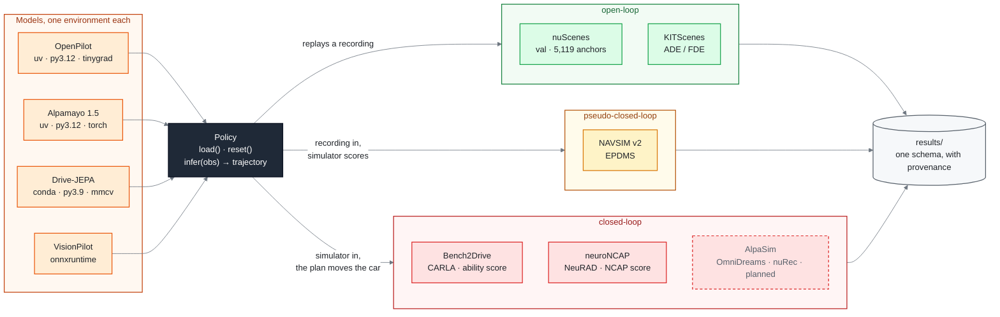

<h1 align="center">
   Paddock
</h1>

<p align="center"><strong>An evaluation framework for driving world models, spanning open-loop and closed-loop benchmarks.</strong></p>

<p align="center">
  <a href="https://github.com/FastCodeAI/Paddock/actions/workflows/check.yml"></a>
  <a href="LICENSE"></a>
  <a href="pyproject.toml"></a>
  <a href="docs/leaderboard.md"></a>
  <a href="docs/ROADMAP.md"></a>
</p>

Paddock runs several independent research codebases against the same
benchmarks, through one interface, and collects the results in one comparable
format.

Shared between **Fastcode** and **Renesas**. Everyone runs it on their own
machine, against whatever copy of the data they already have.

---

## What it does

Every model implements one `Policy` — `load()`, `reset()`, `infer(observation) -> trajectory` —
and runs as its own process behind a small HTTP node. Every benchmark drives
that same class: open-loop benchmarks replay a recording through it, and
closed-loop simulators move the car with what comes back. Scores land in one
schema with provenance, so an ADE and an NCAP score are statements about the
same model, run the same way.



Four models times five benchmarks, and nobody wrote twenty adapters. A fifth
model is one new directory under `adapters/models/`; a sixth benchmark is one
new directory under `adapters/benchmarks/`.

What crosses the wire between paddock, the model node and a simulator is
drawn step by step in [docs/architecture.md](docs/architecture.md#on-the-wire).

Paddock does **not** copy datasets and does **not** vendor model code. It points
existing clones at existing data using each repo's own configuration mechanism.

## Support matrix

Headline number per model and benchmark, as measured through paddock; the
per-metric tables follow. How each was produced is in `docs/benchmarks/`.

🟢 open-loop · 🟡 pseudo-closed-loop · 🔴 closed-loop · ↑ higher is better · ↓ lower is better

| | 🟢 nuScenes cumulative L2 avg ↓ (m) | 🟢 KITScenes ADE ↓ (m) | 🟡 NAVSIM v2 EPDMS ↑ (0–1) | 🔴 Bench2Drive driving score ↑ (0–100) | 🔴 neuroNCAP score ↑ (0–5) | 🔴 AlpaSim (OmniDreams) | 🔴 AlpaSim (nuRec) |
|---|---|---|---|---|---|---|---|
| OpenPilot | 2.477 △ | 1.599 | ✗ 2 Hz ‡ | 30.09 ≈ ◆ | superseded ‖ | planned | planned |
| Alpamayo 1.5 | 0.787 △ | 1.002 | 0.608 † | 44.58 ◆ | 2.46 | planned | planned |
| Drive-JEPA | 0.912 △ | 2.364 | 0.843 | 31.11 ◆ | 4.04 | planned | planned |
| VisionPilot | 1.441 △ | n/a ∗ | 0.431 | 49.85 ◆ | 1.67 | planned | planned |
| Baseline (Constant Velocity) | 0.641 △ | 1.381 | 0.239 | 47.94 ♣ | 0 § | — | — |

∗ VisionPilot has no native trajectory output. For nuScenes and NAVSIM, Paddock
constructs sampled XY points from its projected image-space path and speed
schedule. KITScenes has no scored trajectory for this adapter.

△ nuScenes uses 5,119 scoring anchors across 150 validation scenes. The headline
is the mean of cumulative L2 through 1, 2 and 3 seconds, not ADE at 3 seconds.
OpenPilot uses real approximately 12 Hz front-camera history; scoring stays at
2 Hz. See the nuScenes table below for point L2, cumulative L2 and ADE.

† All three NAVSIM figures are the full navtest split, 12,146 real recorded
scenarios, scored through paddock's proxy agent. This is NAVSIM v2's **stage
one** only: the leaderboard's stage two, the pseudo-simulation on synthetic
scenes (navhard / navsafe two-stage), is not run -- it needs the
`synthetic_scenes/` download and a second metric cache. Alpamayo's earlier
242-scenario estimate was 0.653; the full split says 0.608, which is why
subsets are stored `valid: false`. On the subset Drive-JEPA scored 0.880
through the proxy — the vendor's own agent scores 0.907 by reading the
scorer's simulator at inference time, which no other model can do, so the
proxy figure is the comparable one. `preflight` refuses a partial split unless told
otherwise, so a subset cannot be reported as full navtest by accident, and the
subset rows in `results/` are stored `valid: false` -- they appear under
"Excluded runs" and never average against a full-split row.

‡ OpenScene is a 2 Hz dataset and OpenPilot infers motion from frame-to-frame
change, so it plans a parked car — 0.30 m of travel in 4 s at 4.8 m/s. Its model
has no speed input at all (`{desire_pulse, traffic_convention, action_t}`), so
this is not fixable in the adapter. It declares `min_input_hz: 10.0` and the
harness refuses the pairing rather than recording the artefact. Alpamayo hit the
same dataset property in a milder form and was fixed in its adapter, worth
+0.207 EPDMS. See `docs/benchmarks/navsim.md`.

◆ Historical Bench2Drive mean driving score on 24 routes (04–06 Sep 2026),
one run per route; route 11715 was excluded after CARLA crashes. These are
driving scores, not per-ability scores. OpenPilot ≈ is the **unassisted
pre-resume estimate**, reconstructed from the assisted recordings: 16 routes
are censored before intervention and eight had no intervention. It is not a
separate unassisted sweep. The historical OpenPilot scores predate later
controller fixes. Drive-JEPA uses its released NAVSIM-v2 checkpoint zero-shot
in CARLA. See [Bench2Drive protocol](docs/benchmarks/bench2drive.md).

♣ The Bench2Drive baseline uses a **fixed 3 m/s target**, with straight ego-frame
waypoints and the shared controller; actual vehicle speed can differ. nuScenes
constant velocity instead extrapolates the recorded ego velocity. These are
different speed settings of the baseline, as detailed below.

§ Not run — zero by construction. Every neuroNCAP scenario is staged so that an
ego holding its current velocity collides at full speed. A run that avoids the
collision scores a flat **5**; a run that collides scores
`4 · max(0, 1 − v_impact / v_reference)`, which is 0 when the two speeds are
equal. The baseline therefore scores 0 in all three scenarios with a 100%
collision rate.

Note the discontinuity: **a single run scores either exactly 5, or at most 4** —
grazing an obstacle at walking pace scores 4, not 4.9. Anything between the two
is a mean over runs, which is what the model rows above are.

### nuScenes

Recorded validation results, 5,119 anchors across 150 scenes. Lower is better.
OpenPilot completed with zero failures using up to five seconds of real CAM_FRONT
history, CUDA inference, CPU camera warping and resume assistance disabled.

| Model | L2 at 1 s (m) | L2 at 2 s (m) | L2 at 3 s (m) | Point L2 avg (m) | Cumulative L2 avg (m) | ADE at 3 s (m) | Point collision avg (%) |
|---|---:|---:|---:|---:|---:|---:|---:|
| OpenPilot | 1.925 | 4.054 | 6.194 | 4.057 | 2.477 | 3.535 | 2.624 |
| Alpamayo 1.5 | 0.509 | 1.351 | 2.602 | 1.487 | 0.787 | 1.249 | 1.582 |
| Drive-JEPA | 0.540 | 1.587 | 3.519 | 1.882 | 0.912 | 1.536 | 1.459 |
| VisionPilot | 1.031 | 2.213 | 3.837 | 2.360 | 1.441 | 2.058 | 3.816 |
| Baseline (Constant Velocity) | 0.372 | 1.151 | 2.340 | 1.288 | 0.641 | 1.069 | 1.661 |

Point L2 averages errors at 1, 2 and 3 seconds. Cumulative L2 averages the three
prefix means; ADE at 3 seconds averages all six half-second errors. Collision
is predicted ego-footprint overlap with annotated boxes, not an observed crash.
Constant velocity has the lowest L2 on this recorded split.

[nuScenes implementation and result records (PR #14)](https://github.com/FastCodeAI/Paddock/pull/14)
· [OpenPilot full metrics](https://github.com/FastCodeAI/Paddock/blob/a75d30418248c33e5a9a76de837887cd1e19a1e8/results/nuscenes/openpilot/20260908T110028-b71f4f/metrics.json).
Older model results predate the geometry/navigation corrections noted in #14;
these tables report the saved runs, not new evaluations of the merged code.

### KITScenes

Open-loop displacement error in metres over the 3 s horizon, full 223-sample
split. Alpamayo 1.5 is its nav-conditioned single-draw run. VisionPilot has no
trajectory to score (see ∗).

| Model | ADE@3s ↓ (m) | FDE@3s ↓ (m) |
|---|---:|---:|
| OpenPilot | 1.599 | 2.894 |
| Alpamayo 1.5 | **1.002** | **2.158** |
| Drive-JEPA | 2.364 | 4.199 |
| VisionPilot | n/a ∗ | n/a ∗ |
| Baseline (Constant Velocity) | 1.381 | 3.091 |

### NAVSIM v2

Full navtest (stage one: real recorded scenes, no synthetic stage two), 12,146 scenarios, all sub-metrics 0–1. Every column except EPDMS
is the mean of a per-scenario pass/fail or ratio, and EPDMS is the weighted
product the scorer builds from them. Drive-JEPA is scored through paddock's
proxy agent (see †). Extended comfort is the mean over the scenarios where it
is defined, 10,040 of the 12,146 -- it compares consecutive frames' plans, so
it is absent for a log's first frame and for any scenario without a scorable
predecessor (`docs/results-schema.md`); every other column is over all 12,146.
The last column is the 242-scenario subset (2% of navtest) that every model
was first run on, for reference only.

| Model | EPDMS ↑ | No at-fault collisions ↑ | Drivable area ↑ | Driving direction ↑ | Traffic light ↑ | Ego progress ↑ | TTC within bound ↑ | Lane keeping ↑ | History comfort ↑ | Extended comfort ↑ | EPDMS on 242 subset |
|---|---:|---:|---:|---:|---:|---:|---:|---:|---:|---:|---:|
| OpenPilot | — ‡ | — | — | — | — | — | — | — | — | — | — |
| Alpamayo 1.5 | 0.608 | 0.941 | 0.788 | 0.890 | 0.998 | 0.596 | 0.939 | 0.931 | 0.938 | 0.490 | 0.653 |
| Drive-JEPA | **0.843** | 0.984 | 0.985 | 0.991 | 0.998 | 0.889 | 0.979 | 0.974 | 0.978 | 0.477 | 0.880 |
| VisionPilot | 0.431 | 0.727 | 0.819 | 0.926 | 0.975 | 0.404 | 0.700 | 0.899 | 0.968 | 0.518 | 0.447 |
| Baseline (Constant Velocity) | 0.239 | 0.681 | 0.578 | 0.805 | 0.981 | 0.209 | 0.669 | 0.827 | 0.979 | 0.567 | 0.257 |

### Bench2Drive — historical 24-route results

Mean driving score and route completion from the 24-route cohort described in ◆.
The superseded 25-route, two-model ability table is replaced here with the
recorded driving metrics. Higher is better for both columns.

| Model | Driving score ↑ | Route completion ↑ (%) |
|---|---:|---:|
| VisionPilot | **49.85** | **75.5** |
| Alpamayo 1.5 | 44.58 | 73.4 |
| Drive-JEPA | 31.11 | 40.4 |
| OpenPilot (unassisted estimate ≈) | 30.09 | 30.8 |

OpenPilot's row is an approximate reconstruction, as explained in ◆; it does
not establish the performance of the corrected controller.
[Detailed metrics](docs/benchmarks/bench2drive.md).

#### Constant velocity — fixed-speed baseline

The separate **3 m/s** experiment completed all **24 / 24** routes on the same
route set, with zero infrastructure failures. Higher is better for these metrics.

| Target speed (m/s) | Routes scored | Driving score ↑ | Route completion ↑ (%) | Infraction penalty factor ↑ |
|---:|---:|---:|---:|---:|
| 3 | 24 / 24 | 47.94 | 74.68 | 0.635 |

[Run configuration](results/bench2drive/constant_velocity/20260908T084921-804913/run.json)
· [Full metrics](results/bench2drive/constant_velocity/20260908T084921-804913/metrics.json).
This fixes the target speed rather than holding the zero speed at route start;
the path is straight in the ego frame, not a route-following reference. Targets
of 6, 9, 12 and 15 m/s are separate experiments; no complete aggregate is
published for them here. The saved run reused four completed route checkpoints.

### neuroNCAP

Scene 0103, 5 runs per scenario, mean ± std of the NCAP score (0 = full-speed
collision, 5 = avoided). CR is the collision rate over all 15 runs.

**Preliminary — 1 of the 20 official scenario–scene pairs.** The official set is
10 stationary scenes, 5 frontal and 5 side; these numbers are one scene, so the
between-scene variance that dominates a category mean is entirely unmeasured. A
full-set sweep at 10 runs per pair will replace them. See
[docs/benchmarks/neuroncap.md](docs/benchmarks/neuroncap.md#the-evaluation-set-and-how-many-runs).

| Model | stationary ↑ (0–5) | frontal ↑ (0–5) | side ↑ (0–5) | mean ↑ (0–5) | CR ↓ (0–100%) |
|---|---:|---:|---:|---:|---:|
| OpenPilot ‖ | — | — | — | — | — |
| Alpamayo 1.5 | 4.08 ±1.84 | 2.10 ±1.63 | 1.20 ±0.36 | 2.46 | 67% |
| Drive-JEPA | 5.00 ±0.00 | 2.13 ±0.08 | 5.00 ±0.00 | **4.04** | 33% |
| VisionPilot | 2.79 ±0.56 | 1.68 ±0.10 | 0.54 ±0.64 | 1.67 | 100% |
| Baseline (Constant Velocity) | 0.00 | 0.00 | 0.00 | 0.00 § | 100% |

‖ **Superseded — OpenPilot has no closed-loop score on record.** Every stored
closed-loop run was produced before `12f3250` fixed the `traffic_convention`
one-hot, which had been telling supercombo it was a right-hand-drive car in
Boston. All five are now stored `valid: false` with that reason, so `paddock
report` excludes them and this row is empty because the record is empty, not
because a footnote says so. Its previous figures were 5.00 / 2.21 / 4.18,
mean 3.80, CR 47%; the size of the error is unknown until the re-run lands. The
open-loop KITScenes path always passed `[1, 0]`, so only closed-loop is affected.

---

## Quickstart

```bash
git clone <this repo> && cd paddock
make setup                                  # .venv + editable install
source .venv/bin/activate                   # puts `paddock` on PATH

cp paddock.toml.example paddock.toml
$EDITOR paddock.toml                        # point at YOUR repos, data and scratch space

paddock setup                               # clone/adopt vendor repos, apply patches
paddock doctor                              # what this machine can actually run
```

Without activating, the CLI is still there as `.venv/bin/paddock`, and
`make doctor` works from a cold shell.

`paddock doctor` is the entry point for everything that goes wrong. It reports
which repos resolved, which datasets are present and valid, which interpreters
exist, and how much GPU headroom there is — each failure naming the doc section
that fixes it.

Then:

```bash
paddock run --model openpilot --bench kitscenes --limit 5    # smoke test
paddock run --model all --bench neuroncap --runs 1 --scene 0103
paddock report                                               # leaderboard
```

---

## The one idea worth understanding

**Tracked files say what a thing is. `paddock.toml` says where it lives.**

| Tracked in git — identical at every site | Site-local, gitignored |
|---|---|
| `datasets.yaml` — a dataset's layout, splits, validation checks | `paddock.toml` — the path to it on this machine |
| `repos.yaml` — upstream URL, pinned commit, patches | which clones already exist here |
| `adapters/models/<name>/model.yaml` — interpreter kind, PYTHONPATH, VRAM, cameras | resolved interpreter and repo paths |

Tracked files name locations only through template variables — `{repos}`,
`{runs}`, `{weights}`, `{data.kitscenes}` — expanded at launch by
`paddock.config`. `tests/test_portability.py` fails the build if a tracked file
contains a real machine path, which is what keeps this true over time.

This is also the answer to "do I have to copy the data?" — no. Every model repo
already accepts external paths through an environment variable, a CLI flag, a
symlink, or (once) a source patch. Paddock computes the right one per repo.

---

## Layout

```
paddock.toml.example     copy to paddock.toml — the only file a new site edits
repos.yaml               vendor manifest: upstream URL + pinned sha + patches
datasets.yaml            what each dataset is (no paths)
patches/                 extracted edits to third-party source
results/                 TRACKED metrics + provenance (kilobytes)
external/                gitignored symlinks to this machine's vendor clones
src/paddock/
  config.py              paddock.toml + template expansion
  policy/                the Policy protocol and its HTTP server wrapper
  runtime/               per-model env construction, process supervision, GPU gating
  metrics/               trajectory (ADE/FDE), pose transforms
  adapters/models/       one directory per model  (_template to copy)
  adapters/benchmarks/   one directory per benchmark (_template to copy)
  results/               canonical store, ingest of legacy formats, reporting
docs/                    see below
```

Run artifacts — predictions, frames, videos — go to `roots.runs`, outside the
repo. Only the small `results/` metrics are tracked, so the leaderboard is
reviewable in a diff.

---

## Documentation

| Doc | Read it when |
|---|---|
| [docs/site-setup.md](docs/site-setup.md) | setting paddock up on a new machine |
| [docs/data-setup.md](docs/data-setup.md) | pointing paddock at datasets, or fetching ones you lack |
| [docs/adding-a-model.md](docs/adding-a-model.md) | **adding a model** — the full checklist |
| [docs/adding-a-benchmark.md](docs/adding-a-benchmark.md) | **adding a benchmark** — the full checklist |
| [docs/architecture.md](docs/architecture.md) | understanding open- vs closed-loop, the Policy protocol |
| [docs/benchmarks/](docs/benchmarks/) | how each benchmark is run and scored, and every recorded figure with its run id |
| [docs/leaderboard.md](docs/leaderboard.md) | the full per-run leaderboard, rendered by `paddock report` |
| [docs/results-schema.md](docs/results-schema.md) | reading or ingesting results |
| [docs/troubleshooting.md](docs/troubleshooting.md) | something fails in a way that makes no sense |
| [CONTRIBUTING.md](CONTRIBUTING.md) | before opening a PR |
| [docs/ROADMAP.md](docs/ROADMAP.md) | what is done, what is verified, and what is not |

Adding a model touches **one registry file and one new directory** — no changes
to `src/paddock/`. If you cannot add a model without editing the core, that is a
framework bug; please report it.

---

## License

Apache License 2.0. See [LICENSE](LICENSE). Copyright 2026 Renesas Electronics
Corporation.
