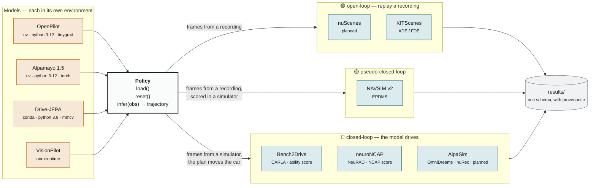

# Paddock

An evaluation framework for driving world models, spanning open-loop and
closed-loop benchmarks. Paddock runs several independent research codebases
against the same benchmarks, through one interface, and collects the results in
one comparable format.

Shared between **Fastcode** and **Renesas**. Everyone runs it on their own
machine, against whatever copy of the data they already have.

---

## What it does

Every model implements one `Policy` — `load()`, `reset()`, `infer(observation) -> trajectory` —
and runs as its own process behind a small HTTP node. Every benchmark drives
that same class: open-loop benchmarks replay a recording through it, and
closed-loop simulators move the car with what comes back. Scores land in one
schema with provenance, so an ADE and an NCAP score are statements about the
same model, run the same way.



Four models times five benchmarks, and nobody wrote twenty adapters. A fifth
model is one new directory under `adapters/models/`; a sixth benchmark is one
new directory under `adapters/benchmarks/`.

Paddock does **not** copy datasets and does **not** vendor model code. It points
existing clones at existing data using each repo's own configuration mechanism.

## Support matrix

Headline number per model and benchmark, as measured through paddock; the
per-metric tables follow. How each was produced is in `docs/benchmarks/`.

🟢 open-loop · 🟡 pseudo-closed-loop · 🔴 closed-loop · ↑ higher is better · ↓ lower is better

| | 🟢 nuScenes ADE ↓ (m) | 🟢 KITScenes ADE ↓ (m) | 🟡 NAVSIM v2 EPDMS ↑ (0–1) | 🔴 Bench2Drive ability ↑ (0–100) | 🔴 neuroNCAP score ↑ (0–5) | 🔴 AlpaSim (OmniDreams) | 🔴 AlpaSim (nuRec) |
|---|---|---|---|---|---|---|---|
| OpenPilot | planned | 1.599 | ✗ 2 Hz ‡ | 37.7 ¶ | 3.80 | planned | planned |
| Alpamayo 1.5 | planned | 1.002 | 0.653 † | adapter, unrun | 2.46 | planned | planned |
| Drive-JEPA | planned | 2.364 | 0.843 | adapter, unrun | 4.04 | planned | planned |
| VisionPilot | n/a ∗ | n/a ∗ | 0.431 | 61.6 ¶ | 1.67 | planned | planned |
| Baseline (Constant Velocity) | — | 1.381 | 0.239 | — | 0 § | — | — |

∗ VisionPilot does not predict a trajectory. It predicts lane curvature and the
closest in-path object, which are converted into instantaneous acceleration and
steering commands, so there is no plan to measure an ADE against. It can only
be scored where something drives on those commands.

† Alpamayo's NAVSIM figure is still the **242-scenario subset** (5 of 136
logs); its full-navtest run is in progress. Drive-JEPA's and VisionPilot's are
the full 12,146 scenarios. On the subset Drive-JEPA scored 0.880 through
paddock's proxy — the vendor's own agent scores 0.907 by reading the scorer's
simulator at inference time, which no other model can do, so the proxy figure
is the comparable one. `preflight` refuses a partial split unless told
otherwise, so a subset cannot be reported as full navtest by accident, and the
subset rows in `results/` are stored `valid: false` -- they appear under
"Excluded runs" and never average against a full-split row.

‡ OpenScene is a 2 Hz dataset and OpenPilot infers motion from frame-to-frame
change, so it plans a parked car — 0.30 m of travel in 4 s at 4.8 m/s. Its model
has no speed input at all (`{desire_pulse, traffic_convention, action_t}`), so
this is not fixable in the adapter. It declares `min_input_hz: 10.0` and the
harness refuses the pairing rather than recording the artefact. Alpamayo hit the
same dataset property in a milder form and was fixed in its adapter, worth
+0.207 EPDMS. See `docs/benchmarks/navsim.md`.

¶ Preliminary: the Bench2Drive multi-ability mean on **25 of the 220 routes**,
not a full sweep. The per-ability breakdown is in the Bench2Drive table below.
Alpamayo and Drive-JEPA have adapters but no run yet.

§ Not run — zero by construction. Every neuroNCAP scenario is staged so that an
ego holding its current velocity collides at full speed, and the score is
`5 · max(0, 1 − v_impact / v_reference)`, which is 0 when the two speeds are
equal. The baseline therefore scores 0 in all three scenarios with a 100%
collision rate.

### KITScenes

Open-loop displacement error in metres over the 3 s horizon, full 223-sample
split. Alpamayo 1.5 is its nav-conditioned single-draw run. VisionPilot has no
trajectory to score (see ∗).

| Model | ADE@3s ↓ (m) | FDE@3s ↓ (m) |
|---|---:|---:|
| OpenPilot | 1.599 | 2.894 |
| Alpamayo 1.5 | **1.002** | **2.158** |
| Drive-JEPA | 2.364 | 4.199 |
| VisionPilot | n/a ∗ | n/a ∗ |
| Baseline (Constant Velocity) | 1.381 | 3.091 |

### NAVSIM v2

Full navtest, 12,146 scenarios, all sub-metrics 0–1. Every column except EPDMS
is the mean of a per-scenario pass/fail or ratio, and EPDMS is the weighted
product the scorer builds from them. Drive-JEPA is scored through paddock's
proxy agent (see †). The last column is the 242-scenario subset (2% of
navtest) that every model was first run on, for reference only.

| Model | EPDMS ↑ | No at-fault collisions ↑ | Drivable area ↑ | Driving direction ↑ | Traffic light ↑ | Ego progress ↑ | TTC within bound ↑ | Lane keeping ↑ | History comfort ↑ | Extended comfort ↑ | EPDMS on 242 subset |
|---|---:|---:|---:|---:|---:|---:|---:|---:|---:|---:|---:|
| OpenPilot | — ‡ | — | — | — | — | — | — | — | — | — | — |
| Alpamayo 1.5 | running † | — | — | — | — | — | — | — | — | — | 0.653 |
| Drive-JEPA | **0.843** | 0.984 | 0.985 | 0.991 | 0.998 | 0.889 | 0.979 | 0.974 | 0.978 | 0.477 | 0.880 |
| VisionPilot | 0.431 | 0.727 | 0.819 | 0.926 | 0.975 | 0.404 | 0.700 | 0.899 | 0.968 | 0.518 | 0.447 |
| Baseline (Constant Velocity) | 0.239 | 0.681 | 0.578 | 0.805 | 0.981 | 0.209 | 0.669 | 0.827 | 0.979 | 0.567 | 0.257 |

### Bench2Drive (preliminary)

Multi-ability scores (0–100) from the upstream `ability_benchmark.py`, 25 of
220 routes, two models so far. Full-sweep numbers will replace these.

| Model | Overtaking ↑ | Merging ↑ | Emergency-Brake ↑ | Give-Way ↑ | Traffic-Signs ↑ | Overall ↑ |
|---|---:|---:|---:|---:|---:|---:|
| OpenPilot | 13.7 | 62.3 | 22.5 | 67.4 | 24.5 | 37.7 |
| VisionPilot | 22.4 | 85.5 | 96.0 | 86.0 | 22.9 | **61.6** |

### neuroNCAP

Scene 0103, 5 runs per scenario, mean ± std of the NCAP score (0 = full-speed
collision, 5 = avoided). CR is the collision rate over all 15 runs.

| Model | stationary ↑ (0–5) | frontal ↑ (0–5) | side ↑ (0–5) | mean ↑ (0–5) | CR ↓ (0–100%) |
|---|---:|---:|---:|---:|---:|
| OpenPilot | 5.00 ±0.00 | 2.21 ±0.27 | 4.18 ±1.00 | 3.80 | 47% |
| Alpamayo 1.5 | 4.08 ±1.84 | 2.10 ±1.63 | 1.20 ±0.36 | 2.46 | 67% |
| Drive-JEPA | 5.00 ±0.00 | 2.13 ±0.08 | 5.00 ±0.00 | **4.04** | 33% |
| VisionPilot | 2.79 ±0.56 | 1.68 ±0.10 | 0.54 ±0.64 | 1.67 | 100% |
| Baseline (Constant Velocity) | 0.00 | 0.00 | 0.00 | 0.00 § | 100% |

---

## Quickstart

```bash
git clone <this repo> && cd paddock
make setup                                  # .venv + editable install
source .venv/bin/activate                   # puts `paddock` on PATH

cp paddock.toml.example paddock.toml
$EDITOR paddock.toml                        # point at YOUR repos, data and scratch space

paddock setup                               # clone/adopt vendor repos, apply patches
paddock doctor                              # what this machine can actually run
```

Without activating, the CLI is still there as `.venv/bin/paddock`, and
`make doctor` works from a cold shell.

`paddock doctor` is the entry point for everything that goes wrong. It reports
which repos resolved, which datasets are present and valid, which interpreters
exist, and how much GPU headroom there is — each failure naming the doc section
that fixes it.

Then:

```bash
paddock run --model openpilot --bench kitscenes --limit 5    # smoke test
paddock run --model all --bench neuroncap --runs 1 --scene 0103
paddock report                                               # leaderboard
```

---

## The one idea worth understanding

**Tracked files say what a thing is. `paddock.toml` says where it lives.**

| Tracked in git — identical at every site | Site-local, gitignored |
|---|---|
| `datasets.yaml` — a dataset's layout, splits, validation checks | `paddock.toml` — the path to it on this machine |
| `repos.yaml` — upstream URL, pinned commit, patches | which clones already exist here |
| `adapters/models/<name>/model.yaml` — interpreter kind, PYTHONPATH, VRAM, cameras | resolved interpreter and repo paths |

Tracked files name locations only through template variables — `{repos}`,
`{runs}`, `{weights}`, `{data.kitscenes}` — expanded at launch by
`paddock.config`. `tests/test_portability.py` fails the build if a tracked file
contains a real machine path, which is what keeps this true over time.

This is also the answer to "do I have to copy the data?" — no. Every model repo
already accepts external paths through an environment variable, a CLI flag, a
symlink, or (once) a source patch. Paddock computes the right one per repo.

---

## Layout

```
paddock.toml.example     copy to paddock.toml — the only file a new site edits
repos.yaml               vendor manifest: upstream URL + pinned sha + patches
datasets.yaml            what each dataset is (no paths)
patches/                 extracted edits to third-party source
results/                 TRACKED metrics + provenance (kilobytes)
external/                gitignored symlinks to this machine's vendor clones
src/paddock/
  config.py              paddock.toml + template expansion
  policy/                the Policy protocol and its HTTP server wrapper
  runtime/               per-model env construction, process supervision, GPU gating
  metrics/               trajectory (ADE/FDE), pose transforms
  adapters/models/       one directory per model  (_template to copy)
  adapters/benchmarks/   one directory per benchmark (_template to copy)
  results/               canonical store, ingest of legacy formats, reporting
docs/                    see below
```

Run artifacts — predictions, frames, videos — go to `roots.runs`, outside the
repo. Only the small `results/` metrics are tracked, so the leaderboard is
reviewable in a diff.

---

## Documentation

| Doc | Read it when |
|---|---|
| [docs/site-setup.md](docs/site-setup.md) | setting paddock up on a new machine |
| [docs/data-setup.md](docs/data-setup.md) | pointing paddock at datasets, or fetching ones you lack |
| [docs/adding-a-model.md](docs/adding-a-model.md) | **adding a model** — the full checklist |
| [docs/adding-a-benchmark.md](docs/adding-a-benchmark.md) | **adding a benchmark** — the full checklist |
| [docs/architecture.md](docs/architecture.md) | understanding open- vs closed-loop, the Policy protocol |
| [docs/benchmarks/](docs/benchmarks/) | how each benchmark is run and scored, and every recorded figure with its run id |
| [docs/leaderboard.md](docs/leaderboard.md) | the full per-run leaderboard, rendered by `paddock report` |
| [docs/results-schema.md](docs/results-schema.md) | reading or ingesting results |
| [docs/troubleshooting.md](docs/troubleshooting.md) | something fails in a way that makes no sense |
| [CONTRIBUTING.md](CONTRIBUTING.md) | before opening a PR |
| [docs/ROADMAP.md](docs/ROADMAP.md) | what is done, what is verified, and what is not |

Adding a model touches **one registry file and one new directory** — no changes
to `src/paddock/`. If you cannot add a model without editing the core, that is a
framework bug; please report it.

---

## License

Apache License 2.0. See [LICENSE](LICENSE). Copyright 2026 Renesas Electronics
Corporation.
