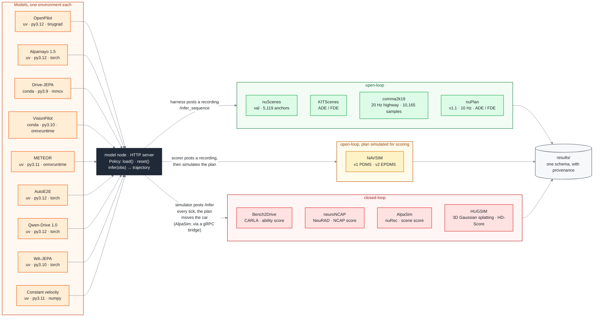
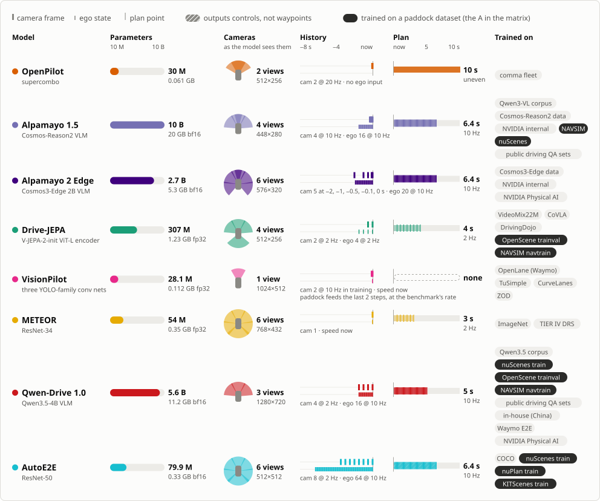

<h1 align="center">
   Paddock
</h1>

<p align="center"><strong>Put any end-to-end driving model through open-loop and closed-loop benchmarks, with one interface and one results format.</strong></p>

<p align="center">
  <a href="https://github.com/FastCodeAI/Paddock/actions/workflows/check.yml"></a>
  <a href="LICENSE"></a>
  <a href="pyproject.toml"></a>
</p>

A driving model usually comes with its own scripts for one benchmark, so scores from
different papers rarely describe the same test. Paddock gives each model one small
adapter. That adapter then runs on recorded data and inside closed-loop simulators,
and every score it produces traces back to a run you can inspect.

## Support matrix

<p align="center">
  
</p>

**A** adapted to the benchmark · **P** a pipeline around the model is graded ·
**S** stale.

Each number is read from the run [docs/support-matrix.toml](docs/support-matrix.toml)
names for it. The matrix holds released checkpoints only.
Per-benchmark tables and notes: [nuScenes](docs/benchmarks/nuscenes.md#support-matrix-results) ·
[KITScenes](docs/benchmarks/kitscenes.md#support-matrix-results) ·
[comma2k19](docs/benchmarks/comma2k19.md#support-matrix-results) ·
[NAVSIM v2](docs/benchmarks/navsim.md#support-matrix-results) ·
[NAVSIM v1](docs/benchmarks/navsim_v1.md#support-matrix-results) ·
[Bench2Drive](docs/benchmarks/bench2drive.md#support-matrix-results) ·
[neuroNCAP](docs/benchmarks/neuroncap.md#support-matrix-results) ·
[AlpaSim](docs/benchmarks/alpasim.md#support-matrix-results).
[HUGSIM](docs/benchmarks/hugsim.md) has no column yet: two of these models have driven it.
[nuPlan](docs/benchmarks/nuplan.md) has no column yet: its runs so far cover 25 of 351 anchors.

<details>
<summary>Why each cell is marked, and what to check before comparing</summary>

A mark on a model's name applies to every cell in its row. A cell without a mark
was measured the same way as the rest of its column, unless a note below says how
it differs.

- **A — adapted, not zero-shot.** The model was trained on data from this
  benchmark, or its settings were chosen on it. Drive-JEPA and Qwen-Drive on
  NAVSIM (both trained on `navtrain`), Qwen-Drive on nuScenes and neuroNCAP
  (its VLM trained on nuScenes train, and on driving-VQA sets whose training
  splits hold nuScenes val scenes), Alpamayo on NAVSIM, nuScenes and
  neuroNCAP (its model card lists two NAVSIM-built and five nuScenes-built public
  training sets), AutoE2E on nuScenes and neuroNCAP (its frozen camera encoder was
  trained on nuScenes train), on NAVSIM (trained on nuPlan's train logs, the
  source of NAVSIM's scenes) and on KITScenes (fine-tuned on its train split).
  OpenPilot's KITScenes cell is a configured run, and its
  configuration was chosen by inspecting one scene of the scored split; the stock
  run scores 1.599.
- **P — grades a pipeline built around the model.** VisionPilot has no
  trajectory output, so paddock builds one from its lane and speed outputs.
  METEOR plans 3 s and NAVSIM scores 4 s, so the last second is extrapolated.
  OpenPilot on Bench2Drive drives through openpilot's own longitudinal planner
  and its driver-resume nudge, which stands in for a driver pressing resume
  once the car has stood 3 s with no lead.
- **S — stale; a re-run will change it.** Every VisionPilot figure but
  comma2k19's predates the `CURV_SCALE` fix. Drive-JEPA's nuScenes cell is the camera-blind run from
  before the camera fix of 13 Oct 2026.
- **What never leaves a cell unranked.** How many cameras a model is given,
  whether it drives through paddock's bridge or its own simulator driver, and
  whether its Bench2Drive routes end early as failed drives are never reasons to
  leave a cell unranked.
- **Ranked, though some Bench2Drive routes end early.** AutoE2E's, METEOR's and
  OpenPilot's Bench2Drive runs end a route after 30 s without progress or at 4x
  the expert's time, and score it as it stood, as a failed drive; the rest of
  the column drove every route to Bench2Drive's own end. That can move a score
  either way: a car that would have crept on, or finished just after the cut,
  scores what it had, and one left to drive on could have collected more
  penalties ([Ending routes early](docs/benchmarks/bench2drive.md#ending-routes-early)).
- **Ranked, though fed what the model is built for.** Bench2Drive cells marked
  2 Hz, 5 Hz or 10 Hz are driven at the model's native inference rate, where the
  rest of the column runs at 20 Hz over the same 50 routes. Drive-JEPA, Alpamayo
  and Qwen-Drive score higher there than at 20 Hz; those gains are
  partly more exposure. Alpamayo's and Qwen-Drive's means are over 49 routes:
  route 3800 crashes CARLA at their rate. Qwen-Drive's 2 Hz is its camera rate
  only: it reads 16 ego positions 0.1 s apart, and at 2 Hz 12 of them are
  interpolated. NAVSIM cells marked 10 Hz
  get nuPlan's 10 Hz frames, where 2 Hz models such as Drive-JEPA get OpenScene's
  2 Hz. AutoE2E on KITScenes is given the scene's map and a route matched to the
  logged drive, upstream's validation protocol (without the route it scores
  0.837); on nuScenes it is fed the 6.5 s of past keyframes it declares, where the
  others get 2 s. Drive-JEPA on comma2k19 gets the one camera there is; its other
  three views are black, and the model reads only its front camera. METEOR there
  sees that one camera in two of its eight slots, the other six left black as its
  training drops a camera.

Before comparing numbers:

- **Three columns use part of a benchmark, so don't compare them with published
  scores.** Bench2Drive is 50 of its 220 routes, and those cover 14 of its 44
  scenario types. AlpaSim is 30 of the 913 scenes in `public_2601`. NAVSIM v2 is
  `navtest`, stage one only; its public leaderboard uses `navhard`, two stages.
- **Both NAVSIM columns are open loop.** The plan is simulated for 4 s to score it,
  but the model never sees what happened, so errors do not compound.
- **Open-loop L2 rewards a straight line.** On nuScenes, constant velocity
  (0.641) beats every learned model except Qwen-Drive, whose cell is adapted.
- **Close closed-loop scores are often ties.** On neuroNCAP (20 scenario pairs,
  10 runs each) the top three are statistically indistinguishable. On AlpaSim
  (30 scenes, one rollout each) a difference under about 0.16 is within two
  standard errors.
- **Constant velocity is a floor, defined per benchmark, and ranked like a model.**
  It extrapolates the recorded speed in open loop, holds a fixed 3 m/s target on
  Bench2Drive, and scores 0 on neuroNCAP by construction: every scenario is
  staged so that holding speed collides.
- **The AlpaSim rows come from AlpaSim's native drivers**, not paddock's bridge,
  and were imported into `results/`; Alpamayo's, AutoE2E's and Qwen-Drive's are the
  exceptions, run through paddock's bridge. The 30-scene rows are ranked together; models
  are given different numbers of cameras (OpenPilot, VisionPilot, Drive-JEPA
  and the floor 1, Qwen-Drive 3, Alpamayo 4, METEOR and AutoE2E 6).

</details>

## Why Paddock

- **One model, both kinds of test.** The same `Policy` object answers open-loop
  scoring and closed-loop simulation, so an ADE and a closed-loop score describe the
  same system, fed the same way.
- **Each model keeps its own environment.** Paddock never imports a model. It starts
  each one in its own interpreter and talks to it over localhost HTTP, so Python 3.9
  with mmcv and Python 3.12 with tinygrad run in the same sweep.
- **Your data stays where it is.** Tracked files say what a dataset is, and one
  gitignored file, `paddock.toml`, says where it lives on your machine. Nothing is
  copied or converted.
- **Every number can be checked.** Upstream repos are pinned to a commit, and each
  run records its settings next to its scores. A partial run or a changed setting is
  kept, but it is not ranked. The one exception is a setting a model lists as safe to
  rank, which keeps its rank and shows a note beside the score.

## How it works



Each model runs as an HTTP server behind one `Policy`: `load()`, `reset()`,
`infer(observation) -> trajectory`. Benchmarks are its clients. A new model or
benchmark is one new directory under `adapters/`. What crosses the wire:
[docs/architecture.md](docs/architecture.md#on-the-wire).

## Models and benchmarks

| Model | What it is | Code | Paper |
|---|---|---|---|
| [Alpamayo 1.5](docs/models/alpamayo15.md) | NVIDIA's 10B vision-language model with a diffusion trajectory decoder | [NVlabs/alpamayo1.5](https://github.com/NVlabs/alpamayo1.5) · Apache-2.0 | [Alpamayo-R1](https://arxiv.org/abs/2511.00088) |
| [AutoE2E](docs/models/autoe2e.md) | The Autoware Foundation's end-to-end model | [autowarefoundation/auto_e2e](https://github.com/autowarefoundation/auto_e2e) · Apache-2.0 | |
| [Drive-JEPA](docs/models/drivejepa.md) | Video JEPA encoder with a proposal-based planner | [linhanwang/Drive-JEPA](https://github.com/linhanwang/Drive-JEPA) · Apache-2.0 | [Drive-JEPA](https://arxiv.org/abs/2601.22032) |
| [METEOR](docs/models/meteor.md) | TIER IV's 8-camera multi-task network | [tier4/METEOR](https://github.com/tier4/METEOR) · Apache-2.0 | |
| [OpenPilot](docs/models/openpilot.md) | comma.ai's driving model, a single 30M-parameter network | [commaai/openpilot](https://github.com/commaai/openpilot) · MIT | [Learning to Drive from a World Model](https://arxiv.org/abs/2504.19077) |
| [Qwen-Drive 1.0](docs/models/qwendrive.md) | 4B vision-language model with a flow-matching planner | [QwenLM/Qwen-Drive-1.0](https://github.com/QwenLM/Qwen-Drive-1.0) · Apache-2.0 | [Qwen-Drive-1.0](https://arxiv.org/abs/2609.00111) |
| [VisionPilot](docs/models/visionpilot.md) | Autoware's lane and speed networks; Paddock builds the trajectory around them | [autowarefoundation/vision_pilot](https://github.com/autowarefoundation/vision_pilot) · Apache-2.0 | |
| [WA-JEPA](docs/models/wajepa.md) | AFARI Research's V-JEPA world-action model | [AFARI-Research/WA-JEPA](https://github.com/AFARI-Research/WA-JEPA) · Apache-2.0 | [WA-JEPA](https://arxiv.org/abs/2608.20974) |
| [Constant velocity](docs/models/constant_velocity.md) | A floor, not a model: it holds its speed in a straight line | in this repo | |

The licences above are for the code, as GitHub reports them. Model weights have their
own terms, and some are non-commercial: read
[Availability](docs/models/comparison.md#availability) before you build on one.
Paddock ships no weights and no datasets.

<p align="center">
  
</p>

| Benchmark | Test | Headline score | Upstream | Paper |
|---|---|---|---|---|
| [nuScenes](docs/benchmarks/nuscenes.md) | open loop | L2 error | [nuScenes](https://www.nuscenes.org/nuscenes) | [nuScenes](https://arxiv.org/abs/1903.11027) |
| [KITScenes](docs/benchmarks/kitscenes.md) | open loop | ADE | [KIT-MRT/kitscenes](https://github.com/KIT-MRT/kitscenes) | [KITScenes](https://arxiv.org/abs/2606.02956) |
| [comma2k19](docs/benchmarks/comma2k19.md) | open loop | ADE | [commaai/comma2k19](https://github.com/commaai/comma2k19) | [A Commute in Data](https://arxiv.org/abs/1812.05752) |
| [nuPlan](docs/benchmarks/nuplan.md) | open loop | ADE | [nuPlan](https://www.nuscenes.org/nuplan) | [nuPlan](https://arxiv.org/abs/2106.11810) |
| [NAVSIM v2](docs/benchmarks/navsim.md) | open loop, plan simulated for scoring; `navtest`, stage one | EPDMS | [autonomousvision/navsim](https://github.com/autonomousvision/navsim) | [Pseudo-Simulation](https://arxiv.org/abs/2506.04218) |
| [NAVSIM v1](docs/benchmarks/navsim_v1.md) | open loop, plan simulated for scoring | PDMS | [autonomousvision/navsim](https://github.com/autonomousvision/navsim) | [NAVSIM](https://arxiv.org/abs/2406.15349) |
| [Bench2Drive](docs/benchmarks/bench2drive.md) | closed loop, CARLA; 50 of 220 routes | driving score | [Thinklab-SJTU/Bench2Drive](https://github.com/Thinklab-SJTU/Bench2Drive) | [Bench2Drive](https://arxiv.org/abs/2406.03877) |
| [neuroNCAP](docs/benchmarks/neuroncap.md) | closed loop, NeuRAD | NCAP score | [atonderski/neuro-ncap](https://github.com/atonderski/neuro-ncap) | [NeuroNCAP](https://arxiv.org/abs/2404.07762) |
| [AlpaSim](docs/benchmarks/alpasim.md) | closed loop, NuRec; 30 of 913 scenes | scene score | [NVlabs/alpasim](https://github.com/NVlabs/alpasim) | |
| [HUGSIM](docs/benchmarks/hugsim.md) | closed loop, Gaussian splatting | HD-Score | [hyzhou404/HUGSIM](https://github.com/hyzhou404/HUGSIM) | [HUGSIM](https://arxiv.org/abs/2412.01718) |

## Quickstart

You need git, make, [uv](https://docs.astral.sh/uv/getting-started/installation/), curl
and unzip.

```bash
git clone <this repo> paddock && cd paddock
make setup && source .venv/bin/activate     # .venv + editable install
cp paddock.toml.example paddock.toml        # then set the three [roots] paths to folders on your machine
paddock doctor                              # what this machine can run, and how to fix the rest
```

Then get a first score, with no GPU and no model weights: the constant-velocity floor
on one 8.7 GB chunk of comma2k19.

```bash
mkdir -p ~/data/comma2k19
curl -L -o ~/data/Chunk_1.zip https://huggingface.co/datasets/commaai/comma2k19/resolve/main/raw_data/Chunk_1.zip
unzip -q ~/data/Chunk_1.zip -d ~/data/comma2k19
printf '\n[datasets.comma2k19]\npath = "%s"\n' ~/data/comma2k19 >> paddock.toml

paddock setup --repo comma2k19              # comma's toolkit, at its pinned commit
paddock setup --model constant_velocity     # this model's own environment
paddock run --model constant_velocity --bench comma2k19 --limit 5
paddock report
```

The run takes under a minute and ends with `n=5  ade mean=0.997717`. Five samples of one
chunk is a smoke test, so Paddock keeps the record but does not rank it:
`paddock report` lists it under "Excluded runs".

For a real model, `paddock setup --model <name>` builds its environment, and
[its page](docs/models/) says what else it needs.

## Add your model

```bash
paddock new model mymodel       # creates src/paddock/adapters/models/mymodel/ from the template
```

Then fill it in:

1. `repos.yaml`: add your upstream repo, pinned to a commit.
2. `model.yaml`: its interpreter, cameras, VRAM and benchmarks. `setup.sh`: how to build
   its environment.
3. `policy.py`: `load()`, `reset()` and `infer()`.
4. `docs/models/mymodel.md`: a page for it, and a row in the table above that links to it.

```bash
paddock setup --model mymodel                              # clones your repo, builds the environment
paddock verify --model mymodel                             # checks the adapter against the contract
paddock run --model mymodel --bench comma2k19 --limit 5
```

The template's policy already drives at constant velocity, so you can get the whole
pipeline working first and swap in your model after. Nothing in Paddock's core changes,
and `make check` tells you if the page or the row is missing. The full guide is
[docs/adding-a-model.md](docs/adding-a-model.md), and a benchmark works the same way:
[docs/adding-a-benchmark.md](docs/adding-a-benchmark.md).

<details>
<summary>Layout</summary>

```
paddock.toml.example     copy to paddock.toml — the only file you edit
repos.yaml               vendor manifest: upstream URL + pinned sha + patches
datasets.yaml            what each dataset is (no paths)
patches/                 extracted edits to third-party source
results/                 TRACKED metrics + provenance (kilobytes)
src/paddock/
  config.py              paddock.toml + template expansion
  policy/                the Policy protocol and its HTTP server wrapper
  runtime/               per-model env construction, process supervision, GPU gating
  metrics/               trajectory (ADE/FDE), pose transforms
  adapters/models/       one directory per model  (_template to copy)
  adapters/benchmarks/   one directory per benchmark (_template to copy)
  results/               canonical store, ingest of legacy formats, reporting
docs/                    see below
  docs/benchmarks/       how a benchmark is run and scored — paddock's protocol
  docs/datasets/         what the data is — true of the dataset on any machine
```

Predictions, frames and videos go to `roots.runs`, outside the repo; only the
kilobyte-sized `results/` metrics are tracked.

</details>

## Documentation

| Doc | Read it when |
|---|---|
| [docs/site-setup.md](docs/site-setup.md) | setting up a new machine |
| [docs/data-setup.md](docs/data-setup.md) | pointing Paddock at datasets, or fetching them |
| [docs/adding-a-model.md](docs/adding-a-model.md) | **adding a model** |
| [docs/adding-a-benchmark.md](docs/adding-a-benchmark.md) | **adding a benchmark** |
| [docs/models/](docs/models/) | one page per model |
| [docs/models/comparison.md](docs/models/comparison.md) | what each model is, and what it was trained on |
| [docs/benchmarks/](docs/benchmarks/) | how each benchmark is scored, every figure with its run id |
| [docs/datasets/](docs/datasets/) | what each dataset holds, and what it cannot answer |
| [docs/architecture.md](docs/architecture.md) | how open and closed loop work |
| [docs/leaderboard.md](docs/leaderboard.md) | every run, as `paddock report` prints it |
| [docs/results-schema.md](docs/results-schema.md) | reading or ingesting results |
| [docs/troubleshooting.md](docs/troubleshooting.md) | something fails in a way that makes no sense |
| [docs/ROADMAP.md](docs/ROADMAP.md) | what has been checked, and what is known to be wrong |
| [CONTRIBUTING.md](CONTRIBUTING.md) | before opening a PR |

## Citation

If you use Paddock in your work, please cite it. GitHub's "Cite this repository" button
reads [CITATION.cff](CITATION.cff), or use:

```bibtex
@software{paddock2026,
  title   = {Paddock: an evaluation framework for end-to-end driving models},
  author  = {{Renesas Electronics Corporation}},
  year    = {2026},
  version = {0.1.0}
}
```

Please also cite the models and benchmarks you run. Their papers are in the tables above.

## Acknowledgements

Paddock only works because other teams released their models, simulators and datasets.
Thanks to the authors of every project linked above. Their work keeps its own licence,
and being listed here does not mean they endorse Paddock.

## License

Apache License 2.0 ([LICENSE](LICENSE)). Copyright 2026 Renesas Electronics Corporation.
