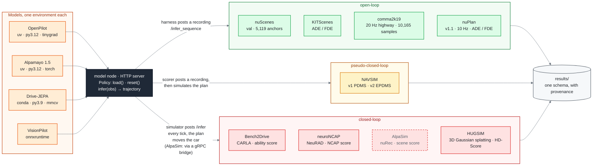
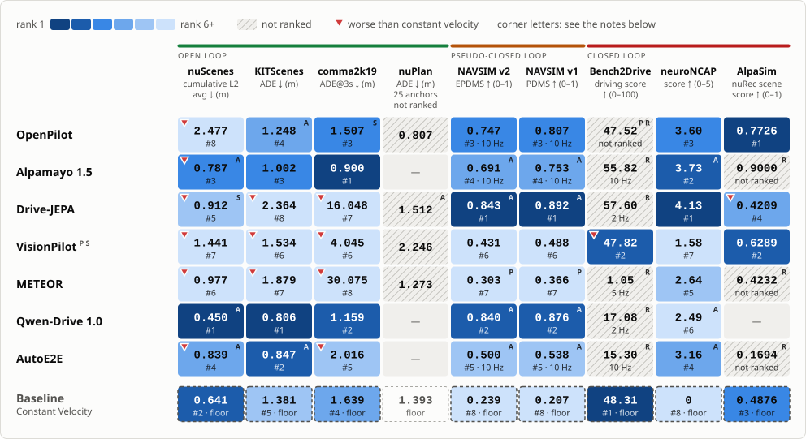

<h1 align="center">
   Paddock
</h1>

<p align="center"><strong>An evaluation framework for driving world models, spanning open-loop and closed-loop benchmarks.</strong></p>

<p align="center">
  <a href="https://github.com/FastCodeAI/Paddock/actions/workflows/check.yml"></a>
  <a href="LICENSE"></a>
  <a href="pyproject.toml"></a>
  <a href="docs/leaderboard.md"></a>
  <a href="docs/ROADMAP.md"></a>
</p>

Many driving models, the same benchmarks, one interface, one results format.
Shared between **Fastcode** and **Renesas**; each site runs it against the data it
already has.

## How it works



Each model runs in its own environment as an HTTP server behind one `Policy`:
`load()`, `reset()`, `infer(observation) -> trajectory`. Benchmarks are its clients.
A new model or benchmark is one new directory under `adapters/`. Paddock copies no
data and vendors no model code. What crosses the wire:
[docs/architecture.md](docs/architecture.md#on-the-wire).

## Support matrix

<p align="center">
  
</p>

**A** adapted to the benchmark · **P** a pipeline around the model is graded ·
**S** stale · **R** run differently, not ranked · **V** stored `valid: false`, not ranked.

Each number is read from the run [docs/support-matrix.toml](docs/support-matrix.toml)
names for it. The matrix holds released checkpoints only; checkpoints we trained
ourselves, such as Drive-JEPA's KITScenes re-ranker and its Physical AI AV retrain,
are in [Gallops' table of training runs](https://github.com/FastCodeAI/Gallops#training-so-far).
Per-benchmark tables and notes: [nuScenes](docs/benchmarks/nuscenes.md#support-matrix-results) ·
[KITScenes](docs/benchmarks/kitscenes.md#support-matrix-results) ·
[comma2k19](docs/benchmarks/comma2k19.md#support-matrix-results) ·
[nuPlan](docs/benchmarks/nuplan.md#support-matrix-results) ·
[NAVSIM v2](docs/benchmarks/navsim.md#support-matrix-results) ·
[NAVSIM v1](docs/benchmarks/navsim_v1.md#support-matrix-results) ·
[Bench2Drive](docs/benchmarks/bench2drive.md#support-matrix-results) ·
[neuroNCAP](docs/benchmarks/neuroncap.md#support-matrix-results) ·
[AlpaSim](docs/benchmarks/alpasim.md#support-matrix-results).
[HUGSIM](docs/benchmarks/hugsim.md) has no column yet: two of these models have driven it.

<details>
<summary>Why each cell is marked, and what to check before comparing</summary>

A mark on a model's name applies to every cell in its row. A cell without a mark
was measured the same way as the rest of its column.

- **A — adapted, not zero-shot.** The model was trained on data from this
  benchmark, or its settings were chosen on it. Drive-JEPA and Qwen-Drive on
  NAVSIM (both trained on `navtrain`), Drive-JEPA on nuPlan (52 of the 62
  nuPlan mini logs are `navtrain` logs), Qwen-Drive on nuScenes and neuroNCAP
  (its VLM trained on nuScenes train, and on driving-VQA sets whose training
  splits hold nuScenes val scenes), Alpamayo on NAVSIM, nuScenes and
  neuroNCAP (its model card lists two NAVSIM-built and five nuScenes-built public
  training sets), AutoE2E on nuScenes and neuroNCAP (its frozen camera encoder was
  trained on nuScenes train), on NAVSIM (trained on nuPlan's train logs, the
  source of NAVSIM's scenes) and on KITScenes (fine-tuned on its train split).
  OpenPilot's KITScenes cell is a configured run, and its
  configuration was chosen by inspecting one scene of the scored split; the stock
  run scores 1.599.
- **P — grades a pipeline built around the model.** VisionPilot has no
  trajectory output, so paddock builds one from its lane and speed outputs.
  METEOR plans 3 s and NAVSIM scores 4 s, so the last second is extrapolated.
- **S — stale; a re-run will change it.** Every VisionPilot figure predates the
  `CURV_SCALE` fix. Drive-JEPA's nuScenes cell is the camera-blind run from
  before #62. OpenPilot's comma2k19 row was not run at the pinned sha.
- **V — stored `valid: false`, not ranked.** AutoE2E's neuroNCAP run
  (`20261021T175940-844841`) carries a site-env override, `AUTOE2E_CHECKPOINT`
  (a site path, not a different checkpoint), which `#82`'s rule flags
  regardless of what the override actually changed. `paddock report` excludes
  it the same way it would any other `valid: false` run. Detail in
  [docs/benchmarks/neuroncap.md](docs/benchmarks/neuroncap.md#support-matrix-results).
- **R — run differently from the rest of its column, so not ranked against it.**
  Bench2Drive at the model's native inference rate over 50 routes, where
  the others run at 20 Hz over the historical 24; those gains are
  partly more exposure. OpenPilot's Bench2Drive cell is an unassisted estimate
  rebuilt from assisted recordings. Alpamayo on AlpaSim drove 4 cameras on 10 of the 30
  scenes, METEOR 6 cameras on all 30, and AutoE2E 6 pinhole cameras at its training field of view on all 30, through paddock's bridge.
- **Ranked, though fed what the model is built for.** NAVSIM cells marked 10 Hz
  get nuPlan's 10 Hz frames, where 2 Hz models such as Drive-JEPA get OpenScene's
  2 Hz. AutoE2E on KITScenes is given the scene's map and a route matched to the
  logged drive, upstream's validation protocol (without the route it scores
  0.837); on nuScenes it is fed the 6.5 s of past keyframes it declares, where the
  others get 2 s. Drive-JEPA on comma2k19 is its released front-camera version,
  `drivejepa_free`, because comma2k19 has one camera.

Before comparing numbers:

- **Open-loop L2 rewards a straight line.** On nuScenes, constant velocity
  (0.641) beats every learned model except Qwen-Drive, whose cell is adapted.
- **nuPlan is recorded, not ranked.** This site holds one of nuPlan's nine camera
  shards: 25 anchors, in 7 of 59 scenario types, six of them stop-sign or
  traffic-light decelerations. Every run is stored `valid: false`.
- **Close closed-loop scores are often ties.** On neuroNCAP (20 scenario pairs,
  10 runs each) the top three are statistically indistinguishable. On AlpaSim
  (30 scenes, one rollout each) a difference under about 0.16 is within two
  standard errors.
- **Constant velocity is a floor, defined per benchmark, and ranked like a model.**
  It extrapolates the recorded speed in open loop, holds a fixed 3 m/s target on
  Bench2Drive, and scores 0 on neuroNCAP by construction: every scenario is
  staged so that holding speed collides.
- **The AlpaSim rows come from AlpaSim's native drivers**, not paddock's bridge,
  and were imported into `results/`; AutoE2E's is the exception, run through
  paddock's bridge.

</details>

## What these models are

<p align="center">
  
</p>

Drawn from each `model.yaml` (`paddock list models`). Architecture, licences and
where each number comes from: [docs/models/comparison.md](docs/models/comparison.md).

## Quickstart

```bash
git clone <this repo> && cd paddock
make setup && source .venv/bin/activate     # .venv + editable install
cp paddock.toml.example paddock.toml        # then point it at YOUR repos, data and scratch space
paddock doctor                              # what this machine can run, and how to fix the rest
paddock run --model openpilot --bench kitscenes --limit 5    # smoke test
paddock report                                               # leaderboard
```

Clone the vendor repos by hand for now: `paddock setup` is not built yet.

## The one idea worth understanding

**Tracked files say what a thing is. `paddock.toml` says where it lives.**

| Tracked in git — identical at every site | Site-local, gitignored |
|---|---|
| `datasets.yaml` — a dataset's layout, splits, validation checks | `paddock.toml` — the path to it on this machine |
| `repos.yaml` — upstream URL, pinned commit, patches | which clones already exist here |
| `adapters/models/<name>/model.yaml` — interpreter kind, PYTHONPATH, VRAM, cameras | resolved interpreter and repo paths |

Tracked files name places only through template variables (`{repos}`,
`{data.kitscenes}`, …), and `tests/test_portability.py` fails the build on a real
machine path.

<details>
<summary>Layout</summary>

```
paddock.toml.example     copy to paddock.toml — the only file a new site edits
repos.yaml               vendor manifest: upstream URL + pinned sha + patches
datasets.yaml            what each dataset is (no paths)
patches/                 extracted edits to third-party source
results/                 TRACKED metrics + provenance (kilobytes)
external/                gitignored symlinks to this machine's vendor clones
src/paddock/
  config.py              paddock.toml + template expansion
  policy/                the Policy protocol and its HTTP server wrapper
  runtime/               per-model env construction, process supervision, GPU gating
  metrics/               trajectory (ADE/FDE), pose transforms
  adapters/models/       one directory per model  (_template to copy)
  adapters/benchmarks/   one directory per benchmark (_template to copy)
  results/               canonical store, ingest of legacy formats, reporting
docs/                    see below
  docs/benchmarks/       how a benchmark is run and scored — paddock's protocol
  docs/datasets/         what the data is — true of the dataset on any machine
```

Predictions, frames and videos go to `roots.runs`, outside the repo; only the
kilobyte-sized `results/` metrics are tracked.

</details>

## Documentation

| Doc | Read it when |
|---|---|
| [docs/site-setup.md](docs/site-setup.md) | setting up a new machine |
| [docs/data-setup.md](docs/data-setup.md) | pointing paddock at datasets, or fetching them |
| [docs/adding-a-model.md](docs/adding-a-model.md) | **adding a model** |
| [docs/adding-a-benchmark.md](docs/adding-a-benchmark.md) | **adding a benchmark** |
| [docs/models/comparison.md](docs/models/comparison.md) | what each model is, in full |
| [docs/models/](docs/models/) | one page per model |
| [SKILLS.md](SKILLS.md) | a model's own environment will not come up |
| [docs/architecture.md](docs/architecture.md) | how open and closed loop work |
| [docs/benchmarks/](docs/benchmarks/) | how each benchmark is scored, every figure with its run id |
| [docs/datasets/](docs/datasets/) | what each dataset holds, and what it cannot answer |
| [docs/leaderboard.md](docs/leaderboard.md) | every run, as `paddock report` prints it |
| [docs/results-schema.md](docs/results-schema.md) | reading or ingesting results |
| [docs/troubleshooting.md](docs/troubleshooting.md) | something fails in a way that makes no sense |
| [CONTRIBUTING.md](CONTRIBUTING.md) | before opening a PR |
| [docs/ROADMAP.md](docs/ROADMAP.md) | what is done and what is verified |

## License

Apache License 2.0 ([LICENSE](LICENSE)). Copyright 2026 Renesas Electronics Corporation.
