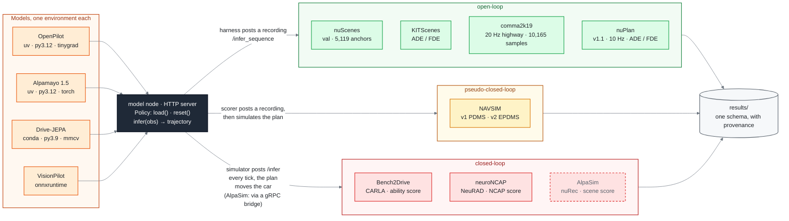

<h1 align="center">
   Paddock
</h1>

<p align="center"><strong>An evaluation framework for driving world models, spanning open-loop and closed-loop benchmarks.</strong></p>

<p align="center">
  <a href="https://github.com/FastCodeAI/Paddock/actions/workflows/check.yml"></a>
  <a href="LICENSE"></a>
  <a href="pyproject.toml"></a>
  <a href="docs/leaderboard.md"></a>
  <a href="docs/ROADMAP.md"></a>
</p>

Paddock runs several independent research codebases against the same
benchmarks, through one interface, and collects the results in one comparable
format.

Shared between **Fastcode** and **Renesas**. Everyone runs it on their own
machine, against whatever copy of the data they already have.

---

## What it does

Every model implements one `Policy` — `load()`, `reset()`, `infer(observation) -> trajectory` —
and runs as its own process behind a small HTTP node. **The model node is the
server; the benchmark side is the client.** Open-loop harnesses post a
recording's frames to it (`/infer_sequence`, image paths), and closed-loop
simulators post rendered frames every tick (`/infer`) and move the car with the
plan that comes back. AlpaSim's runtime calls its driver over gRPC instead, so a
bridge answers it as a gRPC server and calls the node over HTTP. Scores land in
one schema with provenance, so an ADE and an NCAP score are statements about the
same model, run the same way.



Four models times eight benchmarks in the sketch above, and nobody wrote
thirty-two adapters. The tree now holds eight models and nine benchmarks — the
diagram names the ones worth drawing, not all of them; `paddock list` is
authoritative. Another model is one new directory under `adapters/models/`,
another benchmark one new directory under `adapters/benchmarks/`.

What crosses the wire between paddock, the model node, a simulator and AlpaSim's
bridge is drawn step by step in [docs/architecture.md](docs/architecture.md#on-the-wire).

Paddock does **not** copy datasets and does **not** vendor model code. It points
existing clones at existing data using each repo's own configuration mechanism.

## Support matrix

The headline number for each model on each benchmark, measured through paddock.
Each column header links to that benchmark's page, which has the per-metric
tables and every note on these cells.

🟢 open loop · 🟡 pseudo-closed loop · 🔴 closed loop · ↑ higher is better · ↓ lower is better

| | [🟢 nuScenes](docs/benchmarks/nuscenes.md#support-matrix-results) cumulative L2 avg ↓ (m) | [🟢 KITScenes](docs/benchmarks/kitscenes.md#support-matrix-results) ADE ↓ (m) | [🟢 comma2k19](docs/benchmarks/comma2k19.md#support-matrix-results) ADE@3s ↓ (m) | [🟢 nuPlan](docs/benchmarks/nuplan.md#support-matrix-results) ADE ↓ (m), 25 anchors, not ranked | [🟡 NAVSIM v2](docs/benchmarks/navsim.md#support-matrix-results) EPDMS ↑ (0–1) | [🟡 NAVSIM v1](docs/benchmarks/navsim_v1.md#support-matrix-results) PDMS ↑ (0–1) | [🔴 Bench2Drive](docs/benchmarks/bench2drive.md#support-matrix-results) driving score ↑ (0–100) | [🔴 neuroNCAP](docs/benchmarks/neuroncap.md#support-matrix-results) score ↑ (0–5) | [🔴 AlpaSim](docs/benchmarks/alpasim.md#support-matrix-results) nuRec scene score ↑ (0–1) |
|---|---|---|---|---|---|---|---|---|---|
| OpenPilot | 2.477 | 1.248 <sup>A</sup> | 1.507 <sup>S</sup> | 0.807 | 0.747 (10 Hz) <sup>R</sup> | 0.807 (10 Hz) <sup>R</sup> | 30.09 <sup>R</sup> | 3.60 | 0.7726 |
| Alpamayo 1.5 | 0.787 | 1.002 | 0.900 | — | 0.691 (10 Hz) <sup>R</sup> | 0.753 (10 Hz) <sup>R</sup> | 55.82 (10 Hz) <sup>R</sup> | 3.73 | 0.9000 <sup>R</sup> |
| Drive-JEPA | 0.912 <sup>S</sup> | 2.364 | 16.048 <sup>R</sup> | 1.512 | 0.843 <sup>A</sup> | 0.892 <sup>A</sup> | 57.60 (2 Hz) <sup>R</sup> | 4.13 | 0.4209 |
| Drive-JEPA, KITScenes re-ranker | 0.587 | 0.973 <sup>A</sup> | not run | not run | not run | not run | — | not run | — |
| Drive-JEPA, retrained on Physical AI AV | not run | not run | not run | not run | not run | not run | not run | not run | 0.7697 <sup>A</sup> |
| VisionPilot <sup>P S</sup> | 1.441 | 1.534 | 4.045 | 2.246 | 0.431 | 0.488 | 49.85 | 1.58 | 0.6289 |
| METEOR | 0.977 | 1.879 | — | 1.273 | 0.303 <sup>P</sup> | 0.366 <sup>P</sup> | — | 2.64 | 0.4232 <sup>R</sup> |
| Qwen-Drive 1.0 | 0.450 | 0.806 | 1.159 | — | 0.840 <sup>A</sup> | 0.876 <sup>A</sup> | 17.08 (2 Hz) <sup>R</sup> | 2.49 | — |
| AutoE2E | — | — | — | — | 0.500 (10 Hz) <sup>A R</sup> | — | — | — | — |
| Baseline (Constant Velocity) | 0.641 | 1.381 | 1.639 | 1.393 | 0.239 | 0.207 | 47.94 | 0, by construction | 0.4876 |

A mark on a model's name applies to every cell in its row. A cell without a mark
was measured the same way as the rest of its column.

- **A — adapted, not zero-shot.** The model was trained on data from this
  benchmark, or its settings were chosen on it. Drive-JEPA and Qwen-Drive on
  NAVSIM (both trained on `navtrain`), AutoE2E on NAVSIM (pre-trained on nuPlan,
  the source of NAVSIM's scenes), the re-ranker on KITScenes, the retrained
  Drive-JEPA on AlpaSim. OpenPilot's KITScenes cell is a configured run, and its
  configuration was chosen by inspecting one scene of the scored split; the stock
  run scores 1.599.
- **P — grades a pipeline built around the model.** VisionPilot has no
  trajectory output, so paddock builds one from its lane and speed outputs.
  METEOR plans 3 s and NAVSIM scores 4 s, so the last second is extrapolated.
- **S — stale; a re-run will change it.** Every VisionPilot figure predates the
  `CURV_SCALE` fix. Drive-JEPA's nuScenes cell is the camera-blind run from
  before #62. OpenPilot's comma2k19 row was not run at the pinned sha.
- **R — run differently from the rest of its column, so not ranked against it.**
  NAVSIM with a 10 Hz history from nuPlan, where the others get OpenScene's
  2 Hz. Bench2Drive at the model's native inference rate over 50 routes, where
  the others run at 20 Hz over the historical 24; those gains are
  partly more exposure. OpenPilot's Bench2Drive cell is an unassisted estimate
  rebuilt from assisted recordings. Alpamayo on AlpaSim drove 4 cameras on 10 of the 30
  scenes, and METEOR 6 cameras on all 30. Drive-JEPA on comma2k19 is its perception-free variant,
  `drivejepa_free`.

Before comparing numbers:

- **Open-loop L2 rewards a straight line.** On nuScenes, constant velocity
  (0.641) beats every learned model except Qwen-Drive and the re-ranker.
- **nuPlan is recorded, not ranked.** This site holds one of nuPlan's nine camera
  shards: 25 anchors, in 7 of 59 scenario types, six of them stop-sign or
  traffic-light decelerations. Every run is stored `valid: false`.
- **Close closed-loop scores are often ties.** On neuroNCAP (20 scenario pairs,
  10 runs each) the top three are statistically indistinguishable. On AlpaSim
  (30 scenes, one rollout each) a difference under about 0.16 is within two
  standard errors.
- **Constant velocity is a floor, defined per benchmark.** It extrapolates the
  recorded speed in open loop, holds a fixed 3 m/s target on Bench2Drive, and
  scores 0 on neuroNCAP by construction: every scenario is staged so that
  holding speed collides.
- **The AlpaSim rows come from AlpaSim's native drivers**, not paddock's bridge,
  and were imported into `results/`.

### What these models are

The scores above say how well each model drives. This says what each one **is** —
because a four-order-of-magnitude spread in size sits behind a neuroNCAP column
whose top three are statistically indistinguishable. Full table, licences and
provenance in [docs/models/comparison.md](docs/models/comparison.md); the
machine-readable form is in each `model.yaml` and prints with
`paddock list models`.

| | Architecture | Params | Size (GB) | Input | Output | Trained on |
|---|---|---:|---:|---|---|---|
| OpenPilot | supercombo — one ONNX graph, via tinygrad | not published | 0.061 | 2 cam @20 Hz · 512×256 · 2 frames | 33 waypoints, 10 s | comma fleet, ≈6,670 h (not released) |
| Alpamayo 1.5 | Cosmos-Reason2 VLM + diffusion trajectory decoder | **10 B** | 20 | 4 cam @10 Hz · 448×280 | trajectory 6.4 s + reasoning trace | NVIDIA internal, 80,000 h |
| Drive-JEPA | V-JEPA-2 ViT-L encoder + proposal-centric planner | 307 M | 1.23 | 1 cam (the adapter declares 4) · 512×256 · 2 frames | trajectory 4 s, one of 32 candidates, chosen by its scorer | OpenScene, then **NAVSIM `navtrain`** |
| VisionPilot | three YOLO-family conv nets | **28.1 M** | 0.112 | 1 cam @10 Hz · 1024×512 | lane curvature + closest in-path object | OpenLane, TuSimple, CurveLanes |
| METEOR | ResNet-34 + FPN per camera, depth-gated IPM lift to one BEV grid, 12 task heads | 54 M | 0.35 | 8 cam · 768×432 · 1 frame (paddock fills 6) | 3 paths × 6 waypoints, 3 s, + steer / accel / brake and 11 perception heads | TIER IV Co-MLOps DRS, Japan + a US subset, 953 GB / 12,595 scenes @5 Hz, auto-labelled (hours not published) |
| Qwen-Drive 1.0 | Qwen3.5-4B VLM + 1 B flow-matching planning expert | ≈5 B | 11.2 | 3 cam · 4 frames 0.5 s apart · current ~720p, history ~320p | 50 poses (x, y, heading), 5 s @10 Hz | Qwen3.5's corpus + public driving sets, incl. **NAVSIM `navtrain`** |
| AutoE2E | ResNet-50 + BEVFormer V2 T8, deformable route/map fusion, GRU planner | 79.9 M | 0.33 | 6 cam · 512×512 (front also 1024) · 8 frames 0.5 s apart | 64 × (accel, curvature), 6.4 s @10 Hz | nuPlan, then a KITScenes fine-tune |

Two of these models were trained on NAVSIM's own `navtrain`, and AutoE2E on the
nuPlan logs NAVSIM's scenes come from, which is why their NAVSIM cells carry **A**. Why Drive-JEPA declares four cameras when its paper
reads one, and the rest of the model-specific notes, are in
[docs/models/comparison.md](docs/models/comparison.md#notes-moved-from-the-readme-support-matrix).

---

## Quickstart

```bash
git clone <this repo> && cd paddock
make setup                                  # .venv + editable install
source .venv/bin/activate                   # puts `paddock` on PATH

cp paddock.toml.example paddock.toml
$EDITOR paddock.toml                        # point at YOUR repos, data and scratch space

paddock setup                               # clone/adopt vendor repos, apply patches
paddock doctor                              # what this machine can actually run
```

Without activating, the CLI is still there as `.venv/bin/paddock`, and
`make doctor` works from a cold shell.

`paddock doctor` is the entry point for everything that goes wrong. It reports
which repos resolved, which datasets are present and valid, which interpreters
exist, and how much GPU headroom there is — each failure naming the doc section
that fixes it.

Then:

```bash
paddock run --model openpilot --bench kitscenes --limit 5    # smoke test
paddock run --model all --bench neuroncap --runs 1 --scene 0103
paddock report                                               # leaderboard
```

---

## The one idea worth understanding

**Tracked files say what a thing is. `paddock.toml` says where it lives.**

| Tracked in git — identical at every site | Site-local, gitignored |
|---|---|
| `datasets.yaml` — a dataset's layout, splits, validation checks | `paddock.toml` — the path to it on this machine |
| `repos.yaml` — upstream URL, pinned commit, patches | which clones already exist here |
| `adapters/models/<name>/model.yaml` — interpreter kind, PYTHONPATH, VRAM, cameras | resolved interpreter and repo paths |

Tracked files name locations only through template variables — `{repos}`,
`{runs}`, `{weights}`, `{data.kitscenes}` — expanded at launch by
`paddock.config`. `tests/test_portability.py` fails the build if a tracked file
contains a real machine path, which is what keeps this true over time.

This is also the answer to "do I have to copy the data?" — no. Every model repo
already accepts external paths through an environment variable, a CLI flag, a
symlink, or (once) a source patch. Paddock computes the right one per repo.

---

## Layout

```
paddock.toml.example     copy to paddock.toml — the only file a new site edits
repos.yaml               vendor manifest: upstream URL + pinned sha + patches
datasets.yaml            what each dataset is (no paths)
patches/                 extracted edits to third-party source
results/                 TRACKED metrics + provenance (kilobytes)
external/                gitignored symlinks to this machine's vendor clones
src/paddock/
  config.py              paddock.toml + template expansion
  policy/                the Policy protocol and its HTTP server wrapper
  runtime/               per-model env construction, process supervision, GPU gating
  metrics/               trajectory (ADE/FDE), pose transforms
  adapters/models/       one directory per model  (_template to copy)
  adapters/benchmarks/   one directory per benchmark (_template to copy)
  results/               canonical store, ingest of legacy formats, reporting
docs/                    see below
  docs/benchmarks/       how a benchmark is run and scored — paddock's protocol
  docs/datasets/         what the data is — true of the dataset on any machine
```

Run artifacts — predictions, frames, videos — go to `roots.runs`, outside the
repo. Only the small `results/` metrics are tracked, so the leaderboard is
reviewable in a diff.

---

## Documentation

| Doc | Read it when |
|---|---|
| [docs/site-setup.md](docs/site-setup.md) | setting paddock up on a new machine |
| [docs/data-setup.md](docs/data-setup.md) | pointing paddock at datasets, or fetching ones you lack |
| [docs/adding-a-model.md](docs/adding-a-model.md) | **adding a model** — the full checklist |
| [docs/adding-a-benchmark.md](docs/adding-a-benchmark.md) | **adding a benchmark** — the full checklist |
| [docs/models/comparison.md](docs/models/comparison.md) | **what each model is** — size, inputs, outputs, training data, licences |
| [docs/models/](docs/models/) | one page per model — what the checkpoint is, how the adapter wires it, and what its figures do and do not support |
| [SKILLS.md](SKILLS.md) | bringing up a model's own environment, and the failures that look nothing like a paddock bug |
| [docs/architecture.md](docs/architecture.md) | understanding open- vs closed-loop, the Policy protocol |
| [docs/benchmarks/](docs/benchmarks/) | how each benchmark is run and scored, and every recorded figure with its run id |
| [docs/datasets/](docs/datasets/) | what the underlying data *is* — sensors, frames, coverage, and what it cannot answer |
| [docs/leaderboard.md](docs/leaderboard.md) | the full per-run leaderboard, rendered by `paddock report` |
| [docs/results-schema.md](docs/results-schema.md) | reading or ingesting results |
| [docs/troubleshooting.md](docs/troubleshooting.md) | something fails in a way that makes no sense |
| [CONTRIBUTING.md](CONTRIBUTING.md) | before opening a PR |
| [docs/ROADMAP.md](docs/ROADMAP.md) | what is done, what is verified, and what is not |

Adding a model touches **one registry file and one new directory** — no changes
to `src/paddock/`. If you cannot add a model without editing the core, that is a
framework bug; please report it.

---

## License

Apache License 2.0. See [LICENSE](LICENSE). Copyright 2026 Renesas Electronics
Corporation.
