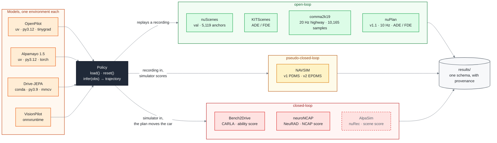

<h1 align="center">
   Paddock
</h1>

<p align="center"><strong>An evaluation framework for driving world models, spanning open-loop and closed-loop benchmarks.</strong></p>

<p align="center">
  <a href="https://github.com/FastCodeAI/Paddock/actions/workflows/check.yml"></a>
  <a href="LICENSE"></a>
  <a href="pyproject.toml"></a>
  <a href="docs/leaderboard.md"></a>
  <a href="docs/ROADMAP.md"></a>
</p>

Paddock runs several independent research codebases against the same
benchmarks, through one interface, and collects the results in one comparable
format.

Shared between **Fastcode** and **Renesas**. Everyone runs it on their own
machine, against whatever copy of the data they already have.

---

## What it does

Every model implements one `Policy` — `load()`, `reset()`, `infer(observation) -> trajectory` —
and runs as its own process behind a small HTTP node. Every benchmark drives
that same class: open-loop benchmarks replay a recording through it, and
closed-loop simulators move the car with what comes back. Scores land in one
schema with provenance, so an ADE and an NCAP score are statements about the
same model, run the same way.



Four models times eight benchmarks in the sketch above, and nobody wrote
thirty-two adapters. The tree now holds eight models and nine benchmarks — the
diagram names the ones worth drawing, not all of them; `paddock list` is
authoritative. Another model is one new directory under `adapters/models/`,
another benchmark one new directory under `adapters/benchmarks/`.

What crosses the wire between paddock, the model node and a simulator is
drawn step by step in [docs/architecture.md](docs/architecture.md#on-the-wire).

Paddock does **not** copy datasets and does **not** vendor model code. It points
existing clones at existing data using each repo's own configuration mechanism.

## Support matrix

Headline number per model and benchmark, as measured through paddock; the
per-metric tables follow. How each was produced is in `docs/benchmarks/`.

🟢 open-loop · 🟡 pseudo-closed-loop · 🔴 closed-loop · ↑ higher is better · ↓ lower is better

| | 🟢 nuScenes cumulative L2 avg ↓ (m) | 🟢 KITScenes ADE ↓ (m) | 🟢 comma2k19 ADE@3s ↓ (m) | 🟢 nuPlan ADE ↓ (m) | 🟡 NAVSIM v2 EPDMS ↑ (0–1) | 🟡 NAVSIM v1 PDMS ↑ (0–1) | 🔴 Bench2Drive driving score ↑ (0–100) | 🔴 neuroNCAP score ↑ (0–5) | 🔴 AlpaSim nuRec scene score ↑ (0–1) |
|---|---|---|---|---|---|---|---|---|---|
| OpenPilot | 2.477 △ | 1.599 | 1.507 ✦ ⊗ | 0.807 ◐ | 0.747 (10 Hz) ‡ | 0.807 (10 Hz) ‡ | 30.09 ≈ ◆ | **3.60** ‖ | **0.9566** ¶ |
| Alpamayo 1.5 | 0.787 △ | 1.002 | **0.900** ✦ | — ◐◐ | 0.691 (10 Hz) † | 0.753 (10 Hz) † | 55.82 (10 Hz) ※ | **3.73** ‖ | 0.9000 ¶¶ |
| Drive-JEPA | 0.912 △ ⊘ | 2.364 | 16.048 ✦ | 1.512 ◐ | 0.843 | 0.892 † | 57.60 (2 Hz) ※ | **3.57** ‖ ⊘ | 0.5030 ¶ |
| Drive-JEPA, KITScenes re-ranker ⊛ | pending ⊛ | 0.973 ⊛ | not run | not run | not run | not run | — | not run ⊛ | — |
| VisionPilot | 1.441 △ | 1.534 ∗ | 4.045 ✦ ∗ | 2.246 ◐ | 0.431 | 0.488 † | 49.85 ◆ | **1.58** ‖ | 0.8488 ¶ |
| METEOR | 0.977 △ | 1.879 ◇ | — ✦ | 1.273 ◐ | 0.303 ◊ | 0.366 ◊ | — | **2.64** ‖ | — |
| Qwen-Drive 1.0 | 0.450 | 0.806 | 1.159 ✦ | — | 0.840 | 0.876 | 17.08 (2 Hz) ※ | **2.49** | — |
| Baseline (Constant Velocity) | 0.641 △ | 1.381 | 1.639 ✦ | 1.393 ◐ | 0.239 | 0.207 † | 47.94 ♣ | 0 § | *0.8850* ¶ |

⊛ `drivejepa_rerank` is Drive-JEPA unchanged up to its 32 candidate
trajectories. A small selector then chooses among them, in place of Drive-JEPA's
NAVSIM-trained scorer. That selector was trained on KITScenes **train** (5,711
keyframes, 373 scenes, none of them in the benchmark), so its KITScenes cell is
*adapted*, not zero-shot like the rows around it.
It sees the cameras cropped onto the OpenScene lens and gets no route hint.
Through that same path, Drive-JEPA's own pick scores 2.521 and the best of its 32
scores 0.409. The selector learned closeness to the human path and nothing about
collisions, so it has no closed-loop cells until it has been through neuroNCAP.
Its nuScenes cell is pending: the zero-shot run was made before the camera-frame
fix (#62), when Drive-JEPA saw no image on nuScenes, so it is withdrawn until it
is re-measured with the fix.
See `docs/models/drivejepa_rerank.md`.

∗ VisionPilot has no native trajectory output. For nuScenes, NAVSIM and
KITScenes, Paddock constructs sampled XY points from its projected image-space
path and speed schedule, so those three figures grade the whole synthesised
pipeline -- perception, ground projection, curve fit, cruise-speed assumption
and extrapolation past a 1 s planner horizon -- and are not comparable in kind
with a model that emits a timed trajectory. The KITScenes run additionally
needed the ego origin dropped from the roof pod to the road, without which every
projected path point lands behind the car; see `docs/benchmarks/kitscenes.md`.

The ∗ rows are also the ones **`CURV_SCALE` moved**. The adapter carried 1.0
where the stack's own `lateral_fusion.hpp` has 0.21, so the planner saw a
curvature 4.8x too large and its `sqrt(mu*g/|kappa|)` speed cap bound where it
should not have. Fixed September 2026; on a 20-sample comma2k19 smoke the
correction moved ADE@3s from 15.09 to 5.28. **Every VisionPilot figure in this
README predates it** and will not be reproduced by a re-run — the closed-loop
ones least, since urban scenes rarely reach the cap, and the comma2k19 and
KITScenes ones most. `docs/models/VISION_PILOT_GUIDE.md` §"Curvature scale" has
the derivation; re-sweeping VisionPilot is an open item in `docs/ROADMAP.md`.

◊ METEOR plans **3 s**; NAVSIM scores **4 s**. A quarter of every scored plan is
therefore not the model's: `METEOR_HORIZON_S=4.0` (on the record as `model_env`)
continues the final 0.5 s segment to 4 s, because `to_navsim_poses` refuses a
shorter horizon rather than inventing one silently. The metrics that read the far
end of the plan are where METEOR falls to or below the constant-velocity floor —
lane keeping 0.795 against the floor's 0.827, extended comfort 0.451 against
0.567, the lowest in this table. Consecutive plans disagree three times more in
the extrapolated second (1.62 m of lateral) than inside the model's own horizon
(0.52 m), measured over 10,040 consecutive pairs. Read these two cells as METEOR
plus that extension, not as a 4 s planner; its 3 s output is scored without any
extension on nuScenes and KITScenes. See `docs/models/meteor.md`.

◇ METEOR is TIER IV's 8-camera multi-task network, run from its released
camera-only ONNX. KITScenes hands it the six-camera ring (#40), so only its two
telephoto slots are absent; it has no driving-command input. Fed the front
camera alone, as the harness did before #40, it scored 4.784 -- the run is kept
as an ablation. With six cameras the residual error is longitudinal above
13 m/s, where its plans plateau near 35 m at 3 s (a prior from its training
domain). The feed matches the authors' reference loader byte for byte. On
nuScenes, with all six cameras, its L2 sits with Drive-JEPA's; its collisions
are concentrated at standstill, where the planner creeps ~1 m into the queue
ahead (22.6 % of stopped anchors), and its plans carry a left bias twice as
large in Boston as in Singapore. See `docs/models/meteor.md`.

◐ **Every nuPlan figure is `valid: false` and excluded from `paddock report`.**
This site holds one of nuPlan's nine camera shards, so of the 351 scorable
anchors in the balanced manifest only **25** have images — and those 25 fall in
**7 of the 59 scenario types**, six of them stop-sign or traffic-light
decelerations. The runs are recorded and comparable *with each other* (one
shared sample set, one record per model, `sequences_sha256` pinned), but a
ranking over near-homogeneous deceleration moments is not a ranking on nuPlan,
and these are not comparable with a full-coverage run. The remaining shards are
~405 GB. OpenPilot's figure additionally comes from a v0.11.1 checkout rather
than the sha `repos.yaml` pins, so its record carries `repo_sha: null`.
See [docs/benchmarks/nuplan.md](docs/benchmarks/nuplan.md).

◐◐ Alpamayo 1.5 has no nuPlan figure: it needs `nvidia/Cosmos-Reason2-8B`,
which is gated. Only its config and tokenizer are read, and the one measurement
made with a substitute is deliberately not committed, so there is no record to
cite.

△ nuScenes uses 5,119 scoring anchors across 150 validation scenes. The headline
is the mean of cumulative L2 through 1, 2 and 3 seconds, not ADE at 3 seconds.
OpenPilot uses real approximately 12 Hz front-camera history; scoring stays at
2 Hz. See the nuScenes table below for point L2, cumulative L2 and ADE.

⊘ Measured camera-blind: until the camera-frame fix (#62) Drive-JEPA's adapter
placed the cameras so that no sample point landed in the image on nuScenes and
neuroNCAP, and the plan came from ego status alone. Re-measure pending; its
other columns are not affected.

✦ comma2k19 is the full dataset: **2035 one-minute segments, 5 keyframes each —
10,165 scored samples**, not 10,175: two truncated segments are too short to
place a keyframe at all, so it is 2033 × 5 (`{0: 2, 5: 2033}`) — derived, with
both segments named, in
[docs/datasets/comma2k19.md](docs/datasets/comma2k19.md). Every row is over the
identical sample set
(`sequences_sha256 = 293a225a0b5cbaff` in all six `run.json`). METEOR has not
been swept on it. Read the mean *and* the median: OpenPilot's 3 s mean beats
constant velocity by 8% (1.507 vs 1.639) while its **median is worse** (1.555 vs
1.475), because two thirds of I-280 is straight enough for constant velocity to
be nearly exact and the mean is carried by the curves. Alpamayo is ahead on
both, but on a **shorter horizon and one camera**: it plans 4 s where supercombo
plans 10, and comma2k19 has a single forward camera against the four view slots
Alpamayo takes, so two of them go unsent. The 3 s column is a fair comparison;
the 10 s column does not exist for it. Qwen-Drive is the only other model within
half a metre of it, and reaches 5 s doing it — the only other model that plans
that far is supercombo, half a metre worse again at that horizon (2.045 vs
2.571). **Drive-JEPA's 16.048 is its perception-free agent** —
a separate registry entry (`drivejepa_free`, NAVSIM v1) from the perception-based
v2 model every other column on that row refers to, since comma2k19 supplies
neither the four cameras nor the lidar extrinsics v2 requires. The number is a
speed prior, not a wiring fault: its plans are the most accurately *shaped* of
any model here (0.609 m lateral error at matched arc length, against OpenPilot's
1.155) but reach only ~67% as far as the car travelled, because 4 s of NAVSIM
city driving saturates near 64 m while I-280 runs at 30 m/s. See
[docs/models/drivejepa_free.md](docs/models/drivejepa_free.md) and the comma2k19
table below.

⊗ **OpenPilot's comma2k19 row was not produced at the `repos.yaml` pin.** It
comes from a clone at `4df40d2c1`, which ships the driving model as two graphs;
the pin names `555f48c5d`, which ships it as one, and the two plan from
different hidden states. The same row also predates a fix to the ONNX backend,
which was feeding the road camera's image to the wide view. The figure is left
as measured — it is a real openpilot over the same 10,165 samples as every other
row — and is due to be replaced when openpilot is next evaluated at the pin;
[docs/ROADMAP.md](docs/ROADMAP.md) tracks it and
[docs/benchmarks/comma2k19.md](docs/benchmarks/comma2k19.md#recorded-results)
gives the detail. Runs made from here on record their clone's sha and their
backend in `run.json`, so a row cannot lose its provenance this way again.

† Every NAVSIM figure is the full navtest split, 12,146 real recorded
scenarios, scored through paddock's proxy agent. This is NAVSIM v2's **stage
one** only: the leaderboard's stage two, the pseudo-simulation on synthetic
scenes (navhard / navsafe two-stage), is not run -- it needs the
`synthetic_scenes/` download and a second metric cache. Alpamayo's 0.691 is
with the 10 Hz history from nuPlan (see ‡); at OpenScene's 2 Hz the same model
scores 0.608 on the same split. Its earlier 242-scenario estimate was 0.653
against that 0.608, which is why subsets are stored `valid: false`. On the subset Drive-JEPA scored 0.880
through the proxy — the vendor's own agent scores 0.907 by reading the
scorer's simulator at inference time, which no other model can do, so the
proxy figure is the comparable one. `preflight` refuses a partial split unless told
otherwise, so a subset cannot be reported as full navtest by accident, and the
subset rows in `results/` are stored `valid: false` -- they appear under
"Excluded runs" and never average against a full-split row.
The **NAVSIM v1 PDMS** column scores the same 12,146 scenarios with the v1.1
devkit -- the composite the 2024 leaderboard uses, on which the NAVSIM paper
reports constant velocity 20.6 and human 94.8 -- see
`docs/benchmarks/navsim_v1.md`. Alpamayo's and OpenPilot's v1 figures replay the
plans their 10 Hz v2 runs recorded -- the same plans, the other scorer -- so each
model's two columns describe one run; Alpamayo's 2 Hz pair (0.608 / 0.676) is in
the tables below. Drive-JEPA and VisionPilot are fresh proxy runs at 2 Hz.

‡ OpenScene is a 2 Hz dataset and OpenPilot infers motion from frame-to-frame
change, so on it OpenPilot plans a parked car — 0.30 m of travel in 4 s at
4.8 m/s. Its model has no speed input at all (`{desire_pulse, traffic_convention,
action_t}`), so this is not fixable in the adapter: it declares
`min_input_hz: 10.0` and the harness refuses the pairing on OpenScene alone. The
frames OpenScene left out exist upstream — nuPlan's cameras run at 10 Hz — and
with `[benchmarks.navsim] nuplan` naming that data the harness feeds a 10 Hz
history to OpenPilot and to Alpamayo (built for 0.1 s frames). On the full
split OpenPilot scores 0.747 at 10 Hz, its plans tracking ego speed (median
0.82 of constant-velocity travel over 4 s while moving; 2 of 12,146 plans look
parked), and Alpamayo 0.691 against 0.608 at 2 Hz, every sub-metric up but
traffic light. See "10 Hz from nuPlan" in `docs/benchmarks/navsim.md`.

◆ Historical Bench2Drive mean driving score on 24 routes (04–06 Sep 2026),
one run per route; route 11715 was excluded after CARLA crashes. These are
driving scores, not per-ability scores. OpenPilot ≈ is the **unassisted
pre-resume estimate**, reconstructed from the assisted recordings: 16 routes
are censored before intervention and eight had no intervention. It is not a
separate unassisted sweep. The historical OpenPilot scores predate later
controller fixes. The assisted and expansion recordings are reported
separately in [OpenPilot, by recording set](#openpilot-by-recording-set); they are
never pooled into one mean. See [Bench2Drive protocol](docs/benchmarks/bench2drive.md).

※ Bench2Drive driving score at the model's **native inference rate** — Drive-JEPA
and Qwen-Drive replan at 2 Hz, Alpamayo 1.5 at 10 Hz — over the 50-route set,
18–20 Sep 2026. Alpamayo 1.5 and Qwen-Drive are means over 49 routes: route 3800
crashes CARLA for both at their native rate and is reported as never scored, not
as a zero. Every other cell in this column is driven at 20 Hz, one inference per
simulator tick; OpenPilot's native rate *is* 20 Hz, and VisionPilot was not
re-run. So the ※ cells are **not comparable with the ◆ cells**: a different rate
and a different route set. At 20 Hz the same three scored Alpamayo 1.5 44.58 and
Drive-JEPA 31.11 (24 routes, ◆) and Qwen-Drive 12.92 (50 routes). Drive-JEPA uses
its released NAVSIM-v2 checkpoint zero-shot in CARLA. The runs stay
`valid: false` and off the ranked [leaderboard](docs/leaderboard.md), which ranks
the 20 Hz protocol only. Per-route detail and the 20 Hz comparison are in
[Native inference rate](#native-inference-rate--three-models-re-driven).

♣ The Bench2Drive baseline uses a **fixed 3 m/s target**, with straight ego-frame
waypoints and the shared controller; actual vehicle speed can differ. nuScenes
constant velocity instead extrapolates the recorded ego velocity. 47.94 is that
3 m/s target on the historical 24 routes; the whole speed sweep, and why the
50-route table shows 40.39, is in
[Constant velocity — the speed sweep](#constant-velocity--the-speed-sweep).

△ nuScenes val, open loop, zero-shot (none of these models was trained on
nuScenes): the average L2 over 0-3 s on the official 150-scene val split (5119
keyframes), UniAD/VAD protocol, `--bench nuscenes` -- the cumulative (per-step)
average, comparable to published tables (the `l2_avg` in `docs/leaderboard.md`
is the point value at 1/2/3 s). OpenPilot now uses real approximately 12 Hz
front-camera history while retaining the same 2 Hz scoring anchors; its completed
GPU run is detailed below. VisionPilot's plan here is its acceleration/steering
integrated to a path, as in NAVSIM, so unlike KITScenes it does yield an L2.
Alpamayo's figure is inflated by the first keyframe of each scene, where it has
no history to difference (9.5 m there vs 1.2 m elsewhere). See `docs/benchmarks/nuscenes.md`. A constant-velocity baseline scores 0.64 here (point-avg L2 1.29), **better than every learned model** — nuScenes ego motion is largely straight, so open-loop L2 rewards a straight line; read these numbers with that in mind.

✦ Bench2Drive constant velocity is a do-nothing floor: "constant velocity" means holding the current speed, and every route starts from a standstill, so the baseline holds zero and never departs -- blocked after 60 s, driving score 0 on every route (confirmed on 3 routes, structural for all 24). Unlike nuScenes, where the logged ego is already moving, it is not an informative baseline in closed loop.

§ Not run — zero by construction. Every neuroNCAP scenario is staged so that an
ego holding its current velocity collides at full speed. A run that avoids the
collision scores a flat **5**; a run that collides scores
`4 · max(0, 1 − v_impact / v_reference)`, which is 0 when the two speeds are
equal. The baseline therefore scores 0 in all three scenarios with a 100%
collision rate.

Note the discontinuity: **a single run scores either exactly 5, or at most 4** —
grazing an obstacle at walking pace scores 4, not 4.9. Anything between the two
is a mean over runs, which is what the model rows above are.

¶ AlpaSim `scene_score`, `public_2601` first 10 scenes, uuid-pinned, n=10,
scorer `affc2ea`, under the **shared 20 Hz referee** — one control rate, one
force-GT duration and one `eval-config.yaml` (md5 `68cf4aaa…`) across every row,
so the rows differ by the model rather than by the harness. The files are in
`results/alpasim/` and `paddock report` reads them. **Only OpenPilot clears the
constant-velocity floor**, by +0.0716. That is a property of the metric as much
as of the models: `scene_score` saturates at `progress_clipped_rel ≥ 0.8` and
zeroes a scene only on an at-fault collision or an offroad event, neither of
which a blind constant velocity commits — it rear-ends things, and a rear-end is
not at fault. Quote progress beside it (floor 0.8290, OpenPilot 0.9010,
VisionPilot 0.8202, Drive-JEPA 0.5652). VisionPilot's whole 0.0362 deficit is a
single at-fault collision; its other nine scenes average 0.9431. Drive-JEPA's
0.5030 is six early-terminated or hard-gated scenes and four clean 1.0000s.
Per-row caveats, including the gates VisionPilot's run did not pass, are in
[docs/benchmarks/alpasim.md](docs/benchmarks/alpasim.md).

¶¶ Alpamayo ran 4 cameras at 20 Hz (`4cam-20Hz`), the other four rows 1 camera
at 20 Hz. **Different group, not comparable** — and it has no constant-velocity
floor in its own group, so it cannot be quoted against one. Scene-level variance
on this model is large enough that no single-rollout mean here should be read to
four figures.

### What these models are

The scores above say how well each model drives. This says what each one **is** —
because a four-order-of-magnitude spread in size sits behind a neuroNCAP column
whose top three are statistically indistinguishable. Full table, licences and
provenance in [docs/models/comparison.md](docs/models/comparison.md); the
machine-readable form is in each `model.yaml` and prints with
`paddock list models`.

| | Architecture | Params | Size (GB) | Input | Output | Trained on |
|---|---|---:|---:|---|---|---|
| OpenPilot | supercombo — one ONNX graph, via tinygrad | not published | 0.061 | 2 cam @20 Hz · 512×256 · 2 frames | 33 waypoints, 10 s | comma fleet, ≈6,670 h (not released) |
| Alpamayo 1.5 | Cosmos-Reason2 VLM + diffusion trajectory decoder | **10 B** | 20 | 4 cam @10 Hz · 448×280 | trajectory 6.4 s + reasoning trace | NVIDIA internal, 80,000 h |
| Drive-JEPA | V-JEPA-2 ViT-L encoder + proposal-centric planner | 307 M | 1.23 | 1 cam ✧ · 512×256 · 2 frames | trajectory 4 s, from 8192 anchors | OpenScene, then **NAVSIM `navtrain`** ✦ |
| VisionPilot | three YOLO-family conv nets | **28.1 M** | 0.112 | 1 cam @10 Hz · 1024×512 | lane curvature + closest in-path object | OpenLane, TuSimple, CurveLanes |
| METEOR | ResNet-34 + FPN per camera, depth-gated IPM lift to one BEV grid, 12 task heads | 54 M | 0.35 | 8 cam · 768×432 · 1 frame (paddock fills 6) | 3 paths × 6 waypoints, 3 s, + steer / accel / brake and 11 perception heads | TIER IV Co-MLOps DRS, Japan + a US subset, 953 GB / 12,595 scenes @5 Hz, auto-labelled (hours not published) |
| Qwen-Drive 1.0 | Qwen3.5-4B VLM + 1 B flow-matching planning expert | ≈5 B | 11.2 | 3 cam · 4 frames 0.5 s apart · current ~720p, history ~320p | 50 poses (x, y, heading), 5 s @10 Hz | Qwen3.5's corpus + public driving sets, incl. **NAVSIM `navtrain`** ✦ |

✦ **Two models here declare training exposure to a benchmark's own dataset.**
Drive-JEPA leads that benchmark by 0.096 EPDMS on v2 and 0.085 PDMS on v1 over
OpenPilot with its 10 Hz history (0.235 and 0.216 over the 2 Hz field): it was
post-trained on NAVSIM `navtrain` and pre-trained partly on OpenScene, which
*is* the NAVSIM dataset. Qwen-Drive 1.0 reports navtest as its own headline
planning result, so its adapter declares `navtrain` too — read off the report
rather than sourced from code, and the one line to correct if the paper says
otherwise. OpenPilot, Alpamayo and VisionPilot meet `navtest` zero-shot. That is the protocol NAVSIM intends — it is not cheating —
but it means both NAVSIM columns conflate "better planner" with
"in-distribution versus zero-shot". Sourced at
the pinned sha: `navsim_v2/scripts/training/train_drive_jepa_perception_based.sh`
sets `TRAIN_TEST_SPLIT=navtrain` for the same agent whose checkpoint paddock
loads. Detail in [docs/models/comparison.md](docs/models/comparison.md).

✧ The published architecture reads one front camera; the adapter declares four,
because it runs the NAVSIM perception-based variant whose BEVFormer stage is
multi-camera. Unreconciled — and since a simulator renders exactly what is
declared, it is worth measuring before the next closed-loop sweep.

### nuScenes

Recorded validation results, 5,119 anchors across 150 scenes. Lower is better.
OpenPilot completed with zero failures using up to five seconds of real CAM_FRONT
history, CUDA inference, CPU camera warping and resume assistance disabled.

| Model | L2 at 1 s (m) | L2 at 2 s (m) | L2 at 3 s (m) | Point L2 avg (m) | Cumulative L2 avg (m) | ADE at 3 s (m) | Point collision avg (%) |
|---|---:|---:|---:|---:|---:|---:|---:|
| OpenPilot | 1.925 | 4.054 | 6.194 | 4.057 | 2.477 | 3.535 | 2.624 |
| Alpamayo 1.5 | 0.509 | 1.351 | 2.602 | 1.487 | 0.787 | 1.249 | 1.582 |
| Drive-JEPA ⊘ | 0.540 | 1.587 | 3.519 | 1.882 | 0.912 | 1.536 | 1.459 |
| VisionPilot | 1.031 | 2.213 | 3.837 | 2.360 | 1.441 | 2.058 | 3.816 |
| METEOR | 0.616 | 1.683 | 3.356 | 1.885 | 0.977 | 1.570 | 6.152 ◇ |
| Qwen-Drive 1.0 | 0.318 | 0.722 | 1.360 | 0.800 | 0.450 | 0.678 | 0.770 |
| Baseline (Constant Velocity) | 0.372 | 1.151 | 2.340 | 1.288 | 0.641 | 1.069 | 1.661 |

Point L2 averages errors at 1, 2 and 3 seconds. Cumulative L2 averages the three
prefix means; ADE at 3 seconds averages all six half-second errors. Collision
is predicted ego-footprint overlap with annotated boxes, not an observed crash.

⊘ Measured camera-blind; re-measure pending, see #62.

**Constant velocity was the lowest L2 on this recorded split until Qwen-Drive,
which is below it on every column**, collision included, and is the first model
here to beat the baseline outright rather than on one metric. That is worth
reading with the split's shape in mind: nuScenes val is 20-second urban clips
scored open-loop against what the log did, so a model that predicts the recorded
future well scores well whether or not it would drive. The same model places
fourth of five on neuroNCAP, which stages the collisions this split never
contains. nuScenes is also not in its declared training data (NAVSIM `navtrain`,
Waymo E2E, NVIDIA PhysicalAI), so unlike its NAVSIM columns this one is
zero-shot.

[nuScenes implementation and result records (PR #14)](https://github.com/FastCodeAI/Paddock/pull/14)
· [OpenPilot full metrics](https://github.com/FastCodeAI/Paddock/blob/a75d30418248c33e5a9a76de837887cd1e19a1e8/results/nuscenes/openpilot/20260908T110028-b71f4f/metrics.json).
Older model results predate the geometry/navigation corrections noted in #14;
these tables report the saved runs, not new evaluations of the merged code.

### KITScenes

Open-loop displacement error in metres over the 3 s horizon, full 223-sample
split. Alpamayo 1.5 is its nav-conditioned single-draw run. VisionPilot's
trajectory is synthesised by the adapter (see ∗); METEOR sees six of its eight
cameras (see ◇). Qwen-Drive 1.0 reads three of the ring's six and is zero-shot
on this dataset. Among zero-shot models, only it and Alpamayo 1.5 beat the
constant-velocity baseline. The re-ranked Drive-JEPA row also beats it, but it is
adapted to KITScenes train (see ⊛): 1.002 on the 186 val samples, 0.828 on the 37
from scenes whose area overlaps train.

| Model | ADE@3s ↓ (m) | FDE@3s ↓ (m) |
|---|---:|---:|
| OpenPilot | 1.599 | 2.894 |
| Alpamayo 1.5 | 1.002 | 2.158 |
| Drive-JEPA | 2.364 | 4.199 |
| Drive-JEPA, KITScenes re-ranker ⊛ | 0.973 | 2.082 |
| VisionPilot | 1.534 ∗ | 3.089 ∗ |
| METEOR | 1.879 ◇ | 4.034 ◇ |
| Qwen-Drive 1.0 | **0.806** | **1.777** |
| Baseline (Constant Velocity) | 1.381 | 3.091 |

### comma2k19

The full dataset: 2035 one-minute segments of 20 Hz California highway driving,
5 keyframes each — **10,165 scored samples**, ten short of 2035 × 5 because two
truncated segments (9.7 s and 11.1 s) place no keyframe at all. Every row over
the identical sample
set. Each sample feeds the model **160 real frames — 7.95 s of history ending at
the scored moment** — and scores the waypoints it plans against the 20 poses the
car actually reached, on a 0.5 s grid out to 10 s. A model is scored only as far
as it plans, so a cell is blank where its own horizon ends rather than being
padded. Lower is better throughout.

| Model | horizon | ADE@1s | ADE@2s | **ADE@3s** | ADE@4s | ADE@5s | ADE@10s | FDE@3s | median ADE@3s | PDMS-style ↑ ⁂ |
|---|---:|---:|---:|---:|---:|---:|---:|---:|---:|---:|
| Alpamayo 1.5 | 4 s | **0.386** | **0.616** | **0.900** | **1.263** | — | — | **1.654** | **0.823** | — |
| Qwen-Drive 1.0 | 5 s | 0.475 | 0.801 | 1.159 | 1.570 | **2.045** | — | 2.094 | 1.138 | 0.511 |
| OpenPilot ⊗ | 10 s | 0.598 | 1.035 | 1.507 | 2.017 | 2.571 | **6.032** | 2.712 | 1.555 | 0.410 |
| Baseline (Constant Velocity) | 3 s | 0.537 | 1.017 | 1.639 | — | — | — | 3.286 | 1.475 | 0.417 |
| VisionPilot ∗ | 4 s | 1.149 | 2.462 | 4.045 | 5.835 | — | — | 8.146 | 2.195 | 0.406 |
| Drive-JEPA (perception-free) | 4 s | 7.800 | 12.077 | 16.048 | 20.501 | — | — | 26.248 | 19.801 | 0.541 |

**OpenPilot and the baseline are separated by horizon, not by skill at the
headline.** Constant velocity is *better* for the first two seconds and has the
better median at three, because I-280 is mostly straight and a straight line is
then almost exactly right; OpenPilot's mean wins on the curves, and its
advantage grows with every horizon they share. The baseline's row stops at 3 s
because the registered policy emits the six waypoints neuroNCAP requires;
extending the same arithmetic to 10 s with
[`tools/benchmarks/comma2k19/constant_velocity.py`](tools/benchmarks/comma2k19/constant_velocity.py)
gives 2.411 / 3.331 / 10.048 at 4, 5 and 10 s, so OpenPilot's advantage is 1.7×
by 10 s. That tool run agrees with the policy to every printed digit at 1, 2 and
3 s, which is what licenses reading the two together. An ADE at 3 s alone would
have called those two nearly a tie.

**Alpamayo and Qwen-Drive lead at every horizon they reach, on less input than
OpenPilot.** Both see one camera where they expect several view slots —
comma2k19 is a single forward camera, so Alpamayo's +55°/−55° slots go unsent
and Qwen-Drive's side views are filled with the forward frame — and both plan
well short of supercombo's 10 s. Alpamayo is ahead on the mean *and* the median
within its 4 s, which is the comparison constant velocity survives against
OpenPilot and does not survive here (0.823 vs 1.475 at 3 s). It is ahead of
Qwen-Drive too, at every horizon the two share; Qwen-Drive's claim is that it
carries the lead a second further, reaching 2.045 at 5 s where OpenPilot needs
until 4 s to reach 2.017. What the table cannot say is how either extrapolates
to 10 s, because neither goes there.

**Drive-JEPA's row is a reach failure, not a shape failure, and the auxiliary
columns are what show the difference.** Its perception-free agent has the
lowest lateral error at matched arc length of any model on this benchmark
(0.609 m against OpenPilot's 1.155) while travelling only 67% as far as the car
did (`path_length_ratio` 0.672), so it draws close to the right curve and stops
a third of the way along it. Four seconds of NAVSIM city driving saturates
around 64 m; I-280 covers 120. Removing the speed error is exactly what
`lateral_at_arclength_mae` does, and it takes 16.048 to 0.609 — which is not a
number this table will headline, because the model was not asked for a shape, it
was asked for where the car would be. This is the clearest case in the repo for
why a benchmark that reported ADE alone would be describing the wrong defect.

comma2k19 also carries the car's own CAN bus, radar and fused pose, so it scores
what a model predicts **besides** the path — one metric list, `NaN` for a model
that publishes no such head. Two of the six do. Over the same 10,165 samples:

| what | OpenPilot | VisionPilot | reference it is scored against |
|---|---:|---:|---|
| ego speed, relative error | 0.020 | — | CAN speed |
| yaw rate, absolute error (rad/s) | 0.0024 | — | fused INS/GNSS pose |
| lead recall / precision | **0.945** / 0.593 | 0.871 / **0.752** | radar tracks |
| lead range, absolute error (m) | **3.04** (median 1.45) | 9.10 (median 6.85) | radar range |
| lead lateral, absolute error (m) | 0.595 | **0.369** | radar track position |
| lead closing speed, absolute error (m/s) | **0.944** | 1.893 | radar range rate |
| plan within 1σ, along / across track | 0.559 / **0.124** | — | the recorded future |
| longitudinal jerk within comfort bound | 0.373 | **0.893** | NAVSIM's bounds |
| sanity gates passed (lane width, camera height, speed) | 0.926 | — | plausibility ranges |

Three of those are results rather than confirmations. OpenPilot's **lateral
uncertainty head is badly under-dispersed** — a calibrated 1σ should contain
about 68% of outcomes and contains 12% — and its plan's **longitudinal jerk
exceeds the comfort bound on 63% of samples** (mean peak 5.04 m/s³ against a
4.13 bound), which is a property of the 33-point plan resampled onto a 0.5 s
grid and is worth reading before anyone treats that grid as a controller input.
And VisionPilot's lead head, which is three times worse than supercombo's at
*range*, is the better of the two at **lateral** placement (0.369 m vs 0.595):
it is solving a detection-and-projection problem where supercombo is solving a
regression, and the two fail in different directions. Alpamayo, Qwen-Drive and
Drive-JEPA publish none of these heads through paddock's extras schema, so their
columns are `NaN` throughout — which is the point of one declared metric list
rather than a per-model one. The baseline's comfort columns are all 1.0 by
construction: a straight line at constant speed has no jerk.

⁂ **PDMS-style** is NAVSIM v1's published composite,
`NC × DAC × (5·TTC + 5·EP + 2·C) / 12`, evaluated over log-replay *proxies* —
comma2k19 has no other-agent tracks and no map, so no-collision sees only the
closest radar lead and drivable-area uses the human's own path as the corridor.
It is deliberately not the primary metric and never called a driving score; the
five sub-scores are reported beside it in `report.md` so nobody has to trust the
sum. Alpamayo predates the column and is `stochastic: true`, so re-running it
would replace a published 0.900 with a different draw for two proxy columns, so
it is `—` rather than a number that cannot be compared. Qwen-Drive was `—` here
too until it was re-swept on the common 0.5 s grid: its comfort term had been
measured on a 0.1 s one, where `1/dt³` turns 4 cm of output quantisation into
1932 m/s³ of "jerk".
See [docs/benchmarks/comma2k19.md](docs/benchmarks/comma2k19.md) for the full
derivation and what it still cannot see.

[OpenPilot](results/comma2k19/openpilot/20260916T051616-2a91ca/metrics.json)
· [Alpamayo 1.5](results/comma2k19/alpamayo15/20260913T072437-b058c2/metrics.json)
· [Qwen-Drive 1.0](results/comma2k19/qwendrive/20260916T220846-971379/metrics.json)
· [Drive-JEPA (perception-free)](results/comma2k19/drivejepa_free/20260916T003407-c504e5/metrics.json)
· [VisionPilot](results/comma2k19/visionpilot/20260916T012719-03350c/metrics.json)
· [baseline](results/comma2k19/constant_velocity/20260916T162837-b89038/metrics.json)
· [protocol, and what it cannot score](docs/benchmarks/comma2k19.md)
· [the dataset itself](docs/datasets/comma2k19.md).

### nuPlan

Open-loop displacement error against the recorded future, on nuPlan v1.1's
original logs at their native **10 Hz** cameras and 100 Hz ego poses — not
NAVSIM's 2 Hz OpenScene redistribution of the same source. That rate is what
makes the dataset scorable for a model like OpenPilot, which infers ego motion
from frame-to-frame change and declares `min_input_hz: 10.0`.

**These are a 25-sample subset, not nuPlan** (see ◐). One camera shard of nine
is present, so 25 of 351 scorable anchors have images, and they fall in 7 of 59
scenario types. Every run below is `valid: false` and excluded from the
leaderboard; they are comparable with each other and with nothing else.

| Model | ADE ↓ (m) | FDE@1s ↓ (m) | FDE@2s ↓ (m) | FDE@3s ↓ (m) | Longitudinal MAE ↓ (m) | Lateral MAE ↓ (m) |
|---|---:|---:|---:|---:|---:|---:|
| OpenPilot | **0.807** | **0.416** | **0.878** | **1.539** | **0.658** | 0.316 |
| Alpamayo 1.5 | — ◐◐ | — | — | — | — | — |
| Drive-JEPA | 1.512 | 0.568 | 1.593 | 3.305 | 1.429 | **0.299** |
| VisionPilot | 2.246 | 1.488 | 2.246 | 3.589 | 1.491 | 1.324 |
| METEOR | 1.273 | 0.483 | 1.333 | 2.803 | 0.831 | 0.778 |
| Baseline (Constant Velocity) | 1.393 | 0.462 | 1.433 | 3.199 | 1.036 | 0.630 |

Two of the four models clear the constant-velocity floor: OpenPilot, which
leads every metric but lateral error, and METEOR. Drive-JEPA and VisionPilot
do not — expected on a subset this skewed toward decelerations, where holding
the current speed is already close to right. `constant_velocity` is a stored
run like any other, declared in its `model.yaml` and scored through the same
harness, so the floor and the rows it anchors regenerate together.

Protocol, the three sampling rules that build the balanced set, and why the
calibration is decoded without nuplan-devkit are in
[docs/benchmarks/nuplan.md](docs/benchmarks/nuplan.md).

### NAVSIM v2

Full navtest (stage one: real recorded scenes, no synthetic stage two), 12,146 scenarios, all sub-metrics 0–1. Every column except EPDMS
is the mean of a per-scenario pass/fail or ratio, and EPDMS is the weighted
product the scorer builds from them. Drive-JEPA is scored through paddock's
proxy agent (see †). Extended comfort is the mean over the scenarios where it
is defined, 10,040 of the 12,146 -- it compares consecutive frames' plans, so
it is absent for a log's first frame and for any scenario without a scorable
predecessor (`docs/results-schema.md`); every other column is over all 12,146.
The last column is the 242-scenario subset (2% of navtest) that every model
was first run on, for reference only.

| Model | EPDMS ↑ | No at-fault collisions ↑ | Drivable area ↑ | Driving direction ↑ | Traffic light ↑ | Ego progress ↑ | TTC within bound ↑ | Lane keeping ↑ | History comfort ↑ | Extended comfort ↑ | EPDMS on 242 subset |
|---|---:|---:|---:|---:|---:|---:|---:|---:|---:|---:|---:|
| OpenPilot, 10 Hz nuPlan history ‡ | 0.747 | 0.970 | 0.913 | 0.954 | 0.998 | 0.712 | 0.965 | 0.947 | 0.983 | 0.653 | — |
| Alpamayo 1.5, 10 Hz nuPlan history ‡ | 0.691 | 0.957 | 0.856 | 0.933 | 0.997 | 0.681 | 0.951 | 0.963 | 0.962 | 0.576 | — |
| Alpamayo 1.5, 2 Hz OpenScene | 0.608 | 0.941 | 0.788 | 0.890 | 0.998 | 0.596 | 0.939 | 0.931 | 0.938 | 0.490 | 0.653 |
| Drive-JEPA | **0.843** | 0.984 | 0.985 | 0.991 | 0.998 | 0.889 | 0.979 | 0.974 | 0.978 | 0.477 | 0.880 |
| VisionPilot | 0.431 | 0.727 | 0.819 | 0.926 | 0.975 | 0.404 | 0.700 | 0.899 | 0.968 | 0.518 | 0.447 |
| METEOR ◊ | 0.303 | 0.694 | 0.687 | 0.805 | 0.979 | 0.317 | 0.683 | 0.795 | 0.973 | 0.451 | — |
| Qwen-Drive 1.0, 10 Hz nuPlan history ‡ | 0.840 | 0.982 | 0.964 | 0.993 | 0.998 | 0.820 | 0.977 | 0.975 | 0.982 | **0.867** | — |
| Baseline (Constant Velocity) | 0.239 | 0.681 | 0.578 | 0.805 | 0.981 | 0.209 | 0.669 | 0.827 | 0.979 | 0.567 | 0.257 |

### NAVSIM v1

The same 12,146 navtest scenarios, scored by the v1.1 devkit as PDMS =
NC × DAC × (5·TTC + 5·EP + 2·comfort) / 12 (`docs/benchmarks/navsim_v1.md`).
Driving direction compliance is recorded with weight zero. Full navtest,
12,146 scenarios each, zero failures. Drive-JEPA and VisionPilot are fresh
proxy runs; the Alpamayo and OpenPilot rows replay the plans their v2 runs
recorded (the 10 Hz nuPlan history and, for Alpamayo, the 2 Hz OpenScene run
too), so each scores the very plans behind the v2 figure above. The baseline
reproduces the NAVSIM
paper's constant-velocity row (20.6) term by term, and the recorded human
future scores 0.946 against the paper's 94.8 (privileged; stored `valid: false`).

| Model | PDMS ↑ | No at-fault collisions ↑ | Drivable area ↑ | Ego progress ↑ | TTC within bound ↑ | Comfort ↑ | Driving direction (weight 0) |
|---|---:|---:|---:|---:|---:|---:|---:|
| OpenPilot, 10 Hz nuPlan history ‡ | 0.807 | 0.969 | 0.913 | 0.719 | 0.936 | 1.000 | 0.948 |
| Alpamayo 1.5, 10 Hz nuPlan history ‡ | 0.753 | 0.957 | 0.856 | 0.690 | 0.896 | 0.991 | 0.927 |
| Alpamayo 1.5, 2 Hz OpenScene | 0.676 | 0.941 | 0.788 | 0.604 | 0.878 | 0.979 | 0.885 |
| Drive-JEPA | **0.892** | 0.984 | 0.985 | 0.887 | 0.881 | 0.999 | 0.988 |
| VisionPilot | 0.488 | 0.771 | 0.818 | 0.451 | 0.617 | 0.996 | 0.920 |
| METEOR ◊ | 0.366 | 0.693 | 0.687 | 0.340 | 0.582 | 0.997 | 0.800 |
| Qwen-Drive 1.0, 10 Hz nuPlan history ‡ | 0.876 | 0.982 | 0.964 | 0.817 | 0.941 | 1.000 | 0.987 |
| Baseline (Constant Velocity) | 0.207 | 0.680 | 0.578 | 0.194 | 0.500 | 1.000 | 0.799 |

**Qwen-Drive reproduces its own published row here, term by term.** Its
technical report gives the `planner-sft`-without-reasoning navtest row — the
exact configuration paddock runs — and every term agrees:

| | NC | DAC | EP | TTC | Comfort | PDMS |
|---|---:|---:|---:|---:|---:|---:|
| vendor, SFT w/o reasoning | 98.2 | 96.4 | 82.0 | 94.4 | 100.0 | 87.8 |
| paddock | 98.19 | 96.42 | 81.73 | 94.06 | 99.99 | **87.58** |

Every term is within 0.34 and five of the six within 0.27. This is the only row
in the table with a vendor figure to check against, and matching the *terms*
rather than just the composite is evidence about the whole path — the camera
mapping, the 10 Hz history, the 8-pose conversion and the v1 scorer — not only
about the model. Read it as an in-distribution result all the same: Qwen-Drive
declares `navtrain` (see ✦).

### Bench2Drive — 50 routes

Five models and constant velocity at five fixed target speeds, evaluated on the
same 50 routes. DS = mean driving score; RC = mean route completion.
**Progress km** is `Σ route_length_m × RC/100 / 1000` — how far each system was
actually exposed, and the denominator Bench2Drive's own aggregate uses. The
infraction columns are **recorded counts, not rates**, and the exposures differ
by nearly 2× (DriveJEPA 2.14 km against CV 3 m/s's 4.09), so compare them through
the per-km table below rather than across this one.

| Model/system | Routes | DS ↑ | RC ↑ (%) | Progress km | Ped. collision ↓ | Vehicle collision ↓ | Layout collision ↓ | Red light ↓ | Stop sign ↓ | Outside lanes ↓ | Deviation ↓ | Blocked ↓ | Emergency yield ↓ | Min-speed entries | Route timeout ↓ | Scenario timeout ↓ | Collisions total ↓ | Routes with collision ↓ |
|---|---:|---:|---:|---:|---:|---:|---:|---:|---:|---:|---:|---:|---:|---:|---:|---:|---:|---:|
| DriveJEPA | 50/50 | 31.71 | 39.10 | 2.14 | 2 | 3 | 3 | 1 | 1 | 7 | 6 | 17 | 3 | 338 | 0 | 0 | 8 | 8/50 |
| VisionPilot | 50/50 | 47.82 | 71.19 | 3.92 | 6 | 23 | 13 | 11 | 3 | 11 | 10 | 2 | 4 | 655 | 0 | 0 | 42 | 29/50 |
| Alpamayo 1.5 (nav) | 50/50 | 43.04 | 72.32 | 3.98 | 3 | 42 | 1 | 0 | 0 | 22 | 3 | 9 | 1 | 660 | 0 | 0 | 46 | 27/50 |
| OpenPilot † | 50/50 | — | — | 3.46 | 3 | 10 | 5 | 5 | 4 | 4 | 9 | 10 | 4 | 587 | 0 | 0 | 18 | 14/50 |
| QwenDrive ‡ | 50/50 | 12.92 | 50.19 | 2.68 | 0 | 50 | 60 | 1 | 0 | 46 | 9 | 16 | 0 | 437 | 0 | 0 | 110 | 45/50 |
| CV (fixed 3 m/s) | 50/50 | 48.31 | 74.65 | 4.09 | 8 | 27 | 14 | 5 | 4 | 11 | 11 | 1 | 5 | 688 | 0 | 0 | 49 | 27/50 |
| CV (fixed 6 m/s) | 50/50 | 40.39 | 73.08 | 3.98 | 9 | 24 | 26 | 11 | 4 | 14 | 14 | 4 | 5 | 673 | 0 | 0 | 59 | 31/50 |
| CV (fixed 9 m/s) | 50/50 | 43.57 | 72.70 | 3.97 | 6 | 24 | 14 | 11 | 4 | 13 | 15 | 3 | 4 | 667 | 0 | 0 | 44 | 29/50 |
| CV (fixed 12 m/s) | 50/50 | 42.19 | 72.12 | 3.92 | 4 | 35 | 16 | 11 | 4 | 14 | 13 | 3 | 4 | 659 | 0 | 0 | 55 | 28/50 |
| CV (fixed 15 m/s) | 50/50 | 41.45 | 73.68 | 4.02 | 4 | 37 | 17 | 11 | 4 | 15 | 15 | 4 | 4 | 676 | 0 | 0 | 58 | 28/50 |

† **OpenPilot has no DS or RC cell here, deliberately.** Its 24 historical routes
were driven with human resume assistance on 16 of them, and its 26 expansion
routes use a different upstream longitudinal setup; no single mean describes both,
so none is published and nothing ranks OpenPilot against the other systems. The
counts in its row are the recorded totals over all 50 routes. The scores are in
[OpenPilot, by recording set](#openpilot-by-recording-set), and its tracked run
carries the same split in `by_group` with `valid: false` on the pooled mean.
DriveJEPA uses a NAVSIM-v2 checkpoint zero-shot; VisionPilot uses a synthesized trajectory with an extrapolated tail.
‡ QwenDrive is zero-shot, on the three cameras it was trained for (front,
front-left, front-right), through the same tracker as every other row; its route
24333 entry is the valid rerun after a startup-guard fix. Its adapter is in this
tree, but its `model.yaml` does not declare `bench2drive`, so this row is
ingested from the recordings rather than re-drivable with `paddock run` —
[`docs/models/qwendrive.md`](docs/models/qwendrive.md).
(nav) marks the Alpamayo run that receives the route's navigation instruction (manoeuvre and distance) on the wire each tick.
CV rows hold the stated fixed target speed; the score depends strongly on the chosen speed, so all five bands are shown.

#### Collisions per progress km

Upstream divides every infraction except `outside_route_lanes` by the same
`km_driven`, so this is the form the counts above are comparable in. Raw counts
are the one form Bench2Drive itself never publishes.

| Model/system | Progress km | Ped. ↓ | Vehicle ↓ | Layout ↓ | Total ↓ |
|---|---:|---:|---:|---:|---:|
| DriveJEPA | 2.14 | 0.94 | 1.40 | 1.40 | 3.74 |
| VisionPilot | 3.92 | 1.53 | 5.87 | 3.32 | 10.72 |
| Alpamayo 1.5 (nav) | 3.98 | 0.75 | 10.56 | 0.25 | 11.56 |
| QwenDrive ‡ | 2.68 | 0.00 | 18.66 | 22.40 | 41.06 |
| CV (fixed 3 m/s) | 4.09 | 1.95 | 6.60 | 3.42 | 11.97 |
| CV (fixed 6 m/s) | 3.98 | 2.26 | 6.02 | 6.53 | 14.81 |
| CV (fixed 9 m/s) | 3.97 | 1.51 | 6.05 | 3.53 | 11.09 |
| CV (fixed 12 m/s) | 3.92 | 1.02 | 8.93 | 4.08 | 14.03 |
| CV (fixed 15 m/s) | 4.02 | 1.00 | 9.21 | 4.23 | 14.44 |

DriveJEPA's 3 vehicle collisions against VisionPilot's 23 is 1.40/km against
5.87/km once exposure is divided out, and part of even that is DriveJEPA having
the table's highest blocked count (17) — stationary, not safe. QwenDrive is the
other direction: 41.06 collisions per progress km, an order of magnitude above
every other row. OpenPilot is in its own block below; its two recording sets are
not pooled into a rate either.

#### Minimum-speed normalization

| Model/system | Recorded entries | Below 100% ↓ (%) |
| --- | ---: | ---: |
| DriveJEPA | 338 | 59.17 |
| VisionPilot | 655 | 21.22 |
| Alpamayo 1.5 (nav) | 660 | 44.09 |
| QwenDrive ‡ | 437 | 53.32 |
| CV (fixed 3 m/s) | 688 | 67.73 |
| CV (fixed 6 m/s) | 673 | 46.66 |
| CV (fixed 9 m/s) | 667 | 13.04 |
| CV (fixed 12 m/s) | 659 | 9.71 |
| CV (fixed 15 m/s) | 676 | 7.99 |

“Below 100%” is the share of recorded ratios below background-traffic speed, not
a safety violation rate: B2D records a ratio at each distance checkpoint even
when the ego is faster than traffic, and lawful stops produce ratios below 100%.
**Entries per progress km is not published**, because it cannot separate these
systems: the checkpoint grid splits *each* route into 20 parts of its own length,
so a route contributes ~20 entries however long it is, and the quantity reduces
to 20 / (completion-weighted mean route length) — 181.7 to 187.3 across all ten
systems, a 3.1% spread, against the 8.5× spread the speed column shows over the
same rows. What is left is the route mix and how far each system got, not how
fast it drove. `below_100_percent` is the column carrying the speed signal;
`entries_per_progress_km` stays in the JSON with that caveat attached.
OpenPilot's entries are in its own block; the two recording sets are not pooled here either.

#### OpenPilot, by recording set

Three different experiments, kept apart. They are never averaged together, and the
pooled 50-route mean they would produce is withheld from
`bench2drive-speed-normalization.json` for the same reason.

| Recording set | Routes | DS ↑ | RC ↑ (%) | Min-speed entries | Below 100% ↓ (%) |
|---|---:|---:|---:|---:|---:|
| Historical 24 — **assisted**, human resume on 16 of 24 | 24 | 53.62 | 66.81 | 300 | 36.00 |
| Expansion 26 — unassisted, different upstream longitudinal setup | 26 | 43.01 | 60.45 | 287 | 58.54 |
| Unassisted 24 estimate ◆ — assisted runs censored at the first resume | 24 | 30.09 | 30.76 | — | — |

The third row is the reconstruction behind ◆ and the 30.09 in the support matrix,
not a measurement: 16 routes are censored before intervention and eight had no
intervention. Its per-route values are
[`openpilot-24-infractions.csv`](docs/benchmarks/openpilot-24-infractions.csv), and
every record in the pooled JSON now carries an `assistance` block, so the assisted
and unassisted subsets can be recomputed from the linked file alone.

#### Constant velocity — the speed sweep

The baseline is not one experiment. All five targets were driven over the same
50 routes; the 6 m/s row is the one carried into the tables above.

| Target speed (m/s) | Routes | DS ↑ | RC ↑ (%) |
|---:|---:|---:|---:|
| 3 | 50/50 | 48.31 | 74.65 |
| 6 | 50/50 | 40.39 | 73.08 |
| 9 | 50/50 | 43.57 | 72.70 |
| 12 | 50/50 | 42.19 | 72.12 |
| 15 | 50/50 | 41.45 | 73.68 |

This fixes the target speed rather than holding the zero speed at route start;
the path is straight in the ego frame, not a route-following reference. The
**47.94 ♣** in the support matrix is the 3 m/s target over the *historical 24*
routes (RC 74.68) — the same setting scores 48.31 over all 50, and the two are
separate runs in the store:
[historical 24](results/bench2drive/constant_velocity/20260908T084921-804913/run.json)
· all 50 under `results/bench2drive/constant_velocity/pooled50-3mps-*`.

[Calculation](docs/benchmarks/bench2drive-speed-normalization.md) · [Recorded data](docs/benchmarks/bench2drive-speed-normalization.json)

#### Native inference rate — three models re-driven

Every row above is driven at **20 Hz**: one inference per simulator tick, which is
a property of the protocol, not of the models. Three of them were built to replan
far more slowly. Re-driving the same 50 routes at that slower rate — 18–20 Sep 2026,
same routes, same `waypoint_dt`, same tracker, `PADDOCK_INFER_HZ` the only knob
turned deliberately — scores all three higher, so **the 20 Hz protocol understates
them**.

| Model | Native rate | Routes | DS 20 Hz | DS native ↑ | RC 20 Hz | RC native ↑ | Routes completed |
|---|---:|---:|---:|---:|---:|---:|---:|
| DriveJEPA | 2 Hz | 50/50 | 31.71 | **57.60** | 39.10 | 70.97 | 5 → 23 |
| Alpamayo 1.5 (nav) | 10 Hz | 49/50 | 43.20 | **55.82** | 73.07 | 76.52 | 24 → 27 |
| QwenDrive ‡ | 2 Hz | 49/50 | 12.94 | **17.08** | 50.64 | 64.30 | 6 → 14 |

The 20 Hz columns are the published recordings **restricted to the routes scored at
both rates**, so for Alpamayo 1.5 and QwenDrive they are not the all-50 means in the
table above. DriveJEPA and QwenDrive gain by driving further instead of stalling
(blocked 17 → 7 and 16 → 10), which also raises their collision counts; Alpamayo 1.5
is the only one that gets safer — infraction penalty 0.648 → 0.725, vehicle
collisions 42 → 23. **A higher score here is partly more exposure, not only better
driving** — though normalized for that exposure all three collide *less* often per
progress-km (DriveJEPA 3.74 → 3.05, Alpamayo 1.5 11.76 → 6.50, QwenDrive 41.48 →
31.25), so the extra distance is not bought with a higher collision rate. Route 3800 is unscorable for Alpamayo 1.5 and QwenDrive (CARLA segfaults;
DriveJEPA completes it and scores 100) and is recorded as requested-and-never-scored
— `n_failed: 1`, `status: partial` — never as a zero. **OpenPilot's native rate is
20 Hz**, so its published run is already its native-rate run, and VisionPilot was not
re-run; nothing here restates either. The rate is recorded per run in
`config.model_env`, not derived from `model.yaml`, and the adapter support for
`PADDOCK_INFER_HZ` is not on `main` yet — so these are landed results, not runs a
clean checkout can re-drive. The three runs are `valid: false` and **do not rank**
on the board: a 2 or 10 Hz run is not the protocol the other rows were driven
under. Their native scores are the Bench2Drive cells of the support matrix for
these three models (※). `model_env` also differs in more than the rate — thread counts, a trace
sink, `ALPAMAYO_NAV` — each argued immaterial and none measured to be; the
[page](docs/benchmarks/bench2drive-native-rate.md) books that as argued, not
verified.

Tracked runs, one per model:
[DriveJEPA](results/bench2drive/drivejepa/native50-2hz-40c29d24c37d542a-447e23/run.json) ·
[Alpamayo 1.5](results/bench2drive/alpamayo15/native50-10hz-084418258d833a9f-c4d076/run.json) ·
[QwenDrive](results/bench2drive/qwendrive/native50-2hz-084418258d833a9f-9b2bc9/run.json)

[Protocol, full infraction breakdown, and what is argued rather than measured](docs/benchmarks/bench2drive-native-rate.md) · [Per-route records](docs/benchmarks/bench2drive-native-rate.json)

Tracked run records for every row above, recomputed from the per-route `results.json`
files by `paddock ingest` (`[[ingest.bench2drive]]`, one pooled closed-loop run per
model or speed band): `results/bench2drive/<model>/pooled50-*`. `paddock report` reads
them like any other run.

[VisionPilot and OpenPilot failure videos](docs/evidence/driving-videos/README.md) — manifest and hashes tracked; the MP4s live under `{runs}`, not in the repo.

### neuroNCAP

The **full official set**: 20 scenario-scene pairs over 14 scenes, 10 runs each,
n = 200 per model. Mean ± std of the NCAP score; CR is the collision rate over
all 200 runs. Runs are seeded 0-9, so every model met identical scenario jitter.

| Model | stationary ↑ (0–5) | frontal ↑ (0–5) | side ↑ (0–5) | overall ↑ (0–5) | CR ↓ (of 200) |
|---|---:|---:|---:|---:|---:|
| Alpamayo 1.5 | 4.41 ±1.48 | 3.64 ±2.01 | 2.45 ±1.93 | **3.73** | 32.5% |
| OpenPilot | 4.52 ±1.34 | 2.30 ±1.24 | 3.08 ±2.25 | **3.60** | 38.0% |
| Drive-JEPA ⊘ | 4.23 ±1.33 | 2.42 ±1.43 | 3.39 ±2.07 | **3.57** | 45.5% |
| METEOR | 2.44 ±2.42 | 3.20 ±2.39 | 2.50 ±2.50 | **2.64** | 48.0% |
| Qwen-Drive 1.0 | 2.71 ±1.73 | 1.52 ±1.49 | 3.00 ±2.04 | **2.49** | 69.0% |
| VisionPilot | 2.53 ±1.60 | 1.17 ±1.38 | 0.08 ±0.18 | **1.58** | 85.5% |
| Baseline (Constant Velocity) | 0.00 | 0.00 | 0.00 | 0.00 § | 100.0% |

⊘ Measured camera-blind; re-measure pending, see #62.

**Qwen-Drive is the widest open-loop-to-closed-loop gap in the table.** It leads
KITScenes and ties Drive-JEPA on NAVSIM, then places fourth here, below three
models it beat on every open-loop column. The frontal column is where it goes:
1.52 with 86% of those runs ending in a collision, against 3.64 for Alpamayo.
**It brakes; it does not steer.** Over the 50 frontal episodes its planned 3 s
path reaches a mean peak lateral offset of 1.22 m, against 10.44 m for
Alpamayo — which decelerates no harder (−2.31 m/s against Qwen-Drive's −2.48)
and collides in 32% of episodes rather than 86%. Drive-JEPA brakes hardest of
the five, −5.47 m/s, and still collides in 78% (⊘ measured camera-blind). In a staged head-on the closing
vehicle arrives whatever the ego's speed, so the escape is lateral, and Alpamayo
is the only model of the five that takes it. This is not an adapter limit: on
NAVSIM the same code path produces lateral offsets to 19.92 m. The full table,
and what is interpretation rather than measurement, are in
[docs/models/qwendrive.md](docs/models/qwendrive.md).

**METEOR is the mirror image: it steers, and it does not brake.** Its mean
places it fourth, level with Qwen-Drive; counted over scenario-scene pairs, it is
only marginally below Alpamayo and not clearly separated from Drive-JEPA or
OpenPilot (paired below). Over the
50 frontal episodes its planned 3 s path reaches a mean peak lateral offset of
5.17 m, second only to Alpamayo's 10.44 m, and it collides in 36% of them, also
second best. But it speeds up through every scenario type rather than slowing:
the ego's last speed minus its first is +2.37 m/s over frontal episodes, +1.82
over side and +1.40 over stationary, against −2.81 for Qwen-Drive and −2.29 for
Alpamayo over the same frontal episodes, last speed minus first
(`docs/models/qwendrive.md` measures speed change differently, which is why its
figures for those episodes differ). So the escape that works head-on fails against an
obstacle standing in the lane, where stationary is its weakest column (2.44,
53% collisions). The same failure shows on NAVSIM, where its no-at-fault
collision rate sits at the constant-velocity floor. Detail in
[docs/models/meteor.md](docs/models/meteor.md).

**Scene 0103 was not representative, and the ordering it implied was wrong.**
Every model met identical scenario jitter (runs seeded 0–9), so these can be
compared paired sample for sample rather than as means:

| paired difference | mean | SE over 200 episodes | t | SE over 20 pairs | t |
|---|---:|---:|---:|---:|---:|
| Alpamayo − OpenPilot | +0.12 | 0.15 | 0.80 | 0.32 | 0.38 |
| Alpamayo − Drive-JEPA | +0.16 | 0.14 | 1.12 | 0.32 | 0.50 |
| Alpamayo − VisionPilot | **+2.15** | 0.17 | **12.89** | 0.38 | **5.73** |
| METEOR − Drive-JEPA | −0.92 | 0.22 | −4.25 | 0.58 | −1.60 |
| METEOR − Qwen-Drive | +0.16 | 0.19 | 0.83 | 0.41 | 0.39 |

**Read the pair-level columns.** The 200 episodes are 10 seeded runs of each of
20 scenario-scene pairs, not 200 independent draws, and this benchmark's error
is dominated by the between-scene term (`docs/benchmarks/neuroncap.md`). The
pair-level standard error averages each pair's ten runs first. The Alpamayo rows
reach the same conclusions at both levels. METEOR's do not: over the 20 pairs
it is not separable from Drive-JEPA (t −1.60) or OpenPilot (t −1.89), only
marginally below Alpamayo (t −2.47) and above VisionPilot (t +2.21), and level
with Qwen-Drive either way.

The top three are **statistically indistinguishable**. Only VisionPilot is
separated, and decisively. On scene 0103 alone the order was Drive-JEPA 4.04,
OpenPilot 3.80, Alpamayo 2.46 — which put Alpamayo last of the three and
Drive-JEPA clearly first. Neither holds up. Alpamayo moved most, from 2.46 to
3.73, because scene 0103's side scenario is one of its worst and n = 15 could
not show that.

VisionPilot's side score moved the same way in the other direction: 0.54 on
0103, 0.08 across the set.

**A single run scores either exactly 5.0 or at most 4.0** (see §), so a mean
between them is an average over runs and the standard deviation matters. The
per-run rows are in `results/`; VisionPilot's side result is 0.08 with a 100%
collision rate on all 50 runs — it hits the side obstacle at nearly full speed
every time, which the 0.54 from one scene did not show.

‖ Full official set, 20 pairs over 14 scenes, 10 runs each (n = 200), stored
`valid: true`. OpenPilot's earlier closed-loop figures were all produced before
`12f3250` fixed the `traffic_convention` one-hot — which had been telling
supercombo it was a right-hand-drive car in Boston — and are stored
`valid: false`; this is its first valid closed-loop score. Paired by seed on
frontal-0103 the fix was worth −0.16, and on side-0103 +0.36, so it moved
scenarios in both directions.

Three scenes (0796, 0921, 0923) initially failed for missing nuScenes lidar and
were completed after fetching it; both runs record `n_reused` for the episodes
carried over. See `docs/benchmarks/neuroncap.md`.

### AlpaSim (nuRec)

Closed-loop driving on replayed real scenes: AlpaSim renders a recorded clip as
a neural reconstruction, hands the policy frames at a fixed control rate, and
steps the world forward on what the policy commands. `scene_score` is 0–1,
meaned over scenes. The set is the first 10 scenes of the `public_2601` suite,
uuid-pinned, one rollout per scene — **n = 10**. Every row is under
`results/alpasim/` and `paddock report` reads it; the protocol is in
[docs/benchmarks/alpasim.md](docs/benchmarks/alpasim.md).

Drive-JEPA's row below is its released checkpoint behind the native driver at
0.1.4. That driver has since been promoted to
[`tools/models/drivejepa/alpasim_driver/`](tools/models/drivejepa/alpasim_driver/)
at 0.1.7, which drives a checkpoint retrained on Physical AI AV; it has no row
here, because none of its runs went through paddock or used this scene set
alone. What it reads, how it picks and what it scored on 30 scenes are in
[docs/models/drivejepa.md](docs/models/drivejepa.md).

**Every row ran under the shared 20 Hz referee**: one control rate, one force-GT
duration and one `eval-config.yaml` (md5 `68cf4aaa…`), so the rows differ by the
model rather than by the harness. Camera count still changes what is measured —
four cameras see what one cannot — so Alpamayo's `4cam-20Hz` row is a separate
group, and it has no constant-velocity floor of its own.

| Model | Group | `scene_score` ↑ | Δ vs its floor | Progress ↑ | `duration_frac_20s` ↑ | At-fault collisions ↓ | Any collision ↓ | Off-road ↓ |
|---|---|---:|---:|---:|---:|---:|---:|---:|
| OpenPilot | `1cam-20Hz` | 0.9566 | **+0.0716** | 0.9010 | 0.777 | 0 / 10 | 1 / 10 | 0 / 10 |
| *floor* | *`1cam-20Hz`* | *0.8850* | *—* | *0.8290* | *0.654* | *0 / 10* | *2 / 10* | *0 / 10* |
| VisionPilot | `1cam-20Hz` | 0.8488 | −0.0362 | 0.8202 | 0.699 | 1 / 10 | 3 / 10 | 0 / 10 |
| Drive-JEPA | `1cam-20Hz` | 0.5030 | **−0.3820** | 0.5652 | 0.462 | 2 / 10 | 4 / 10 | 1 / 10 |
| Alpamayo 1.5 | `4cam-20Hz` | 0.9000 | no floor | 0.9603 | 0.740 | 1 / 10 | 1 / 10 | 0 / 10 |

**An at-fault collision or an off-road event zeroes the scene outright**, whatever
progress preceded it:

```
progress_score = min(clamp(progress_clipped_rel, 0, 1) / 0.8, 1.0)
scene_score    = 0.0  if collision_at_fault or offroad  else progress_score
```

There is no partial credit — 95% of a scene and then a clipped car scores the
same 0.0 as never moving. That rule is why constant velocity is a serious
opponent rather than a formality: it does not steer and it rear-ends things, but
a rear-end is *not at fault*, so the hard-failure rule leaves it standing while
the at-fault collisions and off-road events a real policy commits zero it. At
20 Hz the floor scores 0.8850 and **only OpenPilot beats it**. A model that does
not clear its own floor has not demonstrated competence here, whatever the
absolute number looks like — and because the score saturates, progress is the
column that separates the floor (0.8290) from OpenPilot (0.9010).

**Scored window is the trap in this benchmark.** AlpaSim truncates a rollout at
the first collision or off-road event and again once the ego is 4 m from the
recorded trajectory, so **a policy that fails early is scored over a shorter
window than one that drives the scene out** — and its fidelity numbers, measured
only over the easy opening seconds, look *better* for it. `duration_frac_20s` is
how much of a 20 s scene survived that chain: Drive-JEPA's 0.462 against
OpenPilot's 0.777 is why its `dist_to_gt_trajectory` (2.44 m) cannot be read
against OpenPilot's (1.45 m). Do not compare fidelity across rows whose scored
windows differ.

Alpamayo's row is **one stochastic draw per scene**. No seed is recorded for
the run, and scene `04749bb9` has scored 0.0, 0.9148 and 1.0 across identical
environments — read it as one sample, not as the model's score. It is the same
property `docs/benchmarks/neuroncap.md` records for Alpamayo there, where five
seeds on one scenario spanned 0.000 to 5.000. The floor has no such caveat: it
is deterministic, which is what makes it the useful reference.

---

## Quickstart

```bash
git clone <this repo> && cd paddock
make setup                                  # .venv + editable install
source .venv/bin/activate                   # puts `paddock` on PATH

cp paddock.toml.example paddock.toml
$EDITOR paddock.toml                        # point at YOUR repos, data and scratch space

paddock setup                               # clone/adopt vendor repos, apply patches
paddock doctor                              # what this machine can actually run
```

Without activating, the CLI is still there as `.venv/bin/paddock`, and
`make doctor` works from a cold shell.

`paddock doctor` is the entry point for everything that goes wrong. It reports
which repos resolved, which datasets are present and valid, which interpreters
exist, and how much GPU headroom there is — each failure naming the doc section
that fixes it.

Then:

```bash
paddock run --model openpilot --bench kitscenes --limit 5    # smoke test
paddock run --model all --bench neuroncap --runs 1 --scene 0103
paddock report                                               # leaderboard
```

---

## The one idea worth understanding

**Tracked files say what a thing is. `paddock.toml` says where it lives.**

| Tracked in git — identical at every site | Site-local, gitignored |
|---|---|
| `datasets.yaml` — a dataset's layout, splits, validation checks | `paddock.toml` — the path to it on this machine |
| `repos.yaml` — upstream URL, pinned commit, patches | which clones already exist here |
| `adapters/models/<name>/model.yaml` — interpreter kind, PYTHONPATH, VRAM, cameras | resolved interpreter and repo paths |

Tracked files name locations only through template variables — `{repos}`,
`{runs}`, `{weights}`, `{data.kitscenes}` — expanded at launch by
`paddock.config`. `tests/test_portability.py` fails the build if a tracked file
contains a real machine path, which is what keeps this true over time.

This is also the answer to "do I have to copy the data?" — no. Every model repo
already accepts external paths through an environment variable, a CLI flag, a
symlink, or (once) a source patch. Paddock computes the right one per repo.

---

## Layout

```
paddock.toml.example     copy to paddock.toml — the only file a new site edits
repos.yaml               vendor manifest: upstream URL + pinned sha + patches
datasets.yaml            what each dataset is (no paths)
patches/                 extracted edits to third-party source
results/                 TRACKED metrics + provenance (kilobytes)
external/                gitignored symlinks to this machine's vendor clones
src/paddock/
  config.py              paddock.toml + template expansion
  policy/                the Policy protocol and its HTTP server wrapper
  runtime/               per-model env construction, process supervision, GPU gating
  metrics/               trajectory (ADE/FDE), pose transforms
  adapters/models/       one directory per model  (_template to copy)
  adapters/benchmarks/   one directory per benchmark (_template to copy)
  results/               canonical store, ingest of legacy formats, reporting
docs/                    see below
  docs/benchmarks/       how a benchmark is run and scored — paddock's protocol
  docs/datasets/         what the data is — true of the dataset on any machine
```

Run artifacts — predictions, frames, videos — go to `roots.runs`, outside the
repo. Only the small `results/` metrics are tracked, so the leaderboard is
reviewable in a diff.

---

## Documentation

| Doc | Read it when |
|---|---|
| [docs/site-setup.md](docs/site-setup.md) | setting paddock up on a new machine |
| [docs/data-setup.md](docs/data-setup.md) | pointing paddock at datasets, or fetching ones you lack |
| [docs/adding-a-model.md](docs/adding-a-model.md) | **adding a model** — the full checklist |
| [docs/adding-a-benchmark.md](docs/adding-a-benchmark.md) | **adding a benchmark** — the full checklist |
| [docs/models/comparison.md](docs/models/comparison.md) | **what each model is** — size, inputs, outputs, training data, licences |
| [docs/models/](docs/models/) | one page per model — what the checkpoint is, how the adapter wires it, and what its figures do and do not support |
| [SKILLS.md](SKILLS.md) | bringing up a model's own environment, and the failures that look nothing like a paddock bug |
| [docs/architecture.md](docs/architecture.md) | understanding open- vs closed-loop, the Policy protocol |
| [docs/benchmarks/](docs/benchmarks/) | how each benchmark is run and scored, and every recorded figure with its run id |
| [docs/datasets/](docs/datasets/) | what the underlying data *is* — sensors, frames, coverage, and what it cannot answer |
| [docs/leaderboard.md](docs/leaderboard.md) | the full per-run leaderboard, rendered by `paddock report` |
| [docs/results-schema.md](docs/results-schema.md) | reading or ingesting results |
| [docs/troubleshooting.md](docs/troubleshooting.md) | something fails in a way that makes no sense |
| [CONTRIBUTING.md](CONTRIBUTING.md) | before opening a PR |
| [docs/ROADMAP.md](docs/ROADMAP.md) | what is done, what is verified, and what is not |

Adding a model touches **one registry file and one new directory** — no changes
to `src/paddock/`. If you cannot add a model without editing the core, that is a
framework bug; please report it.

---

## License

Apache License 2.0. See [LICENSE](LICENSE). Copyright 2026 Renesas Electronics
Corporation.
