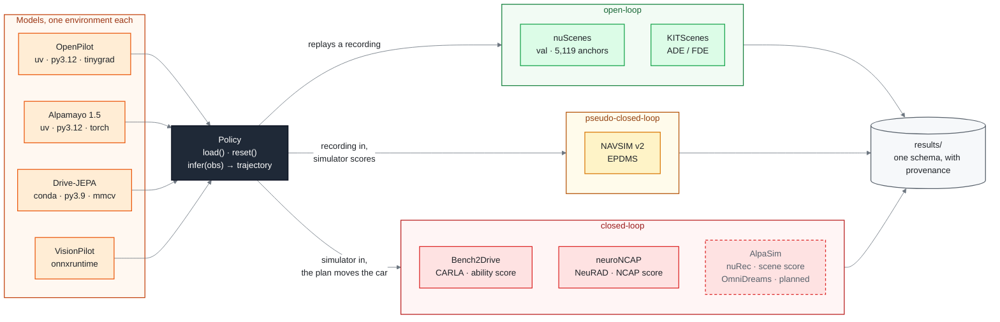

<h1 align="center">
   Paddock
</h1>

<p align="center"><strong>An evaluation framework for driving world models, spanning open-loop and closed-loop benchmarks.</strong></p>

<p align="center">
  <a href="https://github.com/FastCodeAI/Paddock/actions/workflows/check.yml"></a>
  <a href="LICENSE"></a>
  <a href="pyproject.toml"></a>
  <a href="docs/leaderboard.md"></a>
  <a href="docs/ROADMAP.md"></a>
</p>

Paddock runs several independent research codebases against the same
benchmarks, through one interface, and collects the results in one comparable
format.

Shared between **Fastcode** and **Renesas**. Everyone runs it on their own
machine, against whatever copy of the data they already have.

---

## What it does

Every model implements one `Policy` — `load()`, `reset()`, `infer(observation) -> trajectory` —
and runs as its own process behind a small HTTP node. Every benchmark drives
that same class: open-loop benchmarks replay a recording through it, and
closed-loop simulators move the car with what comes back. Scores land in one
schema with provenance, so an ADE and an NCAP score are statements about the
same model, run the same way.



Four models times five benchmarks, and nobody wrote twenty adapters. A fifth
model is one new directory under `adapters/models/`; a sixth benchmark is one
new directory under `adapters/benchmarks/`.

What crosses the wire between paddock, the model node and a simulator is
drawn step by step in [docs/architecture.md](docs/architecture.md#on-the-wire).

Paddock does **not** copy datasets and does **not** vendor model code. It points
existing clones at existing data using each repo's own configuration mechanism.

## Support matrix

Headline number per model and benchmark, as measured through paddock; the
per-metric tables follow. How each was produced is in `docs/benchmarks/`.

🟢 open-loop · 🟡 pseudo-closed-loop · 🔴 closed-loop · ↑ higher is better · ↓ lower is better

| | 🟢 nuScenes cumulative L2 avg ↓ (m) | 🟢 KITScenes ADE ↓ (m) | 🟡 NAVSIM v2 EPDMS ↑ (0–1) | 🔴 Bench2Drive driving score ↑ (0–100) | 🔴 neuroNCAP score ↑ (0–5) | 🔴 AlpaSim nuRec scene score ↑ (0–1) | 🔴 AlpaSim (OmniDreams) |
|---|---|---|---|---|---|---|---|
| OpenPilot | 2.477 △ | 1.599 | ✗ 2 Hz ‡ | 30.09 ≈ ◆ | **3.60** ‖ | 0.9566 ¶ | planned |
| Alpamayo 1.5 | 0.787 △ | 1.002 | 0.608 † | 44.58 ◆ | **3.73** ‖ | 0.8000 ¶ | planned |
| Drive-JEPA | 0.912 △ | 2.364 | 0.843 | 31.11 ◆ | **3.57** ‖ | 0.5619 ¶ | planned |
| VisionPilot | 1.441 △ | n/a ∗ | 0.431 | 49.85 ◆ | **1.58** ‖ | 0.8864 ¶ | planned |
| Baseline (Constant Velocity) | 0.641 △ | 1.381 | 0.239 | 47.94 ♣ | 0 § | 0.3562 ¶ | — |

∗ VisionPilot has no native trajectory output. For nuScenes and NAVSIM, Paddock
constructs sampled XY points from its projected image-space path and speed
schedule. KITScenes has no scored trajectory for this adapter.

△ nuScenes uses 5,119 scoring anchors across 150 validation scenes. The headline
is the mean of cumulative L2 through 1, 2 and 3 seconds, not ADE at 3 seconds.
OpenPilot uses real approximately 12 Hz front-camera history; scoring stays at
2 Hz. See the nuScenes table below for point L2, cumulative L2 and ADE.

† All three NAVSIM figures are the full navtest split, 12,146 real recorded
scenarios, scored through paddock's proxy agent. This is NAVSIM v2's **stage
one** only: the leaderboard's stage two, the pseudo-simulation on synthetic
scenes (navhard / navsafe two-stage), is not run -- it needs the
`synthetic_scenes/` download and a second metric cache. Alpamayo's earlier
242-scenario estimate was 0.653; the full split says 0.608, which is why
subsets are stored `valid: false`. On the subset Drive-JEPA scored 0.880
through the proxy — the vendor's own agent scores 0.907 by reading the
scorer's simulator at inference time, which no other model can do, so the
proxy figure is the comparable one. `preflight` refuses a partial split unless told
otherwise, so a subset cannot be reported as full navtest by accident, and the
subset rows in `results/` are stored `valid: false` -- they appear under
"Excluded runs" and never average against a full-split row.

‡ OpenScene is a 2 Hz dataset and OpenPilot infers motion from frame-to-frame
change, so it plans a parked car — 0.30 m of travel in 4 s at 4.8 m/s. Its model
has no speed input at all (`{desire_pulse, traffic_convention, action_t}`), so
this is not fixable in the adapter. It declares `min_input_hz: 10.0` and the
harness refuses the pairing rather than recording the artefact. Alpamayo hit the
same dataset property in a milder form and was fixed in its adapter, worth
+0.207 EPDMS. See `docs/benchmarks/navsim.md`.

◆ Historical Bench2Drive mean driving score on 24 routes (04–06 Sep 2026),
one run per route; route 11715 was excluded after CARLA crashes. These are
driving scores, not per-ability scores. OpenPilot ≈ is the **unassisted
pre-resume estimate**, reconstructed from the assisted recordings: 16 routes
are censored before intervention and eight had no intervention. It is not a
separate unassisted sweep. The historical OpenPilot scores predate later
controller fixes. Drive-JEPA uses its released NAVSIM-v2 checkpoint zero-shot
in CARLA. See [Bench2Drive protocol](docs/benchmarks/bench2drive.md).

♣ The Bench2Drive baseline uses a **fixed 3 m/s target**, with straight ego-frame
waypoints and the shared controller; actual vehicle speed can differ. nuScenes
constant velocity instead extrapolates the recorded ego velocity. These are
different speed settings of the baseline, as detailed below.

§ Not run — zero by construction. Every neuroNCAP scenario is staged so that an
ego holding its current velocity collides at full speed. A run that avoids the
collision scores a flat **5**; a run that collides scores
`4 · max(0, 1 − v_impact / v_reference)`, which is 0 when the two speeds are
equal. The baseline therefore scores 0 in all three scenarios with a 100%
collision rate.

Note the discontinuity: **a single run scores either exactly 5, or at most 4** —
grazing an obstacle at walking pace scores 4, not 4.9. Anything between the two
is a mean over runs, which is what the model rows above are.

¶ **Preliminary — 10 scenes, one run each, and the results files are not
stored yet.** AlpaSim runs at whatever camera set and control rate you configure,
and each model above was run at the rate and camera count it is built for, so
**the column is four different measurements and its rows do not rank against
each other.** Each is quoted against the constant-velocity floor *of its own
configuration* in the AlpaSim table below; the baseline cell here is the 20 Hz
single-camera floor, one of three. Those floor numbers are being re-checked.

### nuScenes

Recorded validation results, 5,119 anchors across 150 scenes. Lower is better.
OpenPilot completed with zero failures using up to five seconds of real CAM_FRONT
history, CUDA inference, CPU camera warping and resume assistance disabled.

| Model | L2 at 1 s (m) | L2 at 2 s (m) | L2 at 3 s (m) | Point L2 avg (m) | Cumulative L2 avg (m) | ADE at 3 s (m) | Point collision avg (%) |
|---|---:|---:|---:|---:|---:|---:|---:|
| OpenPilot | 1.925 | 4.054 | 6.194 | 4.057 | 2.477 | 3.535 | 2.624 |
| Alpamayo 1.5 | 0.509 | 1.351 | 2.602 | 1.487 | 0.787 | 1.249 | 1.582 |
| Drive-JEPA | 0.540 | 1.587 | 3.519 | 1.882 | 0.912 | 1.536 | 1.459 |
| VisionPilot | 1.031 | 2.213 | 3.837 | 2.360 | 1.441 | 2.058 | 3.816 |
| Baseline (Constant Velocity) | 0.372 | 1.151 | 2.340 | 1.288 | 0.641 | 1.069 | 1.661 |

Point L2 averages errors at 1, 2 and 3 seconds. Cumulative L2 averages the three
prefix means; ADE at 3 seconds averages all six half-second errors. Collision
is predicted ego-footprint overlap with annotated boxes, not an observed crash.
Constant velocity has the lowest L2 on this recorded split.

[nuScenes implementation and result records (PR #14)](https://github.com/FastCodeAI/Paddock/pull/14)
· [OpenPilot full metrics](https://github.com/FastCodeAI/Paddock/blob/a75d30418248c33e5a9a76de837887cd1e19a1e8/results/nuscenes/openpilot/20260908T110028-b71f4f/metrics.json).
Older model results predate the geometry/navigation corrections noted in #14;
these tables report the saved runs, not new evaluations of the merged code.

### KITScenes

Open-loop displacement error in metres over the 3 s horizon, full 223-sample
split. Alpamayo 1.5 is its nav-conditioned single-draw run. VisionPilot has no
trajectory to score (see ∗).

| Model | ADE@3s ↓ (m) | FDE@3s ↓ (m) |
|---|---:|---:|
| OpenPilot | 1.599 | 2.894 |
| Alpamayo 1.5 | **1.002** | **2.158** |
| Drive-JEPA | 2.364 | 4.199 |
| VisionPilot | n/a ∗ | n/a ∗ |
| Baseline (Constant Velocity) | 1.381 | 3.091 |

### NAVSIM v2

Full navtest (stage one: real recorded scenes, no synthetic stage two), 12,146 scenarios, all sub-metrics 0–1. Every column except EPDMS
is the mean of a per-scenario pass/fail or ratio, and EPDMS is the weighted
product the scorer builds from them. Drive-JEPA is scored through paddock's
proxy agent (see †). Extended comfort is the mean over the scenarios where it
is defined, 10,040 of the 12,146 -- it compares consecutive frames' plans, so
it is absent for a log's first frame and for any scenario without a scorable
predecessor (`docs/results-schema.md`); every other column is over all 12,146.
The last column is the 242-scenario subset (2% of navtest) that every model
was first run on, for reference only.

| Model | EPDMS ↑ | No at-fault collisions ↑ | Drivable area ↑ | Driving direction ↑ | Traffic light ↑ | Ego progress ↑ | TTC within bound ↑ | Lane keeping ↑ | History comfort ↑ | Extended comfort ↑ | EPDMS on 242 subset |
|---|---:|---:|---:|---:|---:|---:|---:|---:|---:|---:|---:|
| OpenPilot | — ‡ | — | — | — | — | — | — | — | — | — | — |
| Alpamayo 1.5 | 0.608 | 0.941 | 0.788 | 0.890 | 0.998 | 0.596 | 0.939 | 0.931 | 0.938 | 0.490 | 0.653 |
| Drive-JEPA | **0.843** | 0.984 | 0.985 | 0.991 | 0.998 | 0.889 | 0.979 | 0.974 | 0.978 | 0.477 | 0.880 |
| VisionPilot | 0.431 | 0.727 | 0.819 | 0.926 | 0.975 | 0.404 | 0.700 | 0.899 | 0.968 | 0.518 | 0.447 |
| Baseline (Constant Velocity) | 0.239 | 0.681 | 0.578 | 0.805 | 0.981 | 0.209 | 0.669 | 0.827 | 0.979 | 0.567 | 0.257 |

### Bench2Drive — all 50 routes: recorded results

All four models and CV have one selected final record for each of the **same 50
route IDs** (24 historical + 26 additional). Qwen-Drive is excluded. Counts below
are recorded list entries, including all 12 categories. DS and RC are arithmetic
means over 50 route records; driving failures and the 4000-tick cap are included.
CV is the previously selected fixed 6 m/s target, without per-route speed selection.

**† OpenPilot is a mixed-setup aggregate:** 16 of its historical 24 recordings
include assistance; the additional 26 are unassisted with the newer upstream
longitudinal controller. Its full-record counts and pooled scores are reported
as requested, but are not an unassisted 50-route or single-controller result.
The other systems also retain their cohort-specific deployment/recovery labels
in the [26-route details](docs/benchmarks/bench2drive-expansion-results.md#protocol-labels).

| Model/system | Routes | DS | RC (%) | Ped. collision | Vehicle collision | Layout collision | Red light | Stop sign | Outside lanes | Deviation | Blocked | Emergency yield | Min-speed entries | Route timeout | Scenario timeout | Collisions total | Routes with collision |
|---|---:|---:|---:|---:|---:|---:|---:|---:|---:|---:|---:|---:|---:|---:|---:|---:|---:|
| DriveJEPA | 50/50 | 31.71 | 39.10 | 2 | 3 | 3 | 1 | 1 | 7 | 6 | 17 | 3 | 338 | 0 | 0 | 8 | 8/50 |
| VisionPilot | 50/50 | 47.82 | 71.19 | 6 | 23 | 13 | 11 | 3 | 11 | 10 | 2 | 4 | 655 | 0 | 0 | 42 | 29/50 |
| Alpamayo 1.5 (nav) | 50/50 | 43.04 | 72.32 | 3 | 42 | 1 | 0 | 0 | 22 | 3 | 9 | 1 | 660 | 0 | 0 | 46 | 27/50 |
| OpenPilot (mixed setups) † | 50/50 | 48.11 | 63.50 | 3 | 10 | 5 | 5 | 4 | 4 | 9 | 10 | 4 | 587 | 0 | 0 | 18 | 14/50 |
| CV (fixed 6 m/s) | 50/50 | 40.39 | 73.08 | 9 | 24 | 26 | 11 | 4 | 14 | 14 | 4 | 5 | 673 | 0 | 0 | 59 | 31/50 |

#### Minimum-speed normalization — all 50 routes

| Model/system | Recorded entries | Route progress (km, estimated) | Entries / progress km | Entries / completed-route equivalent | Below 100% / entries | Below 100% (%) |
|---|---:|---:|---:|---:|---:|---:|
| DriveJEPA | 338 | 2.139 | 158.03 | 17.29 | 200/338 | 59.17 |
| VisionPilot | 655 | 3.918 | 167.16 | 18.40 | 139/655 | 21.22 |
| Alpamayo 1.5 (nav) | 660 | 3.978 | 165.93 | 18.25 | 291/660 | 44.09 |
| OpenPilot (mixed setups) † | 587 | 3.456 | 169.85 | 18.49 | 276/587 | 47.02 |
| CV (fixed 6 m/s) | 673 | 3.984 | 168.93 | 18.42 | 314/673 | 46.66 |

Pool counts and progress over all 50 routes before dividing:

```text
progress_km = sum(route_length_m * route_completion_pct / 100) / 1000
entries_per_progress_km = total_min_speed_entries / progress_km
completed_route_equivalents = sum(route_completion_pct / 100)
entries_per_completed_route_equivalent = total_min_speed_entries / completed_route_equivalents
below_100_share_pct = 100 * count(checkpoint_percentage < 100) / total_min_speed_entries
```

Entries/km matches the upstream aggregate normalization for these nonzero-exposure
cohorts. Progress is estimated from scored route completion, not odometry.
Checkpoint spacing scales with route length, so entries/km also depends on route
length; completed-route equivalents show the count-versus-progress effect.
A below-100 ratio can include legitimate waiting/yielding and is not by itself
an unsafe-driving violation. Unvisited checkpoints are not imputed. A saved
100% may be the evaluator's no-usable-traffic-speed fallback. No official driving
score or controller was changed to produce these reporting statistics.

DriveJEPA's lower raw count does not establish better speed compliance: the
criterion emits records at distance checkpoints even above 100% of traffic speed.
Its lower completion gives it fewer checkpoint opportunities. Do not sum these
heterogeneous infraction entries into one safety score.

[Harness calculation audit](docs/benchmarks/bench2drive-speed-normalization.md) ·
[All per-route normalization inputs and source hashes](docs/benchmarks/bench2drive-speed-normalization.json) ·
[Additional 26-route breakdown](docs/benchmarks/bench2drive-expansion-results.md).

### Bench2Drive — historical 24-route results

Mean driving score and route completion from the 24-route cohort described in ◆.
The superseded 25-route, two-model ability table is replaced here with the
recorded driving metrics. Higher is better for both columns.

| Model | Driving score ↑ | Route completion ↑ (%) |
|---|---:|---:|
| VisionPilot | **49.85** | **75.5** |
| Alpamayo 1.5 | 44.58 | 73.4 |
| Drive-JEPA | 31.11 | 40.4 |
| OpenPilot (unassisted estimate ≈) | 30.09 | 30.8 |

OpenPilot's row is an approximate reconstruction, as explained in ◆; it does
not establish the performance of the corrected controller.
[Detailed metrics](docs/benchmarks/bench2drive.md).

#### Recorded infractions (24 routes per model)

Counts are lengths of the recorded upstream infraction lists. DS is mean driving
score; RC is mean route completion. Every model occupies one row; CV uses the
previously selected fixed **6 m/s** target, without best-speed-per-route selection.
All 12 categories are retained, including zero counts. A final record includes
driving failures and the 4000-tick cap, not just successful route finishes.

**OpenPilot here includes assistance on 16 of 24 recordings.** These full-run
counts do not describe the unassisted prefix estimate above. The additional
26-route OpenPilot cohort is unassisted and reported separately.

| Model/system | DS | RC (%) | Ped. collision | Vehicle collision | Layout collision | Red light | Stop sign | Outside lanes | Deviation | Blocked | Emergency yield | Min-speed entries | Route timeout | Scenario timeout | Collisions total | Routes with collision |
|---|---:|---:|---:|---:|---:|---:|---:|---:|---:|---:|---:|---:|---:|---:|---:|---:|
| DriveJEPA | 31.11 | 40.44 | 2 | 2 | 2 | 1 | 0 | 3 | 3 | 5 | 1 | 170 | 0 | 0 | 6 | 6/24 |
| VisionPilot | 49.85 | 75.54 | 3 | 14 | 3 | 6 | 2 | 3 | 2 | 0 | 1 | 338 | 0 | 0 | 20 | 15/24 |
| Alpamayo 1.5 (nav) | 44.58 | 73.36 | 2 | 16 | 1 | 0 | 0 | 12 | 0 | 3 | 0 | 325 | 0 | 0 | 19 | 13/24 |
| OpenPilot (full recorded; assisted) | 53.62 | 66.81 | 1 | 4 | 2 | 4 | 2 | 1 | 4 | 2 | 1 | 300 | 0 | 0 | 7 | 6/24 |
| CV (fixed 6 m/s) | 39.23 | 75.79 | 5 | 14 | 17 | 6 | 2 | 7 | 5 | 2 | 1 | 339 | 0 | 0 | 36 | 16/24 |

##### Minimum-speed normalization

| Model/system | Recorded entries | Route progress (km, estimated) | Entries / progress km | Entries / completed-route equivalent | Below 100% / entries | Below 100% (%) |
|---|---:|---:|---:|---:|---:|---:|
| DriveJEPA | 170 | 1.064 | 159.73 | 17.52 | 107/170 | 62.94 |
| VisionPilot | 338 | 1.950 | 173.30 | 18.64 | 61/338 | 18.05 |
| Alpamayo 1.5 (nav) | 325 | 1.936 | 167.85 | 18.46 | 127/325 | 39.08 |
| OpenPilot (full recorded; assisted) | 300 | 1.718 | 174.59 | 18.71 | 108/300 | 36.00 |
| CV (fixed 6 m/s) | 339 | 1.949 | 173.90 | 18.64 | 153/339 | 45.13 |

These are **derived reporting statistics**, not changes to the B2D penalty or
controller. Entries/km uses the upstream aggregate normalization for these
nonzero-exposure cohorts. Pool counts and exposure across routes before dividing:

```text
route_progress_km = sum(route_length_m * route_completion_pct / 100) / 1000
entries_per_progress_km = total_recorded_min_speed_entries / route_progress_km
completed_route_equivalents = sum(route_completion_pct / 100)
entries_per_completed_route_equivalent = total_entries / completed_route_equivalents
below_100_share_pct = 100 * count(recorded_speed_percentage < 100) / total_entries
```

Route progress is an estimate from recorded route length and completion, not an
odometer measurement. Checkpoint spacing scales with route length (20 configured
per route), so entries/km is also sensitive to route length; completed-route
equivalents help expose the count-versus-progress effect. The below-100 share is
a descriptive fraction of recorded checkpoint ratios, not an official violation
rate: lawful yielding and traffic stops may also reduce speed. Percentages are
rounded to two decimals in the source. A value of 100 can be the evaluator's
fallback when there is no usable background-speed measurement; those entries
cannot be distinguished from an actual 100% ratio in the saved messages.
No unvisited checkpoints are imputed. Zero denominators would be undefined, not
zero; all displayed cohorts have nonzero exposure.

**Why DriveJEPA has fewer entries:** these are distance-checkpoint measurements,
not counts of distinct slow-driving incidents. Its lower route completion reduces
checkpoint exposure. A lower raw count does not establish better speed compliance;
the table above shows the fraction of its recorded ratios below 100%.

[Harness audit and normalization definitions](docs/benchmarks/bench2drive-speed-normalization.md).
[Per-route source counts](docs/benchmarks/bench2drive-24-infractions.json) and
[normalization inputs and source hashes](docs/benchmarks/bench2drive-speed-normalization.json).
Do not sum heterogeneous entries into a safety score.

#### OpenPilot infractions and correlation data

[Download per-route OpenPilot counts and driving scores (CSV)](docs/benchmarks/openpilot-24-infractions.csv).
This covers the same 24 routes as the ≈30.09 driving-score estimate above:
8 recordings had no intervention; 16 rows estimate the prefix ending at the
first intervention. This CSV excludes assisted full-run totals; the full recorded table above includes them.

| Infraction entries | Observed, 8 no-intervention routes | Estimated prefix + observed, 24 routes ≈ |
|---|---:|---:|
| Pedestrian collision | 0 | 0 ≈ |
| Vehicle collision | 0 | 0 ≈ |
| Layout collision | 0 | 0 ≈ |
| Red light | 1 | 1 ≈ |
| Stop sign | 0 | 0 ≈ |
| Outside route lanes | 0 | N/A |
| Route deviation | 1 | 1 ≈ |
| Vehicle blocked | 1 | N/A (1 observed; 16 hypothetical) |
| Failure to yield to emergency vehicle | 0 | N/A |
| Minimum speed | 77 | N/A |
| Route timeout | 0 | 0 ≈ |
| Scenario timeout | 0 | 0 ≈ |

Prefix attribution uses an event's position along the route relative to the
first intervention, not an event timestamp, so these counts are estimates.
Minimum-speed messages and some lane/yield events lack the information needed
to attribute them to that prefix. Missing CSV values are **unknown, not zero**.
The earlier reconstruction inserted 16 hypothetical blocked events; these are
isolated in `hypothetical_blocked_at_cutoff`, not counted as recorded infractions.

For correlations, filter `measurement=observed_no_intervention` for the 8 observed
rows, or explicitly label a 24-route analysis as using prefix estimates and
report the number of non-missing pairs for each category. Collision counts are
zero throughout this export, so their correlation is undefined, not zero.
The CSV also includes route completion and source hashes. These prefixes have
less driving exposure, and driving score itself incorporates infraction penalties;
a correlation does not independently establish model quality or causation.

#### Constant velocity — fixed-speed baseline

All five fixed targets completed the same 24 routes. These are straight
trajectories tracked by the shared PID, without route following or collision avoidance.
Actual achieved speed may differ from the target. The selected baseline remains
6 m/s; no best-speed-per-route selection is used.

| Target (m/s) | Routes | Driving score | Route completion (%) |
|---:|---:|---:|---:|
| 3 | 24 | 47.94 | 74.68 |
| 6 | 24 | 39.23 | 75.79 |
| 9 | 24 | 45.88 | 74.59 |
| 12 | 24 | 46.49 | 75.16 |
| 15 | 24 | 44.94 | 76.84 |

All five bands’ per-route scores and infraction counts are in the linked JSON above.

### neuroNCAP

The **full official set**: 20 scenario-scene pairs over 14 scenes, 10 runs each,
n = 200 per model. Mean ± std of the NCAP score; CR is the collision rate over
all 200 runs. Runs are seeded 0-9, so every model met identical scenario jitter.

| Model | stationary ↑ (0–5) | frontal ↑ (0–5) | side ↑ (0–5) | overall ↑ (0–5) | CR ↓ (of 200) |
|---|---:|---:|---:|---:|---:|
| Alpamayo 1.5 | 4.41 ±1.48 | 3.64 ±2.01 | 2.45 ±1.93 | **3.73** | 32.5% |
| OpenPilot | 4.52 ±1.34 | 2.30 ±1.24 | 3.08 ±2.25 | **3.60** | 38.0% |
| Drive-JEPA | 4.23 ±1.33 | 2.42 ±1.43 | 3.39 ±2.07 | **3.57** | 45.5% |
| VisionPilot | 2.53 ±1.60 | 1.17 ±1.38 | 0.08 ±0.18 | **1.58** | 85.5% |
| Baseline (Constant Velocity) | 0.00 | 0.00 | 0.00 | 0.00 § | 100.0% |

**Scene 0103 was not representative, and the ordering it implied was wrong.**
Every model met identical scenario jitter (runs seeded 0–9), so these can be
compared paired sample for sample rather than as means:

| paired difference over 200 samples | mean | SE | t |
|---|---:|---:|---:|
| Alpamayo − OpenPilot | +0.12 | 0.15 | 0.80 |
| Alpamayo − Drive-JEPA | +0.16 | 0.14 | 1.12 |
| Alpamayo − VisionPilot | **+2.15** | 0.17 | **12.89** |

The top three are **statistically indistinguishable**. Only VisionPilot is
separated, and decisively. On scene 0103 alone the order was Drive-JEPA 4.04,
OpenPilot 3.80, Alpamayo 2.46 — which put Alpamayo last of the three and
Drive-JEPA clearly first. Neither holds up. Alpamayo moved most, from 2.46 to
3.73, because scene 0103's side scenario is one of its worst and n = 15 could
not show that.

VisionPilot's side score moved the same way in the other direction: 0.54 on
0103, 0.08 across the set.

**A single run scores either exactly 5.0 or at most 4.0** (see §), so a mean
between them is an average over runs and the standard deviation matters. The
per-run rows are in `results/`; VisionPilot's side result is 0.08 with a 100%
collision rate on all 50 runs — it hits the side obstacle at nearly full speed
every time, which the 0.54 from one scene did not show.

‖ Full official set, 20 pairs over 14 scenes, 10 runs each (n = 200), stored
`valid: true`. OpenPilot's earlier closed-loop figures were all produced before
`12f3250` fixed the `traffic_convention` one-hot — which had been telling
supercombo it was a right-hand-drive car in Boston — and are stored
`valid: false`; this is its first valid closed-loop score. Paired by seed on
frontal-0103 the fix was worth −0.16, and on side-0103 +0.36, so it moved
scenarios in both directions.

Three scenes (0796, 0921, 0923) initially failed for missing nuScenes lidar and
were completed after fetching it; both runs record `n_reused` for the episodes
carried over. See `docs/benchmarks/neuroncap.md`.

### AlpaSim (nuRec)

Closed-loop driving on replayed real scenes: AlpaSim renders a recorded clip as
a neural reconstruction, hands the policy frames at a fixed control rate, and
steps the world forward on what the policy commands. `scene_score` is 0–1,
meaned over scenes. The set is the first 10 scenes of the `public_2601` suite,
one run per scene — **n = 10, preliminary**. The adapter and the full protocol
are in flight as PR #16; `docs/benchmarks/alpasim.md` arrives with it.

**The four models were not run in the same configuration, and the configuration
changes what is measured.** Each was driven at the rate and camera count it is
built for. 20 Hz control gives a policy ten times the chances to correct that
2 Hz does, and four cameras see what one cannot. Read each model against the
constant-velocity floor *of its own row group*; the floors themselves differ by
more than most of the models do.

| Model | Control · cameras | `scene_score` ↑ | Δ vs its floor | Progress ↑ | Pace (× human) | Scored window | At-fault collisions ↓ | Any collision ↓ | Off-road ↓ |
|---|---|---:|---:|---:|---:|---:|---:|---:|---:|
| OpenPilot | 20 Hz · 1 cam | 0.9566 | **+0.6004** | 0.9010 | 0.913 | 0.777 | 0 / 10 | 1 / 10 | 0 / 10 |
| *floor* | *20 Hz · 1 cam* | *0.3562* | *—* | *0.3815* | *0.383* | *0.267* | *0 / 10* | *3 / 10* | *3 / 10* |
| Alpamayo 1.5 | 10 Hz · 4 cam | 0.8000 | **+0.4209** | 0.9557 | 0.972 | 0.761 | 1 / 10 | 1 / 10 | 1 / 10 |
| *floor* | *10 Hz · 4 cam* | *0.3791* | *—* | *0.4720* | *0.477* | *0.380* | *2 / 10* | *5 / 10* | *2 / 10* |
| VisionPilot | 2 Hz · 1 cam | 0.8864 | +0.1839 | 0.8582 | 0.868 | 0.713 | 1 / 10 | 2 / 10 | 0 / 10 |
| Drive-JEPA | 2 Hz · 1 cam | 0.5619 | **−0.1406** | 0.6116 | 0.622 | 0.450 | 2 / 10 | 4 / 10 | 1 / 10 |
| *floor* | *2 Hz · 1 cam* | *0.7025* | *—* | *0.6826* | *0.700* | *0.497* | *0 / 10* | *3 / 10* | *1 / 10* |

**An at-fault collision or an off-road event zeroes the scene outright**, whatever
progress preceded it:

```
progress_score = min(clamp(progress_clipped_rel, 0, 1) / 0.8, 1.0)
scene_score    = 0.0  if collision_at_fault or offroad  else progress_score
```

There is no partial credit — 95% of a scene and then a clipped car scores the
same 0.0 as never moving. That rule is why constant velocity is a serious
opponent rather than a formality: it does not steer and it rear-ends things, but
a rear-end is *not at fault*, so the hard-failure rule leaves it standing while
the at-fault collisions and off-road events a real policy commits zero it. At
2 Hz the floor scores 0.7025 and **Drive-JEPA does not beat it.** A model that
does not clear its own floor has not demonstrated competence here, whatever the
absolute number looks like.

**Scored window is the trap in this benchmark.** AlpaSim truncates a rollout at
the first collision or off-road event and again once the ego is 4 m from the
recorded trajectory, so **a policy that fails early is scored over a shorter
window than one that drives the scene out** — and its fidelity numbers, measured
only over the easy opening seconds, look *better* for it. The column above is
the fraction of ticks that survived that chain. The 20 Hz floor was scored over
26.7% of its ticks against OpenPilot's 77.7%; do not compare progress or pace
across rows whose scored windows differ.

Two things this table is not yet:

- **The results files are not in `results/` yet.** These numbers are transcribed,
  so `paddock report` does not know them and cannot check them. The run and
  metrics rows land in a follow-up, and this table should be regenerated from
  them when they do.
- **The constant-velocity floors are under review.** All three are being
  re-checked; the Δ column moves with them, and Drive-JEPA's sign is the entry
  most at risk.

Alpamayo's row is a **single unseeded draw**. That run was made before the
adapter set `force_determinism`, so AlpaSim re-running the identical command
would not reproduce it — read it as one sample, not as the model's score. It is
the same property `docs/benchmarks/neuroncap.md` records for Alpamayo there,
where five seeds on one scenario spanned 0.000 to 5.000. The floor has no such
caveat: it is deterministic, which is what makes it the useful reference.

---

## Quickstart

```bash
git clone <this repo> && cd paddock
make setup                                  # .venv + editable install
source .venv/bin/activate                   # puts `paddock` on PATH

cp paddock.toml.example paddock.toml
$EDITOR paddock.toml                        # point at YOUR repos, data and scratch space

paddock setup                               # clone/adopt vendor repos, apply patches
paddock doctor                              # what this machine can actually run
```

Without activating, the CLI is still there as `.venv/bin/paddock`, and
`make doctor` works from a cold shell.

`paddock doctor` is the entry point for everything that goes wrong. It reports
which repos resolved, which datasets are present and valid, which interpreters
exist, and how much GPU headroom there is — each failure naming the doc section
that fixes it.

Then:

```bash
paddock run --model openpilot --bench kitscenes --limit 5    # smoke test
paddock run --model all --bench neuroncap --runs 1 --scene 0103
paddock report                                               # leaderboard
```

---

## The one idea worth understanding

**Tracked files say what a thing is. `paddock.toml` says where it lives.**

| Tracked in git — identical at every site | Site-local, gitignored |
|---|---|
| `datasets.yaml` — a dataset's layout, splits, validation checks | `paddock.toml` — the path to it on this machine |
| `repos.yaml` — upstream URL, pinned commit, patches | which clones already exist here |
| `adapters/models/<name>/model.yaml` — interpreter kind, PYTHONPATH, VRAM, cameras | resolved interpreter and repo paths |

Tracked files name locations only through template variables — `{repos}`,
`{runs}`, `{weights}`, `{data.kitscenes}` — expanded at launch by
`paddock.config`. `tests/test_portability.py` fails the build if a tracked file
contains a real machine path, which is what keeps this true over time.

This is also the answer to "do I have to copy the data?" — no. Every model repo
already accepts external paths through an environment variable, a CLI flag, a
symlink, or (once) a source patch. Paddock computes the right one per repo.

---

## Layout

```
paddock.toml.example     copy to paddock.toml — the only file a new site edits
repos.yaml               vendor manifest: upstream URL + pinned sha + patches
datasets.yaml            what each dataset is (no paths)
patches/                 extracted edits to third-party source
results/                 TRACKED metrics + provenance (kilobytes)
external/                gitignored symlinks to this machine's vendor clones
src/paddock/
  config.py              paddock.toml + template expansion
  policy/                the Policy protocol and its HTTP server wrapper
  runtime/               per-model env construction, process supervision, GPU gating
  metrics/               trajectory (ADE/FDE), pose transforms
  adapters/models/       one directory per model  (_template to copy)
  adapters/benchmarks/   one directory per benchmark (_template to copy)
  results/               canonical store, ingest of legacy formats, reporting
docs/                    see below
```

Run artifacts — predictions, frames, videos — go to `roots.runs`, outside the
repo. Only the small `results/` metrics are tracked, so the leaderboard is
reviewable in a diff.

---

## Documentation

| Doc | Read it when |
|---|---|
| [docs/site-setup.md](docs/site-setup.md) | setting paddock up on a new machine |
| [docs/data-setup.md](docs/data-setup.md) | pointing paddock at datasets, or fetching ones you lack |
| [docs/adding-a-model.md](docs/adding-a-model.md) | **adding a model** — the full checklist |
| [docs/adding-a-benchmark.md](docs/adding-a-benchmark.md) | **adding a benchmark** — the full checklist |
| [docs/architecture.md](docs/architecture.md) | understanding open- vs closed-loop, the Policy protocol |
| [docs/benchmarks/](docs/benchmarks/) | how each benchmark is run and scored, and every recorded figure with its run id |
| [docs/leaderboard.md](docs/leaderboard.md) | the full per-run leaderboard, rendered by `paddock report` |
| [docs/results-schema.md](docs/results-schema.md) | reading or ingesting results |
| [docs/troubleshooting.md](docs/troubleshooting.md) | something fails in a way that makes no sense |
| [CONTRIBUTING.md](CONTRIBUTING.md) | before opening a PR |
| [docs/ROADMAP.md](docs/ROADMAP.md) | what is done, what is verified, and what is not |

Adding a model touches **one registry file and one new directory** — no changes
to `src/paddock/`. If you cannot add a model without editing the core, that is a
framework bug; please report it.

---

## License

Apache License 2.0. See [LICENSE](LICENSE). Copyright 2026 Renesas Electronics
Corporation.
