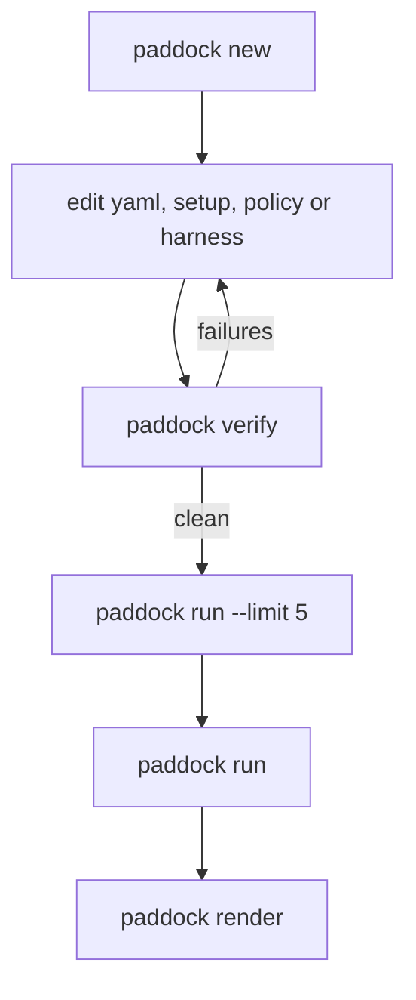

# Adding an adapter

The mechanics of adding a model or a benchmark, and the contract both have to
satisfy. Per-kind detail is in [adding-a-model.md](adding-a-model.md) and
[adding-a-benchmark.md](adding-a-benchmark.md); this page is the part they share.

```bash
paddock new model mymodel            # scaffold
paddock new benchmark mybench --dataset mydata
paddock setup --model mymodel        # clone its repo, build its environment
paddock verify --model mymodel       # check the contract
paddock verify --bench mybench
paddock verify --explain             # what every check is for
paddock run --model mymodel --bench mybench --limit 5
```

## The three steps



`paddock new` copies `_template/` and renames it consistently in the five places
that matter -- the directory, the class, the yaml `name`, the exported
`POLICY`/`BENCHMARK` symbol, and the test module's imports. A half-renamed
adapter is worse than none: `paddock list` shows the template's name, or two
adapters both claim to be `_template`.

**Creating the directory is the registration.** Discovery is a directory walk
(`paddock.registry` globs `*/model.yaml` and `*/benchmark.yaml`), so there is no
registry file to edit and none to forget.

## Why `paddock verify` exists

Every serious defect found in this repo so far has been a **silent contract
violation**, not a crash:

| defect | what it produced | what it looked like |
|---|---|---|
| comma2k19 passed `camera2ego = np.eye(4)` | a 90° rotated warp; 0.000 of the model's input came from real pixels | a completed run reporting ADE 38.8 m, read as a hardware generalisation gap |
| KITScenes reused the first scene's camera adapter | ~¼ of samples warped with the wrong mounting rotation | nothing |
| the closed-loop openpilot node sent `traffic_convention = [0, 1]`, the open-loop harness `[1, 0]` | the same model told it was driving on the other side of the road | two scores that were never comparable |

None of those is caught by "does it run". All of them are caught by
`paddock verify`. The checks are chosen from failures that actually happened,
and each failure prints a `why:` line naming the defect it exists for — so the
output is actionable rather than a wall of assertions.

`paddock.conformance.CHECKS` holds that provenance as data, so it cannot rot
into a comment nobody reads, and `tests/test_conformance.py` builds a
deliberately broken adapter per check and asserts the check fails. **A contract
checker that passes everything is worse than none**, so the checker itself is
tested against known-bad inputs.

## The two checks worth understanding

Most checks are shape and hygiene. Two are load-bearing.

**`benchmark.score_of_ground_truth`** scores the recorded future *against
itself*. A correct metric returns ~0. Anything else means the metric and the
ground truth disagree about a frame, a sign, or a time grid — and that error
then sits underneath every number the benchmark ever reports, applying equally
to every model so that no comparison reveals it. This is the check that catches
a left/right mix-up in a metric.

**`benchmark.score_of_a_stationary_plan`** scores an all-zero trajectory. It
must come out *unmistakably* bad. A benchmark whose metric set cannot tell
"predicted nothing" from "tracked the lane well" cannot support the conclusion
anyone will draw from it — which is exactly how comma2k19's ADE 38.8 m with
`lateral_mae` 0.96 m was misread. A zero plan has a *small* axis-aligned lateral
error, because it sits at the origin and a straight recorded path has little
lateral excursion.

## The contract

Run `paddock verify --explain` for the current list with rationales. In summary:

### A `Policy` must

- return a `Trajectory` with **at least 6 waypoints** — closed-loop engines
  index the first six positionally and raise `IndexError` on fewer;
- return finite values — a NaN waypoint propagates into the score as a silent
  NaN, not an error;
- **never return all zeros** — that is how a vehicle model is told to brake to a
  stop, and it scores as a deliberate emergency stop. Use
  `constant_velocity()` when the model has nothing to say;
- plan in the **ego frame: x forward, y LEFT**, metres, spaced by
  `waypoint_dt`, starting at `t = waypoint_dt` (no waypoint for the current
  position);
- clear all per-episode state in `reset()`, so the same input after a reset
  produces the same plan;
- answer `diagnostics()` before the first frame without raising — it is served
  over HTTP;
- read only the cameras it declares in `model.yaml`, because the simulator
  renders what is declared and rendering dominates closed-loop wall-clock.

### An open-loop `Benchmark` must

- return a list of human-readable strings from `preflight()`, so a sweep fails
  in seconds with a reason rather than an hour in with a traceback;
- yield **deterministic** samples — `--limit N` must select the same N at every
  site, or two people comparing smoke tests reach different conclusions;
- give every sample an id, at least one observation, and finite ground truth;
- supply `camera2image` **and** `camera2ego` per camera;
- produce every metric its `benchmark.yaml` declares, including
  `primary_metric` — a declared key that `score()` never returns is a blank
  leaderboard column forever;
- satisfy the two checks above.

## Coordinate frames — read this once

This is where the real bugs are.

| frame | axes |
|---|---|
| ego (what paddock exchanges) | x **forward**, y **left**, z up |
| camera | x right, y down, z **forward** |

So a camera with **no mounting rotation** is

```python
camera2ego[:3, :3] = [[0, 0, 1],
                      [-1, 0, 0],
                      [0, -1, 0]]
```

**`np.eye(4)` is not "no rotation".** It says "the camera's axes are the ego's
axes", which is a 90° error. `conformance.check_camera_mounting` rejects it by
name, and `conformance.synthetic_observation()` builds a correct one if you
would rather not write it out. `conformance.UNROTATED_CAMERA2EGO` is the matrix
above.

If your model predicts y **right** (openpilot does), negate on the way out —
once, in one place, with a comment.

## Reusable pieces — do not reimplement these

| you need | use |
|---|---|
| ADE / FDE / minADE | `paddock.metrics.trajectory` |
| along/cross-track split, lateral at matched arc length, path-length ratio | `paddock.metrics.openloop` |
| a structurally valid `Observation` for a test | `paddock.conformance.synthetic_observation()` |
| the correct `camera2ego` for an unrotated camera | `paddock.conformance.UNROTATED_CAMERA2EGO` |
| contract checks in your own test module | `paddock.conformance.policy_findings` / `benchmark_findings` |
| a fallback plan | `paddock.policy.protocol.constant_velocity` |

`paddock.metrics.openloop` exists because a plan is a **path plus a speed
profile** and the two fail independently; a single ADE cannot tell them apart,
and the axis-aligned split cannot either once the road curves. It was extracted
from the comma2k19 adapter so the next benchmark gets it for free. Read its
module docstring before defining a metric of your own.

## Testing

Every adapter ships a test module that runs in **paddock's own environment** —
no GPU, no dataset, no weights — because that is what a reviewer can execute on
a PR. The scaffold gives you one containing:

- `test_conformance` — the shared contract, equivalent to `paddock verify`;
- one or two explicit tests spelling the same properties out, for a reader;
- for a benchmark, golden numbers, so a refactor that changes them fails loudly
  instead of silently rewriting history.

Keep `test_conformance` and add adapter-specific tests beside it. Do not
re-write the generic checks by hand: when a new failure mode is discovered, it
gets added to `conformance` once and every adapter inherits the check.

Where a check needs the dataset, skip rather than fail when it is absent — see
the benchmark template's `_benchmark()` helper.

## A model's checks run in the model's own interpreter

`paddock verify --bench` runs in paddock's environment, because benchmark
adapters live there by design. `paddock verify --model` cannot: a model's
dependencies are in its own environment, which is the entire point of
`model.yaml`'s `runtime`. So it spawns that interpreter with a small driver —
the same resolution `paddock run` uses to start a policy node — and reports what
comes back. A model that verifies is therefore one that will actually launch.

The `pair` section (one real sample through the real policy, scored) only runs
when the model happens to be importable in paddock's environment too. When it
is not, `verify` says so and points at `paddock run --limit 1`, which starts the
model's own interpreter properly.
