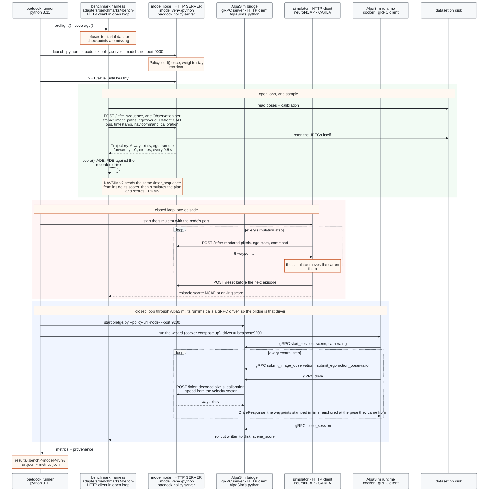

# Architecture

Two axes — models and benchmarks — meeting at one interface.

```
  Benchmark side: the CLIENTS                        Model side: the SERVER
  ───────────────────────────                        ──────────────────────
                                                     ┌──────── model node ────────┐
  open loop   kitscenes · nuscenes · navsim          │ HTTP server, one per       │
    harness ─── POST /infer_sequence ───────────────▶│ model, in the model's      │
                image paths, recorded past           │ own environment            │
                                                     │                            │
  closed loop neuroncap · bench2drive                │ Policy                     │
    simulator ─ POST /infer, every tick ────────────▶│  load() · reset()          │
                rendered pixels                      │  infer(obs) → trajectory   │
                                                     │                            │
  closed loop alpasim (speaks gRPC, not HTTP)        │ openpilot · alpamayo1.5    │
    runtime ─gRPC─▶ bridge ─ POST /infer ───────────▶│ drivejepa · visionpilot …  │
                       (gRPC server, HTTP client)    │                            │
                                                     └────────────────────────────┘

        results/<bench>/<model>/<run>/{run,metrics}.json    tracked, KB
        {runs}/<bench>/<model>/<run>/{samples.jsonl,...}    external, GB
```

**The model is the server; the benchmark side is the client.** Paddock starts
each model as an HTTP node that only ever answers. Whoever holds an observation
calls it: the harness in open loop, the simulator in closed loop. The node never
calls out and never learns which benchmark is driving it. AlpaSim is the one
simulator that cannot call HTTP, so a bridge stands between it and the node (see
[AlpaSim's gRPC bridge](#alpasims-grpc-bridge)).

---

## The Policy protocol

Three methods, defined in `paddock/policy/protocol.py`:

```python
class Policy(ABC):
    cameras: tuple[str, ...] = ("CAM_FRONT",)
    waypoint_dt: float = 0.5

    def load(self) -> None: ...
    def reset(self) -> None: ...
    def infer(self, obs: Observation) -> Trajectory: ...
```

`Observation` carries one timestep: images per camera, `ego2world`, an 18-float
nuScenes-layout CAN bus vector, timestamp, a navigation command, and calibration.
`Trajectory` is a plan in the ego frame — x forward, y **left**, metres — evenly
spaced by `waypoint_dt` starting at `t = waypoint_dt`.

### Why one protocol for both loop types

The same `Policy`, wrapped in an HTTP node by `policy/server.py`, serves both:
open-loop harnesses post recorded frames to it, and closed-loop simulators post
rendered ones. There is no second, in-process path for open loop.

This is not tidiness. Before paddock, each model had *two* implementations of its
camera handling — one in its open-loop eval script and one in its simulator
node — and they diverged. In one case the two paths cropped the image
differently, which means an ADE and an NCAP score for that model were statements
about two slightly different systems. One `Policy` per model, owning its warp
once, is what makes cross-benchmark comparison mean anything.

### The wire contract

The node (`policy/server.py`) is the **server**; everything else is a
**client** of it. `/alive`, `/infer` and `/reset` were ported unchanged from the
NeuroNCAP model nodes; the rest were added for open loop and for provenance.

| Endpoint | Called by | What it does |
|---|---|---|
| `GET /alive` | the runner, after launch | health check |
| `GET /whoami` | the runner, after launch | names the model and this launch's nonce, so a run never scores a sibling's node on the same port |
| `POST /infer` | closed-loop simulators; AlpaSim's bridge | one `Observation` (one timestamp) in, one `Trajectory` out |
| `POST /infer_sequence` | open-loop harnesses; NAVSIM's scorer | a list of `Observation`s, oldest first; the model takes in all but the last and plans on the last |
| `POST /reset` | the simulator, before each episode | clears the model's history between episodes |
| `GET /diagnostics` | the runner, at the end of a run | what the loaded policy says it is, for `run.json` provenance |

One `/infer` carries one moment: one timestamp and at most one frame per camera.
A model that needs past frames gets them either from its own buffer (closed loop:
the node remembers what it was sent) or from `/infer_sequence` (open loop: the
harness sends the recorded past).

Two details that look like off-by-ones and are not:

- **Six waypoints is exact, not a floor.** NeuroNCAP builds six waypoint
  timestamps per step and indexes them positionally; a seventh is dropped, a
  fifth raises `IndexError`.
- **An all-zero trajectory is a commanded emergency stop**, not "no plan". A
  model that has not warmed up must return `constant_velocity(obs.speed)`.
  Returning zeros scores as a deliberate brake, which for a collision-avoidance
  benchmark looks like a *good* result for the wrong reason.

`Observation.from_wire` decodes images that arrive as base64
`torch.save`d uint8 tensors. It includes a torch-free reader, because openpilot's
environment runs tinygrad and has no torch at all — installing torch there just
to unpickle an image would be absurd, and would change what is being evaluated.

### On the wire

Paddock is one Python 3.11 process. It never imports a model. It launches the
model's `Policy` as a node in the model's own interpreter, with paddock's
`src/` on `PYTHONPATH` rather than installed, and everything after that is
HTTP on localhost. Open-loop harnesses send image *paths*, not pixels, because
the node reads the same disk: one KITScenes frame is 24 MB and a full run would
otherwise push 348 GB through a socket. Closed-loop simulators have no file to
point at, so they send rendered pixels per step.



### AlpaSim's gRPC bridge

Every other simulator can be pointed at the node's URL and calls `/infer`
itself. AlpaSim cannot: its runtime calls a **driver over gRPC**
(`EgodriverService`) and expects that driver to be a gRPC server. So
`adapters/benchmarks/alpasim/bridge.py` is that server, and inside it an HTTP
client of the model node:

```
AlpaSim runtime ──gRPC call──▶ bridge.py ──HTTP POST /infer──▶ model node
 (gRPC client)                (gRPC server │ HTTP client)       (HTTP server)
```

It runs as an ordinary host process under AlpaSim's own interpreter (it needs
`grpc` and `alpasim_grpc`); only the simulator services are Docker containers,
on the host network, which is how the runtime reaches the bridge on `localhost`.
`launcher.py` tells the wizard not to start a driver of its own and to call the
bridge instead (`wizard.external_services.driver=[localhost:<port>]`).

The bridge does more than change protocol, because AlpaSim does not send one
complete observation. It pushes the pieces as separate calls (the session's
camera rig, each frame, each pose) and then asks for a plan. The bridge:

- keeps that state per session and assembles it into one `/infer` body when
  `drive` is called;
- decodes the frames, which arrive as encoded bytes;
- computes speed as the magnitude of the velocity vector, since the wire
  carries no scalar speed;
- stamps the returned waypoints in time, `waypoint_dt` apart, anchored at the
  timestamp of the pose the plan was built from;
- fails the rollout loudly if the node does not answer, instead of driving on a
  plan of its own.

There is one bridge for every model. Model-specific work (cropping, history
spacing, which cameras to read) stays in each model's adapter, as it does for
every other benchmark. What the bridge does not do yet is listed in its own
docstring: frames are not rectified for lens distortion, and camera ids and
poses are passed in AlpaSim's own convention, so a model that reads images is not
yet fed what AlpaSim's native drivers feed it.

## Open loop vs closed loop

| | Open loop | Closed loop |
|---|---|---|
| Who decides what happens next | the dataset | the model |
| Errors | do not compound | compound — the point |
| Cost | cheap, parallel | expensive, serial |
| Measures | imitation of a recorded expert | whether it can actually drive |
| Examples | KITScenes, nuScenes, NAVSIM | neuroNCAP, Bench2Drive, AlpaSim |

Both matter, and neither substitutes for the other. Open-loop metrics are
dominated by ego status — a model that just continues the current motion scores
respectably — so a good ADE is weak evidence of competence. Closed-loop is where
a policy has to recover from its own mistakes, but it is orders of magnitude more
expensive and has far higher variance, so it cannot be the fast feedback signal.

The `Benchmark` base classes in `paddock/benchmark.py` reflect this split:
`OpenLoopBenchmark` implements `samples()` and `score()`; `ClosedLoopBenchmark`
implements `episodes()` and `run_episode()`. Both implement `preflight()`.

## Process and GPU model

Every model runs in its **own** interpreter, in its own environment, as a
subprocess. Five Python versions across three managers are in play — this is what
evaluating four independent research codebases costs, and the registry makes it
declarative rather than tribal.

Paddock owns model processes; benchmarks own simulators (and, for AlpaSim, the
bridge in front of it). For closed loop:

1. `runtime/gpu.py` waits for the VRAM the model declares, rather than failing
   eight minutes into a checkpoint read with a CUDA OOM traceback that says
   nothing about the real cause (someone else has the card).
2. `runtime/proc.py` starts the node with the env built by `runtime/env.py`,
   polls `/alive` until it answers, runs every scenario, then tears it down and
   waits for the driver to reclaim the memory.
3. The next model starts only then. With `gpu.serialize = true` exactly one model
   is resident at a time. The simulator's renderer stays up throughout: it is
   model-independent and expensive to start.

Every model sees identical episodes and identical seeds, derived from the run
index. The comparison is paired, not merely averaged — which is worth far more
and costs nothing if planned for.

## Configuration

Covered in [site-setup.md](site-setup.md); the short version is that tracked
files declare what a thing is and `paddock.toml` declares where it lives.
`config.py` expands the template variables; `tests/test_portability.py` fails the
build if a real machine path reaches a tracked file.

## Where does a file belong?

One question settles it:

> **Does this need to know which model produced the result?**

If no, it belongs to the benchmark or the shared layer. Three tiers:

| Tier | Knows about | Examples |
|---|---|---|
| `paddock/viz/` | neither models nor benchmarks | BEV drawing, the model colour palette, contact sheets |
| `adapters/benchmarks/<b>/render.py` | this benchmark's ground truth and what a comparison means; takes runs from **any** models | KITScenes error distribution and worst-disagreement grid |
| `adapters/models/<m>/` | this model's internals only | openpilot's field-of-view margin, VisionPilot's planner trace |

**Rendering is benchmark-scoped, not model-scoped**, because debugging means
putting several models side by side on one benchmark. A model cannot draw that
comparison: it does not know about its rivals, and should not.

Before paddock this was inverted. A three-way KITScenes plot lived under
openpilot, a trajectory plot under Drive-JEPA, a per-sample sheet under
Drive-JEPA again -- each able to draw only the model it sat beside, and each
re-deriving the same axes. `tools/` now mirrors the same split:

```
tools/benchmarks/<b>/   harness checks and one-off figures for that benchmark
tools/models/<m>/       probes into that model's internals
```

### The colour rule

`paddock/viz/palette.py` assigns a colour per **model name**, fixed once.
Debugging produces several figures at a time; if colour came from position in
whatever list a script built, a model would change colour between figures and
the reader would have to re-check the legend each time -- or not notice.

This is easy to break by accident. Folding a metric into a dict key
(`"openpilot 2.84 m"`) makes the colour a function of the number, and the same
model comes out a different colour in every panel. Pass legend text separately;
`bev.draw` takes `labels=` for exactly this reason.

## Module map

| Module | Responsibility |
|---|---|
| `config.py` | site config, template expansion |
| `registry.py` | load repos / datasets / models / benchmarks; adapters are discovered, not listed |
| `doctor.py` | readiness reporting |
| `policy/protocol.py` | `Policy`, `Observation`, `Trajectory`, the wire codec |
| `policy/server.py` | wrap any `Policy` into an HTTP node |
| `benchmark.py` | `OpenLoopBenchmark`, `ClosedLoopBenchmark`, `Sample`, `Episode` |
| `runtime/env.py` | per-model environment construction |
| `runtime/proc.py` | launch, health-check, tear down model nodes |
| `runtime/gpu.py` | VRAM gating |
| `metrics/` | trajectory (ADE/FDE), ncap, pdms |
| `results/` | canonical store, ingest of legacy formats, reporting |
| `adapters/models/<n>/` | one model |
| `adapters/benchmarks/<n>/` | one benchmark: `harness.py` to run it, optional `render.py` to compare models on it |
| `viz/` | drawing primitives shared by every benchmark |
| `render.py` | loads runs and dispatches to a benchmark's renderer |
