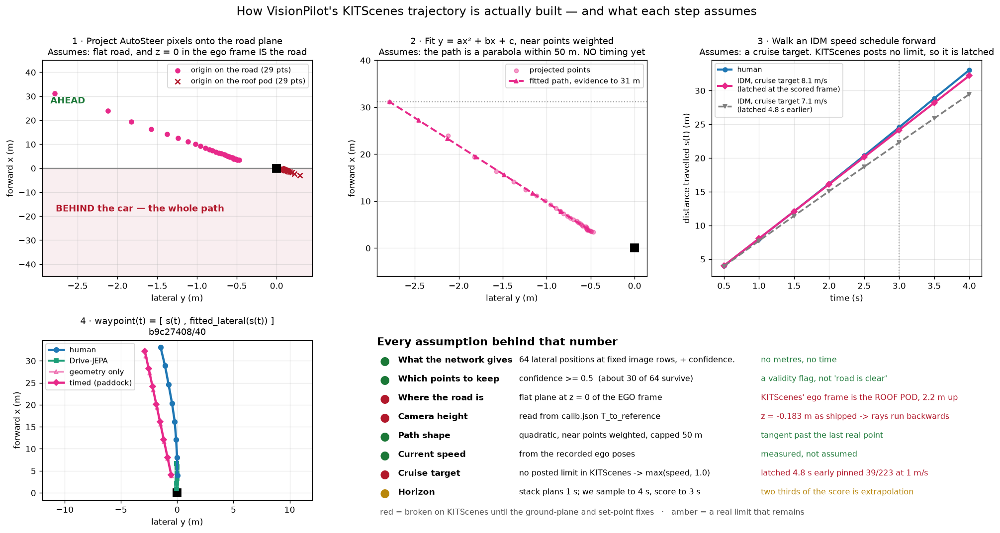
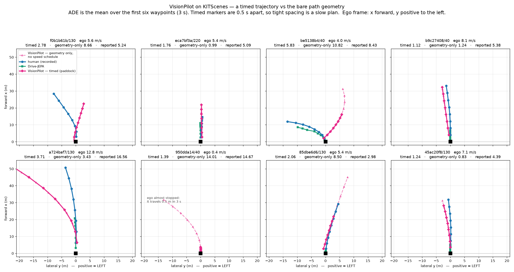

# KITScenes

Open-loop trajectory accuracy: ADE and FDE against the recorded future, over a
fixed set of 223 keyframes.

```bash
paddock run --bench kitscenes --model openpilot --limit 5   # smoke
paddock run --bench kitscenes --model openpilot             # full n=223
```

## The sample list is the benchmark

All models are scored on one shared keyframe list, configured per site:

```toml
[benchmarks.kitscenes]
sample_list = "/path/to/kitscenes_e2e_final.pkl"
```

Benchmark-level, not model-level, deliberately: two models scored on different
keyframes are not comparable however close the counts look. `paddock run
--dry-run` reports how many of the list this site's tiers can serve, and
`samples()` refuses to run a partial set rather than silently scoring fewer.

That file is not a hand-written list. It is the output of the Drive-JEPA run
that went first, kept because whichever 223 keyframes it happened to score
became the set every later model had to match. Reading it as a sample list uses
`scene_id`, `keyframe_index` and `split` and ignores the predictions sitting
beside them; `paddock ingest` reads the same file for the predictions, which is
how Drive-JEPA has a row on this benchmark without a paddock run.

### The four rows, and where each came from

| model | run | n | ADE | source |
|---|---|---:|---:|---|
| alpamayo15 | `legacy-full-nonav` | 223 | 0.921 | `eval_kitscenes/runs/full` |
| visionpilot | `20260909T202724-153b04` | 223 | 1.534 | a paddock run; see below |
| openpilot | `legacy-full223` | 223 | 1.599 | `eval_kitscenes/runs/full223` |
| drivejepa | `legacy-kitscenes_e2e_final` | 223 | 2.364 | `inference/kitscenes_e2e_final.pkl` |

All four carry `sequences_sha256: 80665529bea7f500` — the same 223 keyframes,
so the column compares. Caveats the hash cannot express:

- **Route hint.** Drive-JEPA was run with `--command gt`, which derives a turn
  command from the recorded future on 39 of the 223 samples; openpilot and
  VisionPilot have no such input, and Alpamayo's equivalent is its `nav` arm.
  Recorded as `command_source` in that run's `config`.
- **Domain.** The checkpoint is trained on nuPlan/OpenScene — US cities, a
  windshield rig — and KITScenes is European driving from a roof pod. Its rank
  here is a zero-shot transfer result, which is why it sits last on this
  benchmark and first on NAVSIM. `adapters/benchmarks/navsim/run_kitscenes_inference.py`
  sets out what the adapter can and cannot reconcile.

Nearly all of Drive-JEPA's error is longitudinal (2.317 m against 0.209 m
lateral, an 11:1 split, from the original report, which decomposed it against
Alpamayo only): it steers better than Alpamayo and predicts speed far worse,
so its last place here is a speed result rather than a path one.
## VisionPilot has no trajectory of its own

VisionPilot is an L2 assist stack. Its three networks return a path drawn in
*image* space, a distance to the closest in-path object, and boxes tagged with a
threat class. No metres, no timing. The adapter builds the trajectory by porting
the stack's own planner: project the AutoSteer points onto the road, fit a
curve, then walk an IDM speed schedule along it. So an ADE here scores
perception, projection, the curve fit, the speed assumption and extrapolation
together, and it is not comparable in kind with a model that emits a timed
trajectory directly.

Two things about this dataset broke that pipeline, and both are worth knowing
before reading the number.

**The ego frame is not on the road.** KITScenes calibrates every sensor against
`base_frame`, which is the roof pod. The front ring camera sits at z = -0.183 m
in it. Ground projection assumes z = 0 *is* the road -- true for neuroNCAP,
which zeroes the ego pose's z, and for CARLA, which mounts the camera 1.5 m up.
A negative camera height flips the sign of the ray-plane scale, so every
projected point lands *behind* the car: measured on the first three samples, 0
of 32, 0 of 29 and 0 of 28 AutoSteer points came out ahead of the ego, and since
the furthest sat at -0.09 m every waypoint fell past the fitted extent and came
from the straight-line tangent rule. The lateral path was a perfectly straight
line, identical step to step to seven decimals.

`ground_offset_m` (default 2.2, `POD_HEIGHT_M`) raises the origin to the road.
The same points then span 25-46 m ahead. Only the translation moves, so a model
reading just the rotation is untouched -- openpilot's three-sample ADE is
1.591566 against its recorded 1.591566, unchanged.

**The cruise set-speed was latched 4.8 s early.** KITScenes supplies no posted
limit, so VisionPilot falls back to `max(speed, 1.0)` at the first frame it is
shown -- which `infer_sequence` makes the *start of the history*, not the frame
being scored. That pinned 39 of 223 samples to a 1 m/s crawl while the ego was
moving. `observe()` now warms the filters without fixing the set-point, moving
the latch to the scored frame; 12 samples remain at the floor, and those are
cars genuinely stopped at the keyframe. This uses the speed the car has at
prediction time, not the recorded future -- the driver's speed changes 1.36 m/s
on average over the scored 3 s, so it stays a prediction.

Together these took the three-sample ADE from 5.486 to 1.996.



The left panel is the whole roof-pod story in one picture: the same 29 AutoSteer
points, projected twice. With the origin on the road they span 3-31 m ahead;
with the origin where KITScenes puts it, all 29 land behind the car.



The second figure is worth keeping for a different reason. It separates the
timed trajectory from the *bare path geometry* -- the fitted curve with no speed
schedule -- because those are easy to confuse and score very differently. The
clearest case is `950dda14`, where the ego is doing 0.4 m/s and travels 0.1 m in
3 s: the timed plan barely moves and scores 1.39, while the geometry alone runs
31 m out and scores 14.01. A path with no clock cannot know the car is stopped.

Both are drawn by `tools/benchmarks/kitscenes/visionpilot_figures.py` from a
stage dump written by `visionpilot_stages.py`, which records the pod-origin and
stale-set-point variants alongside the merged behaviour so the comparison can be
redrawn without arguing from memory.

## Samples are sequences

Each sample is 48 preceding source frames plus the keyframe, not a single image.
The models need real history — openpilot fills a 24-deep feature buffer, Alpamayo
differences 16 ego poses to derive its speed — and handing them one frame would
measure a model working from a history it invented.

`Policy.infer_sequence` feeds the sequence and scores the last frame, disabling
self-priming for its duration. A model that primes *and* receives real history
sees a manufactured past followed by a real one.

## Camera adaptation

openpilot's ModelState compiles its warp for fixed geometries, so a source must
become 1928x1208 exactly. Which way depends on the source's aspect, and the
adapter derives it rather than hardcoding one:

| source | aspect | strategy | why |
|---|---:|---|---|
| KITScenes 3504x2272 | 1.542 | **crop** | taller than the target, so trimming height costs no horizontal field of view |
| nuScenes render 1600x900 | 1.778 | **letterbox** | wider, so cropping would trim width — and hFOV is scarce, the wide model view wants 58.7 deg of about 64 available |

Before paddock these were two separate classes, one per loop type, each
hardcoding one strategy — which is why the open-loop path could not run a
nuScenes frame and the closed-loop path could not run a KITScenes one.

## Reproduction status

Verified against the recorded `runs/full223` results, same keyframes:

| scene / keyframe | paddock ADE | recorded ADE |
|---|---:|---:|
| 00fc1b9b / 40 | 1.0783930800368695 | 1.0783930800368695 |
| 02be7d74 / 40 | 0.8611… | identical |
| 03ed2585 / 40 | 2.8353… | identical |

The **full n=223 run reproduces every metric exactly**:

| metric | exact / 223 | paddock | recorded |
|---|---:|---:|---:|
| ade | **223/223** | 1.599424 | 1.599424 |
| fde@1s | **223/223** | 0.836421 | 0.836421 |
| fde@2s | **223/223** | 1.808482 | 1.808482 |
| fde@3s | **223/223** | 2.893613 | 2.893613 |

892 of 892 metric comparisons identical at full float precision; ADE median
1.322747 against 1.322747. Roughly 85 minutes on this hardware.


## A bug worth knowing about

Reproducing the full n=223 found something a three-sample check could not: the
openpilot adapter cached its `CameraAdapter` across samples. It is built from
the first frame's calibration, and `reset()` did not clear it, so every scene
after the first was warped with the **first scene's mounting rotation**.

KITScenes rigs are recalibrated between sessions. Across 60 `val` scenes there
are three distinct front-camera rotations, up to 1 degree apart — so roughly a
quarter of samples were fed a subtly wrong view. Intrinsics are identical
throughout, which is why this survived the obvious checks.

What made it hard to see:

- **Nothing failed.** A degree of rotation shifts the warp; it does not raise.
- **The three samples used for the initial check all shared one rotation
  group**, so they matched bit-for-bit and looked like proof.
- The error only showed as a slowly growing gap in the running mean
  (+0.021 at 25 samples, +0.067 at 100), which is easy to attribute to noise.

The lesson generalises past this adapter: **anything derived from calibration is
episode state.** If a model caches it, `reset()` must clear it, and a test should
say so. `tests/test_policy.py::test_reset_clears_the_camera_adapter` does.
