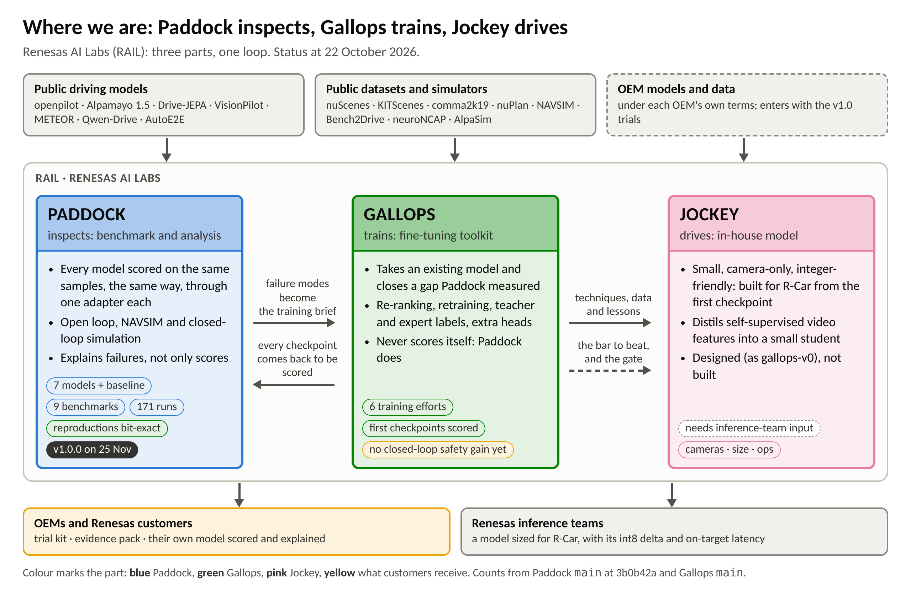

# 1 · Where we are

*Level 1, strategy. Answers: what is RAIL building, and how far has each part got?
Up: [executive plan](../plan-v1.0.0.md) · Next: [2 · What a score says](02-what-a-score-says.md)*

**The point**
- All of this work sits under **Renesas AI Labs (RAIL)**. It has three parts that make
  one loop:
  - **Paddock** measures models and explains their failures.
  - **Gallops** trains models to close the gaps Paddock finds.
  - **Jockey** is the model we intend to put in a car.
- **Paddock is ready to release** (v1.0.0 on 25 November).
- **Gallops has proven the loop,** but has no closed-loop safety gain yet.
- **Jockey is a design** waiting on the inference team's constraints.

The names follow one metaphor:
- A **paddock** is where a racehorse is paraded and judged before a race.
- The **gallops** is where it is trained.
- The **jockey** rides it in the race.

"Jockey" is a proposed name for the in-house model. Alternatives are listed among the
[decisions](08-release-v1.0.0.md#decisions-for-leadership).

---

## Paddock: the benchmark and analysis framework

**What it does**
- **Apples to apples.** Every model implements one interface: `load`, `reset`, and
  `infer` from an observation to a trajectory. It runs in its own environment, behind
  a small local web service.
  - Every benchmark is an adapter that calls that service.
  - So each model is scored on the same samples, with the same metrics. Results land in
    one format that records how each run was made.
- **Three kinds of test** (see the [glossary](../3-reference/glossary.md)):
  - *open loop* replays a recording and compares the plan with what the driver did;
  - *NAVSIM* simulates the plan for four seconds against recorded traffic;
  - *closed loop* lets the model's plan drive the car in a simulator.
- **More than a score.** Renders, scene sweeps, per-model diagnostics and a regression
  gate say *why* a model fails and whether a change helped
  ([5 · Outcomes](05-outcomes.md)).

**Status on `main`, 22 October**

| | Today |
|---|---|
| Models | 7 driving models plus a constant-velocity baseline (10 adapters, counting variants) |
| Benchmarks | 9: four open loop, two NAVSIM versions, three closed loop |
| Results | 171 run records: 112 valid, 59 excluded, each with its reason |
| Trust | Earlier evaluations reproduced bit for bit: 892/892 KITScenes and 2,379/2,379 NAVSIM metric comparisons |
| Engineering | about 1,600 tests on every pull request, no GPU needed; a gate that bans machine-specific paths |
| Version | 0.1.0, never released |

**What it cannot do yet.** These are the gaps v1.0.0 has to close or disclose
([8 · Release](08-release-v1.0.0.md)):
- **Setup is by hand.** `paddock setup` prints "not implemented". There are no
  containers. Nine model environments span three environment managers and Python 3.9 to
  3.12.
- **Customer IP has no home.** A model's adapter must live inside this repository, and
  results are written into its tracked tree. A customer's model would have to be
  committed beside ours.
- **It runs on one host only.**
- **Analysis is uneven.** Failure analysis is deep for openpilot and thin for the rest.
  Cross-model renders exist for 5 of the 9 benchmarks.

## Gallops: the fine-tuning toolkit

**What it does**
- Takes an existing model and trains part of it to close a gap that Paddock measured.
- Paddock then scores the result like any other model.
- **Neither repository imports the other.** They meet at a checkpoint directory. Its
  sidecar records the model, step, commit and training data, so overlap between
  training and test data stays visible.

**Six training efforts so far.** All start from the released Drive-JEPA with its image
encoder frozen:
- a re-ranker that picks among the model's own 32 candidate plans;
- two Bench2Drive retrains;
- a retrain on NVIDIA's Physical AI AV data;
- a swerve fine-tune (11 runs);
- a scorer trained on cached features.

Four more are open as pull requests:
- expert imitation;
- a privileged teacher;
- scene selection;
- extra prediction heads.

**Status**
- **Proven:** the loop runs end to end. Train, write a checkpoint, load it through a
  Paddock adapter, get a row in the same table.
- **Strongest result:** the re-ranker, open loop, KITScenes ADE 2.521 → 0.973 m.
- **Not yet:** no closed-loop safety gain shown on scenes that were not used to choose
  the model. The same re-ranker does *worse* in closed loop (1.85 against 3.01 on nine
  neuroNCAP episodes). [6 · Pathway to Gallops](06-pathway-to-gallops.md) has the full
  picture.

**Gaps**
- There is no CI.
- Training data is the binding constraint. Only nuScenes is held in full, and NAVSIM's
  training split is absent.
- A training-and-evaluation round takes about 6.5 hours.

## Jockey: the in-house model

**What it is**
- RAIL's own driving model: small, camera-only and integer-friendly, built for R-Car
  from its first checkpoint.
- Gallops' design document calls its first version `gallops-v0`.

**Why build our own:**
- No candidate we have measured is all four of these:
  - commercially licensed;
  - small enough for an SoC;
  - safe in closed loop;
  - retrainable with released training code.
- [7 · Jockey](07-jockey.md) has each candidate's pros and cons.

**Status: designed, not built.** It waits on three things:
1. **The inference team's constraints:** cameras, size, supported operations,
   toolchain.
2. **Training data we may use commercially.**
3. **A baseline registered in Paddock** to select against.

## Activity, and what is landing next

**Activity**
- Since 1 September: 71 Paddock pull requests merged (46 in September, 25 in October)
  and 13 in Gallops, from six contributors across Fastcode and Renesas.
- **Open now:** 14 in Paddock, 4 in Gallops.
- **None is approved yet:** five conflict with their base branch, and one fails CI.
  Review, not code, is the release's critical path.

| Theme | Open PRs | What they add |
|---|---|---|
| Regression gate | #100, #102 | Bench2Drive crashes isolated; every verdict states the smallest difference it could detect; NAVSIM's safety and comfort terms beside each score |
| Closed-loop pairings | #92, #96 | AutoE2E on neuroNCAP (3.93, re-run requested) and on Bench2Drive (in progress) |
| Failure analysis | #79, #76, #86 | openpilot on all 220 Bench2Drive routes: driving score 32.88 → 42.75 with two opt-in settings. Alpamayo decision and reasoning tools |
| Model improvements | #57, #90, #91, #95 | VisionPilot synced to upstream, plus a scenario classifier; Drive-JEPA's momentum-aware selection on by default |
| Framework | #87 | a privileged ground-truth channel, used to train teachers in Gallops |
| New model | #83 | an adapter for WA-JEPA (smoke test only) |
| Sim-to-real | #53 | how far each model's plan moves when only the pixels change |

Which of these land before v1.0.0, and which wait, is proposed in
[open work](../3-reference/open-work.md).

---

## Sources

**Verified** (read at the source on 22 October):
- Counts of models, benchmarks and results:
  - `README.md` support matrix;
  - the header of `docs/leaderboard.md` (112 valid, 59 excluded);
  - the adapter directories under `src/paddock/adapters/`.
- Reproductions: `docs/ROADMAP.md`, rows M6 and M7.
- `paddock setup` is a stub: `src/paddock/cli.py`.
- Test count: `make check` on this branch.
- Gallops' six efforts and their status: Gallops `README.md`, "Training so far".
- `gallops-v0`: Gallops `docs/architecture.md`.
- Pull requests, merges and their numbers: GitHub, 22 October. The PR claims above were
  checked against each PR's own description.

**Argued:**
- That Paddock is ready to release, and that review is the critical path.
- The name "Jockey".
