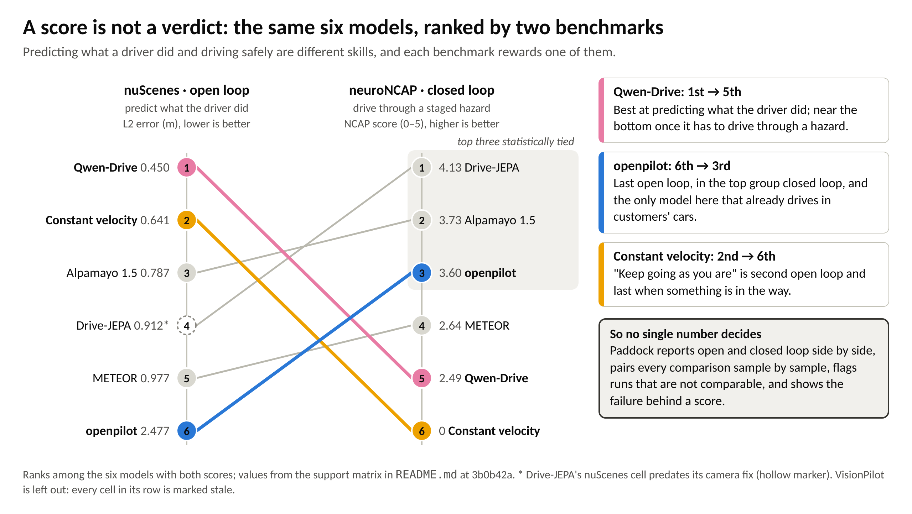

# 2 · What a score says, and what it does not

*Level 1, strategy. Answers: can a benchmark number tell us whether a model is good?
Up: [executive plan](../plan-v1.0.0.md) · Previous: [1 · Where we are](01-where-we-are.md) ·
Next: [3 · What customers ask](03-customer-questions.md)*

**The point**
- **Every benchmark measures a slice of driving.**
  - A high score does not mean a model drives well, and a low one does not mean it
    cannot.
  - Models that already drive in the world score low on some boards. Research models
    that have never left a simulator top others.
- **This is the main risk to how our results are read,** by leadership and by
  customers.
- **Paddock's answer is to never rank on one number:**
  - several benchmarks side by side;
  - comparisons paired sample by sample;
  - runs that are not comparable marked as such;
  - the failure behind every score shown.

---

## The evidence: how a score misleads

Every row below is a measurement already in the repository.

| What goes wrong | Example from our own results |
|---|---|
| **Open loop rewards predicting the log, not driving** | Qwen-Drive has the best nuScenes error of any model (0.450 m), but is 5th of 6 on neuroNCAP (2.49). nuScenes never contains the collision that neuroNCAP stages. |
| **A model that ships can rank last** | openpilot is last on nuScenes (2.477 m). It is in neuroNCAP's top group (3.60, statistically tied with the leaders) and the best released model on 30 AlpaSim scenes (0.7726). |
| **Doing nothing clever scores well** | Constant velocity beats most learned models on nuScenes (0.641 m). On Bench2Drive, a plan that drives straight at a fixed 3 m/s scores 47.94 of 100, more than openpilot or Qwen-Drive as recorded there. On neuroNCAP an all-zero plan reads as an emergency stop. |
| **A blind model can still score** | Drive-JEPA's adapter once landed 0% of its image samples inside the camera frame, so a black frame gave the same plan. It still scored 3.57 on neuroNCAP. Fixed, it scores 4.13. |
| **The benchmark itself can be wrong** | comma2k19's ground truth sat in the camera frame and the plans in the car frame, about 2° apart. Corrected, openpilot goes 1.507 → 0.858 and Qwen-Drive 1.159 → 0.602, and the board reorders. |
| **One number hides what failed** | 64% of openpilot's KITScenes error is the speed it starts from. Drive-JEPA's error there is 11:1 longitudinal to lateral, so its last place is about speed, not steering. |
| **Noise looks like a result** | Five neuroNCAP runs of Alpamayo on one scenario span 0.0 to 5.0 (sd 1.817). Telling it from openpilot to ±0.25 would take about 200 runs. One AlpaSim scene scored 0.0, 0.9148 and 1.0 in identical environments. |
| **The harness moves scores more than the model** | AlpaSim's constant-velocity floor went 0.356 → 0.741 → 0.885 across three versions of its driver: a spread wider than the gap between most models. |
| **Training data can overlap the test** | NAVSIM's leaders, Drive-JEPA and Qwen-Drive, both trained on NAVSIM's own training split. |

## Deployed in the world, or in progress

Deployment maturity and benchmark rank are different axes.

| Model | In the world today | What the benchmarks say |
|---|---|---|
| openpilot | Ships to drivers on comma's devices; comma trains it on its fleet | Last open loop on nuScenes; top group closed loop; best released model on AlpaSim |
| VisionPilot | Open driver-assistance software (lane keeping, following distance) from one camera; runs on ONNX Runtime, on a CPU | Last on neuroNCAP (1.58); its whole row is stale, owed a re-run |
| Alpamayo 1.5 | NVIDIA research; weights non-commercial | Best open loop on comma2k19, but 10 B parameters, 26 GB of GPU memory, and very noisy run to run |
| Drive-JEPA | Academic research | Best on NAVSIM and neuroNCAP once it could see; picks about the 15th best of its own 32 plans |
| Qwen-Drive | Research, released September 2026 | Best on nuScenes and KITScenes; 5th of 6 on neuroNCAP |

So a score is **evidence about one skill, measured one way**, not a verdict on a model.
That holds for the models we evaluate, for Gallops' fine-tunes, and for Jockey when it
exists.

## How Paddock keeps scores honest

**What is in place**
- **Several benchmarks of each kind,** reported side by side. The support matrix marks
  every cell that was adapted (A), run through a pipeline built around the model (P),
  is stale (S), or was run differently (R).
- **Validity is decided in one place.** A run that used a subset, changed its inputs or
  failed is stored as `valid: false` with the reason. The report never averages it in.
- **Paired comparison.** The regression gate compares two runs sample by sample. It
  clusters the error on the benchmark's independent unit (scene, log, route), and
  reports ship, hold or fail. Open PR #100 adds the smallest difference each verdict
  could have detected, so "no change" is never mistaken for "equal".
- **Failure analysis before conclusions** ([5 · Outcomes](05-outcomes.md)).

**What v1.0.0 adds** ([8 · Release](08-release-v1.0.0.md)):
- a certification run that reproduces reference numbers on a clean install;
- an evidence pack with no stale cells.

**What we still owe**
- **A power analysis** of which benchmark can detect which size of effect. Gallops'
  strategy calls it the gate for training.
- **Re-runs of the stale cells.**
- **Parity of our nuScenes scorer** with the published UniAD and VAD scorers.

## How to read a Paddock number

1. **Ask which kind of test it is.** Open loop measures prediction. Closed loop measures
   driving.
2. **Ask how many samples, and how many runs.** One closed-loop run per scene is one
   draw.
3. **Ask whether the cell carries a mark,** and whether the run is valid.
4. **Ask what it is paired against.** A difference smaller than the gate's detectable
   difference is "no evidence either way", not "the same".

## The data behind the figure

Ranks are among the six models with both scores. VisionPilot is left out because every
cell in its row is marked stale.

| Model | nuScenes L2 (m) ↓ | Rank | neuroNCAP (0–5) ↑ | Rank |
|---|---:|---:|---:|---:|
| Qwen-Drive 1.0 | 0.450 | 1 | 2.49 | 5 |
| Constant velocity | 0.641 | 2 | 0 | 6 |
| Alpamayo 1.5 | 0.787 | 3 | 3.73 | 2 |
| Drive-JEPA | 0.912 (before its camera fix) | 4 | 4.13 | 1 |
| METEOR | 0.977 | 5 | 2.64 | 4 |
| openpilot | 2.477 | 6 | 3.60 | 3 |

neuroNCAP's top three cannot be separated over its 20 scenario pairs.

The release's other risks are in [8 · Release](08-release-v1.0.0.md#risks): licences,
the date, review capacity, reproducing results across sites, and the security of a
hosted trial.

---

## Sources

**Verified** (read at the source on 22 October):
- All matrix values: `README.md` support matrix.
- neuroNCAP:
  - top three tied: `docs/benchmarks/neuroncap.md`, "statistically indistinguishable";
  - Alpamayo's spread and the ~200 runs: the same file;
  - an all-zero plan reads as a stop: the same file.
- Qwen-Drive open loop vs closed loop: `docs/benchmarks/nuscenes.md`.
- Bench2Drive's 3 m/s straight plan, 47.94 over the 24 historical routes:
  `docs/benchmarks/bench2drive.md`.
- Drive-JEPA camera-blind (0.0% of samples in frame): `docs/ROADMAP.md`. Its 4.13 after
  the fix: `docs/leaderboard.md`.
- comma2k19 ground-truth frame: `docs/ROADMAP.md`, M8.
- The 64% start-speed share:
  `tools/models/openpilot/analysis/openpilot_drv_supcombo_kitscenes_four_questions.md`.
- The 11:1 split: `docs/benchmarks/kitscenes.md`.
- AlpaSim's floor and the 0.0 / 0.9148 / 1.0 scene: `docs/benchmarks/alpasim.md`.
- Training-data overlap: `docs/models/comparison.md`.
- openpilot's hardware and fleet: `docs/models/openpilot-guide.md`,
  `docs/models/comparison.md`.
- VisionPilot: `docs/models/VISION_PILOT_GUIDE.md` §1. Qwen-Drive's release:
  `docs/models/qwendrive.md`.
- The power-analysis gap: Gallops `docs/STRATEGY.md` §6.

**Argued:**
- That this is the main risk to how results are read.
- The reading guide.
