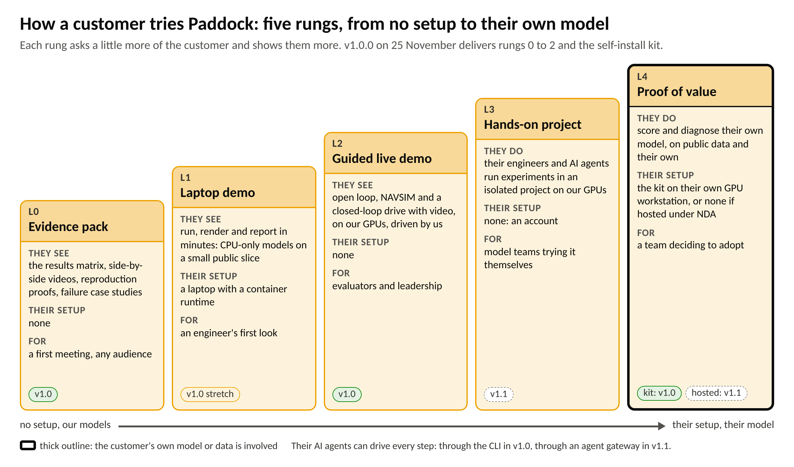

# 3 · What customers ask

*Level 1, strategy. Answers: why would an OEM or a Renesas customer need Paddock, how
easy is it to use, and how do they try it for themselves?
Up: [executive plan](../plan-v1.0.0.md) · Previous: [2 · What a score says](02-what-a-score-says.md) ·
Next: [4 · Using Paddock](04-using-paddock.md)*

**The point**
- **Why.** Every driving model is published against its own benchmark, protocol and
  caveats, so a team choosing or building one cannot compare them. Paddock gives
  comparable, trustworthy numbers and explains failures. Next it will report what a
  model costs on Renesas silicon.
- **How easy.** Today it takes an expert days. v1.0.0's target is install to first
  certified run in **under a working day**, on a GPU workstation, by someone outside our
  team.
- **How to try it.** A ladder runs from an evidence pack that needs no setup to running
  their own model. v1.0.0 delivers the first three rungs and the self-install kit.
  Hosted hands-on projects follow in v1.1.

---

## Why do we need this framework?

The questions a customer asks, and what Paddock answers with:

| They ask | Paddock's answer | Evidence today |
|---|---|---|
| "Which model is best for us?" | One interface for every model. The same samples and the same metrics, open loop and closed loop, in one results format | 7 models and a baseline on 9 benchmarks; 171 recorded runs |
| "Can we trust the numbers?" | Bit-exact reproduction of earlier evaluations; runs that are not comparable are stored as invalid, with the reason; a paired regression gate | 892/892 and 2,379/2,379 metric comparisons identical |
| "Why does it fail, and what do we fix?" | Failure analysis that separates a wrong input, a wrong choice and a missing skill ([5 · Outcomes](05-outcomes.md)) | openpilot's KITScenes error −21.8% with no retraining |
| "What will it cost on the chip?" | A model card (parameters, compute, precision), the fp32-to-int8 delta on identical samples, and on-target latency imported from an R-Car board | Designed, not built: v1.2 ([7 · Jockey](07-jockey.md)) |
| "Our model and data are our IP" | The adapter lives outside our repository, results go to their own location, and it all runs on their site | v1.0.0 ([8 · Release](08-release-v1.0.0.md)) |

**The one-line answer:** you cannot choose, fine-tune or ship a driving model you cannot
measure fairly, and every public benchmark on its own measures only a slice
([2 · What a score says](02-what-a-score-says.md)).

## How easy is it, and what would make it easy?

**Today: an expert's tool**
- Setup takes about 15 minutes if the data and the model environments already exist.
  Building nine environments by hand takes hours to days.
- Data can take days to weeks: terabytes to move and licences to clear.
- Wrapping a new model that already runs takes about half a day, mostly spent on
  coordinate frames.

| Step | Today | v1.0.0, 25 November | Later |
|---|---|---|---|
| Model environments | nine, built by hand across three environment managers, Python 3.9 to 3.12 | one container image per model in the trial matrix | images for every model and simulator |
| Vendor code | cloned at pinned commits and patched by hand | done by `paddock setup` | the same |
| Weights and data | found, downloaded and laid out by hand | download scripts for the evaluation subsets, with checksums | data kits for an OEM's own fleet data |
| Configuration | `paddock.toml` written by hand | written by `paddock setup` for a chosen profile, then checked by `paddock doctor` | a guided setup in the browser app |
| Checking a site | `doctor`'s read-only checks | a certification run that reproduces reference numbers | nightly certification |
| Seeing results | command line, a Markdown leaderboard, renders for 5 of 9 benchmarks | plus an evidence pack and an onboarding guide | the browser app (v1.1) |
| Their own model | scaffolded and verified, but committed inside our repo | an adapter outside the repo, with private results | driven by their agents through a gateway (v1.1) |

**What makes it easy**, biggest saving first:
1. Prebuilt images.
2. Download scripts that fetch only the evaluation subset.
3. Profiles, so a site installs only what it will run.
4. A setup command gated by `doctor`.
5. For first contact, nothing to install at all: the hosted demo.

[Packaging and setup](../2-design/packaging-and-setup.md) has the design, including
why containers are the right call and where they stop.

## How do we enable a hands-on trial?

Each rung of the ladder above earns the next.

| Rung | What happens | In v1.0.0? |
|---|---|---|
| **L0 Evidence pack** | the results matrix, side-by-side videos, reproduction proofs, failure case studies, licences | yes |
| **L1 Laptop demo** | one container with the CPU-only models (openpilot, VisionPilot, constant velocity) on a small public slice | stretch goal |
| **L2 Guided live demo** | we drive Paddock on our GPUs: open loop, NAVSIM, and a closed-loop drive with video | yes |
| **L3 Hands-on project** | their engineers, and their AI agents, run experiments in an isolated project on our GPUs | v1.1 |
| **L4 Proof of value** | their own model on public data and their own: on their site with the kit, or hosted under NDA | kit in v1.0; hosted in v1.1 |

**Agents.** Every step is a command-line verb (`list`, `verify`, `run`, `render`,
`report`), so a customer's AI agent can drive a trial today on a machine it can reach.
In v1.1 an agent gateway exposes the same verbs to agents outside our network:
- through the open protocol that AI agents use to call tools (MCP), and an API;
- scoped to the customer's project;
- with every action logged.

[Hands-on access](../2-design/hands-on-access.md) has the guardrails.

## What we tell every customer up front

- **Camera models assume pinhole projection.** A fisheye rig needs adapter work.
- **A model must output a trajectory in the car's frame,** or controls that an adapter
  converts.
- **The v1.0.0 kit covers open loop and NAVSIM.** Closed-loop simulation is shown on our
  machines until a closed-loop kit ships (v1.1 or later).
- **Most public datasets are non-commercial,** nuScenes and KITScenes among them. On
  their own site, customers license the data themselves.
- **Numbers from two sites compare only after both are certified.**

---

## Sources

**Verified:**
- Setup effort: `docs/site-setup.md` ("15 minutes if the data and clones are already on
  the box").
- Wrapping a model: `docs/adding-a-model.md` (about half a day).
- `paddock setup` is a stub: `src/paddock/cli.py`.
- Render hooks for 5 of 9 benchmarks: `src/paddock/render.py`.
- The existing data fetchers: `tools/benchmarks/kitscenes/fetch_scenes.py`,
  `tools/benchmarks/navsim/fetch_test_blobs.py`.
- Pinhole cameras: `docs/benchmarks/alpasim.md`.
- Weight licences: `docs/models/comparison.md`.
- Dataset licences: Gallops' docs (nuScenes CC BY-NC-SA, KITScenes CC BY-NC).
- The −21.8%: `docs/benchmarks/kitscenes.md` (1.595 → 1.248).

**Argued:**
- The ladder, and the v1.0.0 cut across it.
- The order of the levers.
- The target of under a day from install to first certified run.
