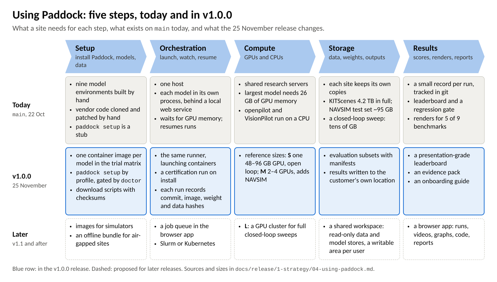

# 4 · Using Paddock: setup, orchestration, compute, storage, results

*Level 1, strategy. Answers: what infrastructure does a site need, and what are the
high-level steps to use Paddock?*

*Up: [executive plan](../plan-v1.0.0.md) · Previous: [3 · What customers ask](03-customer-questions.md) ·
Next: [5 · Outcomes](05-outcomes.md)*

**The point**
- **Five steps.** Today, someone who knows the codebase does each one by hand.
- **v1.0.0 automates setup and makes results portable and certifiable.**
- **A hosted demo removes setup** for a first look. Later, a browser app removes it for
  hands-on use too.
- **Paddock itself is light:** one Python 3.11 process with six dependencies. The weight
  is in the models' environments, the data and the simulators.

---

## 1. Setup

**What it covers**
- Paddock itself.
- One environment per model.
- Each model's code at a pinned commit, with our patches applied.
- Weights, datasets, and a site configuration that says where all of it lives.

**Today**
- **Nine model environments:** six managed by uv, two by conda, one plain virtual
  environment, Python 3.9 to 3.12. Drive-JEPA and its re-ranker share one.
- **Vendor repositories are pinned in `repos.yaml`,** but each is cloned and patched by
  hand.
- `paddock doctor` checks a site without changing it. `paddock setup` prints "not
  implemented".

**v1.0.0**
- One container image per model in the trial matrix, plus a core image and a
  development container.
- `paddock setup` for a chosen profile (open loop, NAVSIM).
- Download scripts that fetch only the evaluation subset, with checksums.
- `doctor` as the gate between stages, and a certification run at the end.

**Decision: yes to containers, within three boundaries.**
1. **Images carry environments.** Data and licensed weights are mounted at run time and
   never baked in.
2. **One image per model,** because model environments conflict.
3. **Docker, Podman and Apptainer all work.** The host's GPU driver stays a
   prerequisite, since an image cannot carry it.

[Packaging and setup](../2-design/packaging-and-setup.md) has the design and the
alternatives we rejected.

## 2. Orchestration

**Today**
- `paddock run` starts each model in its own interpreter, behind a local web service.
- It waits until the declared GPU memory is free before loading, rather than failing
  minutes into a checkpoint read.
- It scores the run, then tears everything down.
- `--resume` continues an interrupted run in place.
- The regression gate runs tiered smoke subsets. Open PR #100 measured 19 minutes for
  the quick tier and 2 h 21 min for the closed-loop tier.

**v1.0.0**
- The same runner, launching containers.
- A certification run on every new install.
- Every run records the Paddock commit (PR #100), the image digest, the weight hash and
  the data hash. Two sites can then prove they ran the same thing.

**Later**
- A job queue and a launcher in the browser app (v1.1).
- Multi-node scheduling on Slurm or Kubernetes, for full closed-loop sweeps.

## 3. Compute

| Size | Hardware | Runs |
|---|---|---|
| Demo | any Linux laptop, no GPU | CPU-only models on a small public slice |
| **S** | a workstation with one 48–96 GB GPU | open loop for the trial matrix |
| **M** | a server with 2–4 GPUs of 80 GB or more | adds NAVSIM, whose scoring is CPU-heavy, and one closed-loop benchmark |
| **L** | a GPU cluster | the full matrix and closed-loop sweeps (later) |

What drives the sizes:
- Alpamayo 1.5 declares 26 GB of GPU memory and Qwen-Drive 18 GB. Drive-JEPA needs 12,
  METEOR 8 and AutoE2E 4.
- openpilot and VisionPilot run on a CPU.
- AlpaSim needs about 17 GB for the simulator alone, and about 41 GB with a 10 B model
  resident.

The hosted demo and trial need their own machine. The shared research servers are
already contended. [Hosted twin and on-prem kit](../2-design/hosted-twin-and-on-prem-kit.md)
sizes it.

## 4. Storage

| What | Size |
|---|---|
| KITScenes | ~4.2 TB in full; the benchmark reads 223 keyframes of it |
| comma2k19 | ~100 GB unpacked; ~4.9 TB if every decoded frame is kept |
| NAVSIM test set | ~95 GB of sensor data, plus a metric cache |
| nuPlan | ~450 GB of camera images |
| One neuroNCAP sweep | ~5 GB with videos encoded, ~66 GB keeping every frame |
| One Bench2Drive sweep, recorded | ~40 GB |
| All tracked results | 5.5 MB for 171 runs |

**Rules that hold today, and carry into v1.0.0**
- **Paddock never copies a dataset.** It points at the data where it already is.
- **The repository names places only through template variables;** the site's own
  config fills them in. A test fails the build on any machine-specific path.
- **The small summary of each run is tracked in git.** Per-sample records go outside it.

**v1.0.0 adds**
- Evaluation subsets with manifests and checksums.
- A results location the customer chooses, so their numbers never enter our tree.

**Later:** a shared workspace with read-only dataset buckets, a read-only model store
and a writable area per user ([shared workspace](../2-design/shared-workspace.md)).

## 5. Results

**Today**
- Per run, a run record and metrics, both kilobytes and both reviewable in a diff.
- A leaderboard of valid runs.
- Cross-model renders for 5 of 9 benchmarks.
- The regression gate's verdicts.
- One place, `_validity()`, decides whether a run counts.

**v1.0.0**
- **A presentation-grade leaderboard:** the newest valid run per model, a minimum sample
  size, tuned runs flagged.
- **An evidence pack and an onboarding guide.**
- **Results that are private and certified.**

**Later:** the browser app, with runs, videos, graphs, the code behind each run, and
reports (v1.1).

## The people a site needs

- **An ML engineer,** who wraps the model.
- **An infrastructure admin,** for GPUs, containers and storage.
- **A data and licensing owner,** who clears what may be used.

---

## Sources

**Verified:**
- Environments: each `model.yaml` and `paddock.toml.example`.
- Pins: `repos.yaml`.
- `doctor`: `src/paddock/doctor.py`.
- `setup` is a stub: `src/paddock/cli.py`.
- GPU memory per model: the `vram_gb` in each `model.yaml`.
- AlpaSim: `docs/benchmarks/alpasim.md`.
- Sizes:
  - KITScenes: `datasets.yaml`;
  - comma2k19: `docs/data-setup.md` and `docs/benchmarks/comma2k19.md`;
  - NAVSIM: `docs/benchmarks/navsim.md`;
  - nuPlan: `docs/benchmarks/nuplan.md`;
  - neuroNCAP: `docs/benchmarks/neuroncap.md`;
  - Bench2Drive: `docs/benchmarks/bench2drive.md`;
  - results: `du` on `results/`.
- Gate timings: PR #100's description, one measured run.

**Argued:**
- The S/M/L sizes.
- The container boundaries.
- What v1.0.0 contains.
