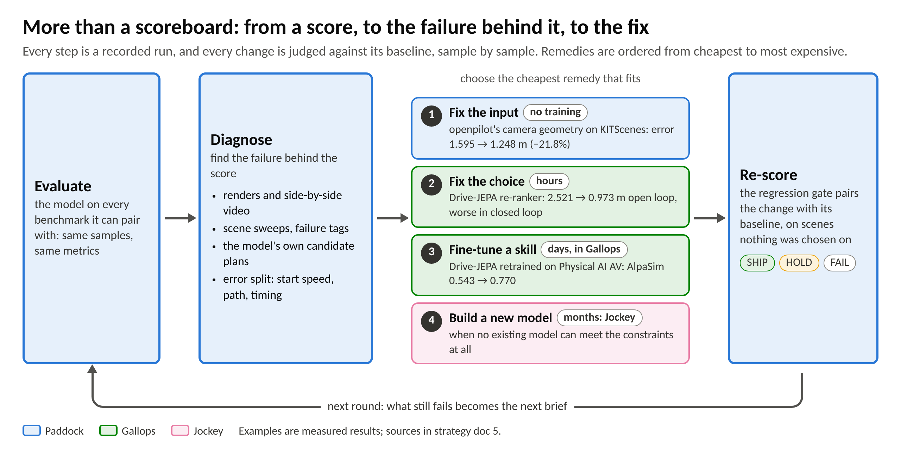

# 5 · Outcomes: failure modes, areas to improve, tools

*Level 1, strategy. Answers: what does a team get from running its model through
Paddock, beyond a score?
Up: [executive plan](../plan-v1.0.0.md) · Previous: [4 · Using Paddock](04-using-paddock.md) ·
Next: [6 · Pathway to Gallops](06-pathway-to-gallops.md)*

**The point**
- **Paddock's output is a diagnosis, not a ranking.** It says which failure is behind a
  score, why it happens, and the cheapest change that addresses it:
  1. fix an input, which needs no training;
  2. fix the model's choice, which needs hours;
  3. fine-tune a skill, which takes days, in Gallops;
  4. build a new model, which takes months: Jockey.
- **The loop has already produced measured fixes.**
  - openpilot −21.8% on KITScenes with no training.
  - Drive-JEPA's closed-loop score 3.57 → 4.13, from a fix in Paddock's own adapter.
  - It has also produced fine-tuning targets that Gallops took up.
- **For a customer, the same loop runs on their model.** What survives the free fixes
  becomes their fine-tuning brief.

---

## Failure modes found so far

Each was found by Paddock's analysis, not by the score alone.

| Model | Failure, and how it showed | What it pointed to |
|---|---|---|
| openpilot | Reads its own speed about 12% slow on KITScenes. The start speed explains 64% of its error | **Input fix:** a camera-geometry setting in the adapter. Error 1.595 → 1.248 m (−21.8%), no training. Turns did not improve, and the analysis says so |
| openpilot | Route intent sets the direction of a turn but not its timing: +1.54 m error on turns 40 m or more ahead | **Fine-tuning target:** turn timing given intent |
| openpilot | No speed input, so it stops and does not start again. This standstill trap is 53% of its lost Bench2Drive points (93 routes), and it completed 0 of 31 left turns (PR #79) | **Training requirement:** give the model its own speed. A design rule for Jockey |
| Drive-JEPA | Its adapter placed the cameras wrong: 0% of its image samples landed in the frame, and a black frame gave the same plan | **Fix in Paddock:** neuroNCAP 3.57 → 4.13, collisions 91 → 49 of 200 |
| Drive-JEPA | The best of its own 32 candidate plans is within ~0.4 m of the human driver, but it picks about the 15th best | **Selection fix:** a re-ranker trained in Gallops ([6](06-pathway-to-gallops.md)) |
| AutoE2E | Its plans follow its own past motion: fed a steady past, route 1711 completes 99.25% instead of 12.86% (PR #96) | **Input fix** in the adapter (PR #89); the closed-loop re-run is pending |
| VisionPilot | Hits the side obstacle at nearly full speed: neuroNCAP side score 0.08 | **Retraining target,** named in Gallops' strategy |
| comma2k19 itself | Ground truth in the camera's frame, plans in the car's, about 2° apart | **Fix the benchmark:** openpilot 1.507 → 0.858, and the board reorders |

## Areas to improve

**For the models we evaluate, cheapest first**
- **Inputs:** camera geometry, frame conventions, history and rate.
- **Selection:** when the model already proposes a good plan.
- **Only then fine-tuning:** turn timing, starting from rest, side hazards.

**For Jockey, as design rules** ([7 · Jockey](07-jockey.md)):
- give it its own speed;
- see to the sides;
- time its turns from intent;
- choose checkpoints on closed loop, not open loop.

**For Paddock itself**
- **The toolkit is deep for openpilot and thin for the rest.** v1.1 makes the failure
  catalogue model-agnostic, so every model gets the same diagnosis.
- **Cross-model renders cover 5 of 9 benchmarks.** The other four need render hooks.

## Tools and techniques

| Tool | The question it answers |
|---|---|
| `paddock render` (cross-model figures) | How do the models differ on the same sample? |
| Side-by-side videos and contact sheets (neuroNCAP) | What actually happened in closed loop? |
| Scene sweeps and analysis notebooks (openpilot) | Where along a scene does it fail, and which input moves it? |
| Failure tags: 769 lines of scenario, perception and response rules (openpilot) | Which kind of failure is this, and how often? |
| Candidate viewer (Drive-JEPA) | Could it not make a good plan, or did it pick the wrong one? |
| Render and projection gates (neuroNCAP) | Was the hazard actually rendered where the model could see it? |
| Collision margin (nuScenes) | Does an open-loop near miss predict a closed-loop crash? |
| Regression gate | Did a change help, by more than noise, on samples nothing was chosen on? |
| Hard-scenario survey | Which of ~50 hard driving scenarios does each benchmark test at all? |

That survey's answer is a caution in itself: none of the benchmarks scores reading
blinkers, hand signals, sirens, speed bumps or bad weather.

## What a customer receives

- **A failure report for their model:** its scores beside the reference models, its
  failure classes with examples and video, and the fix-or-fine-tune brief that follows.
- **Every number traceable** to a recorded run, with its validity and provenance.
- **In v1.0.0 the report is hand-assembled** from these tools. Generating it for any
  model comes with the model-agnostic catalogue in v1.1.

---

## Sources

**Verified:**
- openpilot on KITScenes:
  - 0.877 speed ratio, 64% start-speed share, +1.54 m on far turns:
    `tools/models/openpilot/analysis/openpilot_drv_supcombo_kitscenes_four_questions.md`
    and `…_config_run.md`;
  - 1.595 → 1.248: `docs/benchmarks/kitscenes.md`.
- openpilot on Bench2Drive (53%, 93 routes, 0 of 31): open PR #79's branch,
  `tools/models/openpilot/analysis/openpilot_drv_supcombo_bench2drive_failure_analysis.md`.
  Not merged yet.
- Drive-JEPA:
  - camera fix: `docs/ROADMAP.md`, `docs/leaderboard.md`;
  - candidates: `docs/models/drivejepa_rerank.md`.
- AutoE2E route 1711: open PR #96's description.
- VisionPilot's side score: `docs/benchmarks/neuroncap.md`; Gallops `docs/STRATEGY.md`.
- comma2k19: `docs/ROADMAP.md`, M8.
- Tool locations: `src/paddock/render.py`, `tools/benchmarks/neuroncap/`,
  `tools/benchmarks/nuscenes/collision_margin.py`, `tools/models/drivejepa/proposals.py`,
  `tools/gate.py`, `docs/driving-scenarios.md`.

**Argued:**
- The order of remedies.
- The design rules for Jockey.
