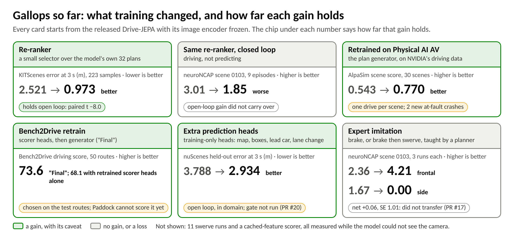

# 6 · Pathway to Gallops

*Level 1, strategy. Answers: how does a finding in Paddock become a better model? What
has fine-tuning achieved so far, and when should we train a new model instead of
fine-tuning an existing one?
Up: [executive plan](../plan-v1.0.0.md) · Previous: [5 · Outcomes](05-outcomes.md) ·
Next: [7 · Jockey](07-jockey.md)*

**The point**
- **Gallops turns Paddock's diagnosis into training, and Paddock scores the result.**
  The two meet only at a checkpoint directory, so the numbers for our own models are as
  trustworthy as the numbers for the vendors'.
- **Six training efforts so far,** all on Drive-JEPA:
  - real gains open loop: the re-ranker, 2.52 → 0.97 m;
  - a real gain on one closed-loop simulator: AlpaSim, 0.543 → 0.770;
  - **no closed-loop safety gain yet** on scenes nothing was chosen on.
- **The lessons point straight at Jockey:**
  - selection is the bottleneck;
  - open-loop gains do not carry over by themselves;
  - a model must be proven to use its camera;
  - data is the binding constraint;
  - the chip has to shape the model from the first checkpoint.

---

## How Gallops works with Paddock

1. **Paddock measures a gap.** For example, Drive-JEPA picks about the 15th best of its
   own 32 plans ([5 · Outcomes](05-outcomes.md)).
2. **Gallops builds the training data,** often from Paddock's own record of what the
   model proposed.
3. **A preflight that cannot be skipped** checks the code, the grading, the data, and
   *sight*: blanking the camera must change the plan. It was added after weeks of
   training a model that, it turned out, could not see.
4. **Training writes a checkpoint and a sidecar together.** The sidecar records the
   model, step, commit, training data, size and precision.
5. **Paddock loads the checkpoint through an adapter** and scores it like any other
   model. The regression gate then decides whether it is a gain.

The rules:
- choose a checkpoint on one split and report on another;
- closed loop is a gate, not a training signal;
- open-loop error is a tripwire, not a target.

## Fine-tuned model performance

| What was trained | Result | How far it holds |
|---|---|---|
| **Re-ranker:** a small selector over the frozen model's 32 plans | KITScenes 2.521 → 0.973 m. On nuScenes, zero-shot, 0.587 m, better than constant velocity's 0.641 | Strong open loop (paired t −8.0). **Worse in closed loop:** 3.01 → 1.85 on nine neuroNCAP episodes |
| **Bench2Drive retrain:** scorer heads, then the generator | Driving score 68.1 (heads alone) and 73.6 ("Final") on 50 routes | Variant chosen on the reporting routes, one run per route. Paddock cannot score it yet |
| **Physical AI AV retrain:** the plan generator on NVIDIA's data | AlpaSim 0.543 → 0.770 on 30 scenes | One drive per scene; 3 at-fault collisions, 2 of them new. Level with openpilot's 0.7726 |
| **Swerve fine-tune,** 11 runs | Full neuroNCAP set 3.568 → 3.671 (+0.10, SE 0.08) | Camera-blind: no evasion learned |
| **Scorer on cached features** | Collision-ranking AUC 0.50–0.59 → 0.66–0.83 | Camera-blind, open loop only; breaks on real logs |
| **Extra prediction heads** (Gallops PR #20) | nuScenes held-out error at 3 s 3.788 → 2.934 m; collisions 4.04% → 2.69% | Open loop and in domain; the gate has not run. The author: "not a ship candidate" |
| **Expert imitation** (Gallops PR #17) | Scene 0103: frontal 2.36 → 4.21, side 1.67 → 0.00 | Net +0.06 (SE 1.01): learned on the training scenes, did not transfer |

**Read it this way:** the loop works and the gains are real where they are claimed. But
none of them is yet what an OEM most wants to see: a closed-loop safety gain on scenes
nothing was chosen on.

## Tools and techniques Gallops organises

| Technique | What it does | Status |
|---|---|---|
| Selection (re-ranking) | A small model chooses among a frozen model's own candidates | Done, scored in Paddock |
| Head retraining | Retrain only the scorer heads (1.32 M parameters) | Done: Bench2Drive |
| Generator retraining | Retrain the plan generator on new data | Done: Physical AI AV, Bench2Drive |
| Teacher labels | A stronger planner labels the training paths | Done: Bench2Drive "Final" |
| Geometric expert | Brake and swerve targets computed offline; its grader reproduces Paddock's 38,080 verdicts exactly | Done |
| DAgger | Drive, relabel what went wrong, retrain | Done. Round 1 scored 0.80 on scene 0103 against the release's 4.05 |
| Privileged teacher | A teacher that sees the true positions of other actors, through a Paddock channel (PR #87) | Open PRs |
| Auxiliary heads | Extra training-only targets: map, boxes, lead car, lane change | Built, 9 runs; gate not run |
| Distillation | A large self-supervised encoder teaches a small student | Jockey's design ([7](07-jockey.md)) |
| Preflight and checkpoint contract | Refuse a model the camera does not move; write weights and sidecar atomically | Done |

## Train a new model, or fine-tune an existing one?

Pick the cheapest row that fits:

| When Paddock finds… | Do this | Cost | Example |
|---|---|---|---|
| an input mismatch: camera, frame, rate | fix the adapter | no training | openpilot −21.8% on KITScenes |
| good plans proposed, the wrong one chosen | train a selector or the scorer heads | hours | the re-ranker |
| a skill missing in a domain | fine-tune the generator on that domain's data | days | the Physical AI AV retrain |
| a constraint no existing model can meet: licence, chip, sensors, training code | train a new model | months | **Jockey** |

Whatever the route, re-score with the gate on held-out scenes. A fine-tune that wins
open loop must also pass closed loop.

## Lessons that shape Jockey

1. **Selection is the bottleneck, not the proposals.** Training the plan generator
   behind a frozen scorer made the picked plan *worse* even as the proposals improved.
2. **Open-loop gains do not carry to closed loop by themselves.** Examples: the
   re-ranker; a cached-feature scorer whose one closed-loop "gain" was a drift.
3. **Prove the model can see.** Every swerve run was trained camera-blind. The preflight
   now blanks the camera and refuses a model whose plan does not move.
4. **Selection bias is everywhere.** Choose on one split and report on another, always.
5. **Data is the binding constraint:**
   - only nuScenes is held in full as training data;
   - NAVSIM's training split and nuScenes' 12 Hz camera sweeps (~75 GB) are absent;
   - most public data is non-commercial.
6. **Iteration is too slow.** A full round takes about six and a half hours, 4 h 48 m of
   it collecting episodes. Shorter loops are designed but not built.
7. **The chip cannot be a later phase.** VisionPilot's int8 export ran about 30% slower
   than fp32, because it was never designed for an integer path.

## What Gallops needs to go further

- **Compute.** GPUs dedicated to training, not shared with evaluation.
- **Data:**
  - NAVSIM's training split;
  - nuScenes camera sweeps;
  - a training corpus we may use commercially, before Jockey's first checkpoint.
- **CI.** Gallops has none today.
- **The gate on every candidate** before anyone calls it a gain.

---

## Sources

**Verified:**
- The six efforts, their headlines and their caveats: Gallops `README.md`, "Training so
  far", and the docs it links:
  - `docs/drivejepa_b2d.md`;
  - `docs/drivejepa-retrain.md`;
  - `docs/swerve-finetune.md`, which also gives DAgger round 1, the grader's 38,080
    verdicts and the six-and-a-half-hour round;
  - `docs/scorer-cache.md`.
- The re-ranker's numbers: Paddock `docs/models/drivejepa_rerank.md`.
- Extra heads and expert imitation: Gallops PRs #20 and #17, their own descriptions.
- The sweeps estimate: Gallops `docs/architecture.md` §5.1.
- int8 slowdown: Gallops `docs/STRATEGY.md` §5, from Paddock's
  `docs/models/VISION_PILOT_GUIDE.md`.
- openpilot's AlpaSim score: `README.md`.

**Argued:**
- The decision table.
- That no gain is yet closed-loop safety on held-out scenes. That is Gallops' own
  reading, repeated here.
