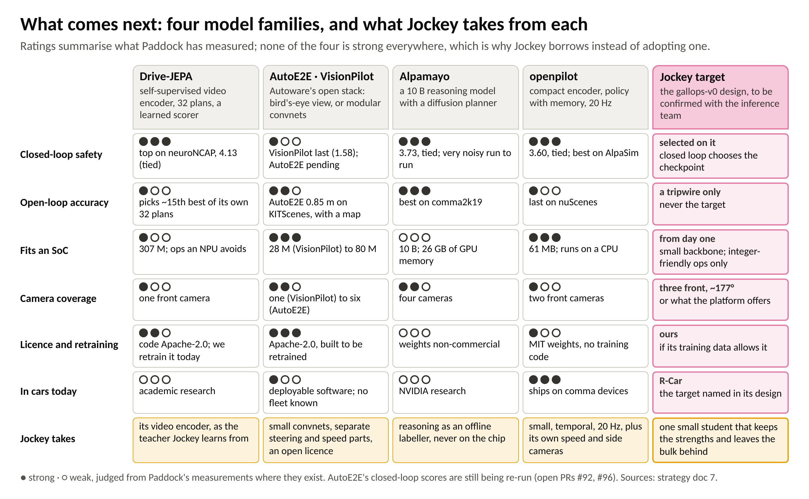
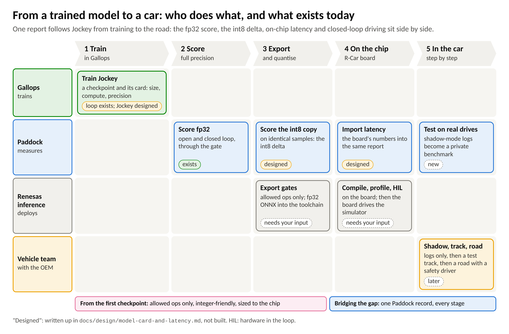

# 7 · What comes next: Jockey, the in-house model

*Level 1, strategy. Answers: what should RAIL's own model look like? What do the
candidate architectures teach us? What do we need from Renesas' inference teams? How
does a model get from training into a car?
Up: [executive plan](../plan-v1.0.0.md) · Previous: [6 · Pathway to Gallops](06-pathway-to-gallops.md) ·
Next: [8 · Release v1.0.0](08-release-v1.0.0.md)*

**The point**
- **None of the four families we have measured is strong everywhere.**
- **Recommendation: build Jockey as one small, camera-only, integer-friendly model that
  takes the strengths of each.**
  - It learns from a self-supervised video encoder.
  - It is small and temporal like openpilot.
  - It reads its own speed and sees to the sides.
  - It is chosen on closed loop and built for R-Car from its first checkpoint.
  - This is the design Gallops calls `gallops-v0`.
- **The inference teams' answers come before training:** cameras, model size and
  latency budget, supported operations, toolchain. They change the design.
- **The path to a car has five stages.**
  - Paddock already covers scoring, and has written designs for the int8 delta and for
    importing on-chip latency.
  - Hardware in the loop and the vehicle stages are new.

---

## The candidates: pros and cons

### Drive-JEPA-inspired architectures

A video encoder learned without labels (V-JEPA 2; 304 M of its 307 M parameters)
proposes 32 candidate plans, and a learned scorer picks one. It declares 12 GB of GPU
memory and runs at 2 Hz.

| Pros | Cons |
|---|---|
| Best closed-loop safety measured: neuroNCAP 4.13 (top, statistically tied); NAVSIM 0.843 after adaptation | 307 M parameters, and operations embedded chips avoid (attention, LayerNorm, GELU). Not deployable as it is |
| Its candidates already include near-human plans: the best of 32 is within ~0.4 m. The representation works | Its scorer, trained only on NAVSIM's score, picks about the 15th best plan anywhere else |
| We know it best: Gallops has retrained it six ways, and the loop is proven on it | Reads one front camera, at 2 Hz; its speed prior tops out near 16 m/s |
| Self-supervised pretraining scales with unlabelled video, the data OEMs hold most of | The checkpoint's licence is not stated |

**Verdict:** the representation to learn *from*, as a teacher. Not the model to ship.

### AutoE2E and VisionPilot (Autoware) architectures

**VisionPilot** is three small separate networks:
- one finds the lead vehicle;
- one finds the drivable path;
- one drives.

Together they are 28.1 M parameters on one camera, and they output steering and speed
rather than a trajectory.

**AutoE2E** is larger, 79.9 M:
- a ResNet-50 feeds a bird's-eye-view transformer, with a map and a route;
- it reads six cameras over 8 frames;
- it also outputs controls.

| Pros | Cons |
|---|---|
| Apache-2.0 and commercially usable (VisionPilot); built to be retrained; an open ecosystem | VisionPilot is last on neuroNCAP (1.58, 85.5% collisions, side 0.08), and its whole row is stale |
| Small: 28–80 M. VisionPilot already ships an int8 file and runs on a CPU | VisionPilot's int8 export is weight-only, so it ran about 30% *slower* than fp32 |
| Separate steering and speed parts suit silicon: a small speed head can run faster than the perception network | AutoE2E needs a map and a route, its plans follow its own past motion, and its closed-loop scores are still being re-run (PRs #92, #96) |
| AutoE2E reaches 0.847 m on KITScenes, with surround coverage | AutoE2E is worse than constant velocity on comma2k19; its bird's-eye-view transformer uses chip-unfriendly operations |

**Verdict:** borrow the engineering (small convnets, separate steering and speed, an
open licence), not the closed-loop behaviour.

### Alpamayo-like architectures (vision-language-action)

A 10 B reasoning model with a diffusion trajectory decoder:
- it writes out why it drives as it does;
- it reads four cameras;
- it was trained on 80,000 hours of NVIDIA data.

| Pros | Cons |
|---|---|
| Best open-loop accuracy on comma2k19 (0.900) and strong on KITScenes (1.002) | 10 B parameters and 26 GB of GPU memory: about 1 s per call measured here, against a published 99 ms on NVIDIA's own hardware |
| Tied for the top on neuroNCAP (3.73) | Weights are non-commercial |
| Explains its decisions in text, which helps analysis and labelling | Samples without a seed: one scenario spans 0.0 to 5.0, and placing it would take ~200 runs |
| Very large training corpus | Tied on safety with a 61 MB model that runs on a CPU |

**Verdict:** an offline teacher and labeller, for reasoning about rare scenes. Never
the model in the car. Gallops' strategy lists it under "what not to build".

### openpilot-like architectures

comma's supercombo:
- one ONNX graph holds a compact vision encoder and a policy with a recurrent state;
- it reads two front cameras at 20 Hz;
- it has about 26.6 M distinct weights, 61 MB on disk.

| Pros | Cons |
|---|---|
| The only one that ships to drivers; runs on a CPU | No training code, and the 6,670 h of fleet data is unreleased. Fine-tuning means converting the graph, a project that is set up but not yet training |
| Tied for the top on neuroNCAP (3.60) and the best released model on AlpaSim (0.7726), with no simulator training | It assumes comma's camera geometry: KITScenes needed a calibration setting to gain 21.8% |
| Temporal: 20 Hz with memory, so it reads its own motion from the frames | No speed input: the standstill trap is 53% of its lost Bench2Drive points; route intent sets direction, not timing |
| Proof that a small model can reach the safety bar a 10 B model reaches | Two front cameras: a car crossing at 36–45° stays outside a front camera's 32.6° half-view until too late. Last on nuScenes open loop |

**Verdict:** the size and the temporal design to match, plus a speed input, side
coverage, and our own training.

## The recommendation: Jockey

Gallops' `gallops-v0` design, with what each family taught us:

| Part | Design | Taken from |
|---|---|---|
| Inputs | three front cameras (~177°, no gaps); frames chosen by timestamp; its own speed and yaw rate; a 4-way route command | openpilot's lessons; side coverage |
| Backbone | ≤12 M parameters, shared across cameras; plain ReLU convolutions. No attention softmax, LayerNorm, SiLU or GELU, squeeze-excitation or dynamic shapes | VisionPilot's int8 lesson; the chip |
| Training | a frozen V-JEPA 2 teacher distils its features into the student. "The student is what goes to silicon" | Drive-JEPA |
| Output | 8 waypoints at 0.5 s (4 s ahead), predicted as a correction to a simple constant-curvature path | Paddock's trajectory contract |
| Selection | on NAVSIM and closed loop. nuScenes error is a tripwire against an ego-only baseline | Paddock's metric lessons ([2](02-what-a-score-says.md)) |
| Export | an allowlist of operations, then an int8 simulation, then the real toolchain | the R-Car target |

**Before training can start**
1. **nuScenes camera sweeps (~75 GB).** Today we hold only 2 Hz keyframes.
2. **An ego-only baseline registered in Paddock,** to select against.
3. **Hazard data.** The corpus holds only 12.7 s of braking harder than −3 m/s².
4. **Training data we may use commercially.**

**Where our own documents disagree.** These are design questions for the inference team
and for ablations:

| Question | One answer | The other | What decides it |
|---|---|---|---|
| Size | ≤12 M backbone (what the data supports) | ≲100 M (the ceiling from the target) | the chip's budget, then the data |
| Memory | stateless, one pass per sequence | a recurrent state, as openpilot has | the chip's memory, then an ablation |
| Head | one trajectory head | separate steering and speed heads | ablation A1 in the design |
| Cameras | three front | six to eight around | the platform the OEM builds |

## What we need from Renesas' inference teams

These answers shape Jockey v0. We ask for them by **13 November**, so its specification
can freeze alongside the v1.0.0 release ([8](08-release-v1.0.0.md)).

1. **Target chip and its envelope.**
   - Is it R-Car X5, as the design assumes, or another?
   - Its TOPS, memory bandwidth and on-chip memory?
   - *Sets the model size and the frame rate.*
2. **Supported operations and precision.**
   - True integer convolution?
   - int8, int16, or mixed?
   - Attention, LayerNorm, GELU, which resize modes?
   - *Sets the allowlist. Today it is a guess until someone has the SDK.*
3. **Camera setup.**
   - How many cameras will the planner see: one front, two, three front, or six to eight
     around?
   - At what resolution and rate?
   - Shared with which perception workloads?
   - *Sets the inputs and the coverage.*
4. **Size and latency budget.**
   - Parameters and compute per frame, at 10–20 Hz, alongside what else on the chip?
   - *Picks between ≤12 M and ≲100 M.*
5. **Toolchain and access.**
   - Does Renesas' flow take an fp32 ONNX and quantise it internally, and against what
     calibration data?
   - Is there a profiler that works without a board, and a board for a test harness?
   - *Makes the int8 delta and the on-chip latency real.*
6. **Integration.**
   - Should the model output a trajectory or controls?
   - Into which middleware?
   - With what fallback and safety envelope?
   - *Sets the output contract.*

## How many cameras, and how big?

**Cameras**

| Setup | Coverage | Evidence |
|---|---|---|
| One front | ~65° | VisionPilot and Drive-JEPA: blind to a side hazard until too late |
| Two front (road and wide) | wider ahead | openpilot scores 3.08 on side scenarios. Its speed policy, not its view, makes the difference |
| **Three front** | ~177°, 7–10° overlap, no gaps | gallops-v0's choice: not structurally blind to a quarter of neuroNCAP's tests |
| Six to eight around | 360° | AutoE2E, Alpamayo: more compute, more data to train on |

**Size**

| Band | Parameters | Models measured |
|---|---|---|
| Tiny | ≤30 M | openpilot (~27 M), VisionPilot (28 M) |
| Small | 50–100 M | METEOR (54 M), AutoE2E (80 M) |
| Large | ~300 M | Drive-JEPA (307 M) |
| Huge | 4–10 B | Qwen-Drive (5.6 B), Alpamayo (10 B) |

**Jockey aims at the tiny-to-small band.** The strongest single piece of evidence for
it: on neuroNCAP, a 61 MB model that runs on a CPU is statistically tied with a 10 B
model that needs 26 GB of GPU memory.

## The road to a car, and how to bridge the gap

| Stage | Owner | What happens | Exists? |
|---|---|---|---|
| 1 Train | Gallops | Jockey trained; checkpoint plus card: size, compute, precision | the loop exists; Jockey is designed |
| 2 Score | Paddock | full precision, open and closed loop, through the gate | exists |
| 3 Export | Inference team, Paddock | allowed operations only; fp32 ONNX into the toolchain. Paddock scores the int8 copy on identical samples | designed |
| 4 On the chip | Inference team, Paddock | compile and profile on an R-Car board; latency imported into the same report; then the board drives a simulator (hardware in the loop) | latency import designed; hardware in the loop new |
| 5 In the car | Vehicle team with the OEM | logs only (shadow mode), then a test track, then a road with a safety driver. Shadow drives become a private Paddock benchmark | new |

**How we bridge the gap**
1. **Design rules from the first checkpoint,** not at export. VisionPilot shows what
   "quantise at the end" produces.
2. **One record from training to road.** The fp32 score, the int8 delta, on-chip latency
   and closed-loop driving sit in the same Paddock report.
3. **A model card in every result:** parameters, compute, precision. Paddock records
   none of these for any model today.
4. **A `soc` profile in v1.2** that packages stages 3 and 4 for customers too: their own
   int8 deltas and R-Car latency.

**Proposed timeline**
- **13 November:** the inference team's answers; Jockey v0's specification frozen.
- **December–January:** the preconditions (sweeps, baseline, data licences), then the
  first training runs.
- **v1.2 (March 2027, proposed):** Jockey v0 scored in Paddock in fp32 and int8, with
  latency from an R-Car board.

---

## Sources

**Verified:**
- Model facts (parameters, cameras, licences, maturity): `docs/models/comparison.md`
  and each `model.yaml`.
- Scores:
  - `README.md` support matrix;
  - `docs/benchmarks/neuroncap.md` (ties, Alpamayo's spread);
  - `docs/benchmarks/alpasim.md`.
- VisionPilot's int8: `docs/models/VISION_PILOT_GUIDE.md`.
- Alpamayo's latency: the published 99 ms is in `docs/models/comparison.md`; the ~1 s
  per call measured here is in `docs/models/alpamayo15-eval-notes.md`.
- openpilot's weight count: the openpilot fine-tuning project. Its calibration:
  `docs/benchmarks/kitscenes.md`. Its standstill trap: open PR #79.
- gallops-v0, the sweeps, the 12.7 s of hard braking, the 3.08 side score and the
  open questions: Gallops `docs/architecture.md` and `docs/STRATEGY.md`.
- The 32.6° half-view: Gallops PR #17's branch, `docs/brake-swerve-expert.md`.
- The model card, the int8 adapter and the latency import:
  `docs/design/model-card-and-latency.md`.

**Argued:**
- The verdicts.
- The recommendation.
- The asks and their dates.
- The size bands.
- The vehicle stages.
