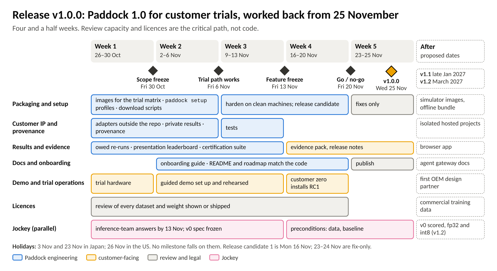

# 8 · Release v1.0.0: Paddock 1.0 for customer trials, 25 November 2026

*Level 1, strategy. Answers: what ships on 25 November, what does not, how we get there
working back from the date, what could break it, and what leadership must decide.
Up: [executive plan](../plan-v1.0.0.md) · Previous: [7 · Jockey](07-jockey.md)*

**The point**
- **v1.0.0 is Paddock's first external release.** It ships:
  - a self-install trial kit for open loop and NAVSIM, on a certified matrix of models
    and benchmarks;
  - an evidence pack;
  - a guided live demo;
  - a way for customers to bring their own model while their IP stays on their side.
- **Later releases (dates proposed):**
  - **v1.1, late January 2027:** hosted hands-on projects, the browser app and the
    agent gateway;
  - **v1.2, March 2027:** an on-prem pilot and the chip profile.
- **Working back from Wednesday 25 November leaves four and a half weeks:**
  - scope freeze on 30 October;
  - a working trial path on 6 November;
  - feature freeze on 13 November;
  - release candidate on 16 November, installed unaided by a Renesas team;
  - go / no-go on 20 November.
- **The critical path is review capacity and licences, not code.**

---

## Scope

**In v1.0.0**
1. **Trial kit:**
   - one container image per model in the trial matrix, plus a core image and a
     development container;
   - `paddock setup` for the open-loop and NAVSIM profiles;
   - download scripts with checksums;
   - `paddock doctor` as the gate between stages;
   - a certification run at the end.
2. **Certified matrix:** the cells below, reproduced on a clean install.
3. **Customer IP stays theirs:**
   - an adapter can live outside our repository;
   - results go to a location the customer chooses;
   - every run records the Paddock commit, image digest, weight hash and data hash.
4. **Results we can stand behind:**
   - the owed re-runs;
   - comma2k19's ground-truth frame corrected;
   - a presentation-grade leaderboard: newest valid run per model, a minimum sample
     size, tuned runs flagged;
   - docs that describe only what exists. Today the README's quickstart still shows
     `paddock setup` working.
5. **An evidence pack and a guided live demo** (rungs 0 and 2 of the
   [trial ladder](03-customer-questions.md)), including one closed-loop drive with
   video.
6. **An onboarding guide,** version 1.
7. **A finished licence review** of every dataset and weight we show or ship.

**Not in v1.0.0**

| Item | Release |
|---|---|
| hosted hands-on projects, the agent gateway, the browser app | v1.1 |
| closed-loop kit, model-agnostic failure catalogue, shared workspace | v1.1 |
| on-prem pilot, offline bundle, the chip profile (int8 delta and R-Car latency) | v1.2 |
| multi-node runs, the full closed-loop matrix, OEM data kits | v2.0 |

### The proposed trial matrix

| | In the v1.0.0 kit | Shown in the evidence pack and demo |
|---|---|---|
| **Benchmarks** | KITScenes, nuScenes, comma2k19, NAVSIM v2 | neuroNCAP, Bench2Drive, AlpaSim (closed loop); nuPlan stays out, since every run there is still invalid |
| **Models** | openpilot, VisionPilot (re-run), METEOR, Qwen-Drive, AutoE2E, constant velocity; Alpamayo 1.5 with the customer's own access to its non-commercial weights | Drive-JEPA and its variants: into the kit too if their image builds by 6 November, otherwise v1.1 |

Why this cut:
- Open loop and NAVSIM run on a single-GPU workstation.
- Their data has download paths we already script.
- The closed-loop simulators bring CARLA, a neural renderer and Docker-in-Docker,
  which is too much to certify on other sites in four weeks.

## Working back from 25 November

| Date | Milestone | Done when |
|---|---|---|
| Leadership meeting | Decisions taken | the [decisions below](#decisions-for-leadership) are recorded |
| Fri 30 Oct | **Scope freeze** | trial matrix fixed; licence review started; owed re-runs scheduled; trial hardware confirmed; release owner named |
| Fri 6 Nov | **Trial path works** | images build and pass `paddock verify`; `paddock setup` installs the open-loop profile on a clean machine; download scripts fetch and verify; external adapters and private results merged |
| Fri 13 Nov | **Feature freeze** | release PRs merged or deferred; certified re-runs done; leaderboard regenerated; the inference team's answers in for Jockey |
| Mon 16 Nov | **Release candidate 1** | customer zero, a Renesas team outside the core contributors, starts an unaided install; onboarding guide and evidence pack drafted |
| Fri 20 Nov | **Go / no-go** | the exit criteria below are checked |
| Mon 23 – Tue 24 Nov | Fixes only | no new scope. 23 November is a public holiday in Japan |
| **Wed 25 Nov** | **v1.0.0** | tagged, release notes out, evidence pack published. US Thanksgiving follows on the 26th |

**Workstreams, in parallel**

| Workstream | Delivers | Depends on |
|---|---|---|
| Packaging and setup | images, setup profiles, download scripts | the trial matrix (30 Oct) |
| Customer IP and provenance | external adapters, private results, provenance fields | — |
| Results and evidence | re-runs, comma2k19 frame fix, leaderboard, certification suite, evidence pack | GPU time; PR triage |
| Docs and onboarding | onboarding guide, accurate README and roadmap, release notes | packaging |
| Demo and trial operations | trial hardware, guided demo, customer zero | the hosting decision |
| Licences | review of every dataset and weight shown or shipped | legal |
| Jockey (not gating) | the inference team's answers by 13 Nov; v0 specification | a named counterpart |

**Which open PRs land before the freeze** is proposed in
[open work](../3-reference/open-work.md). The rule: by 13 November, land only what
changes certified numbers or the trial path. That covers:
- the gate, #100 and #102;
- VisionPilot's sync, #57, once re-measured;
- Drive-JEPA's momentum default, #95, once its gate runs finish;
- the closed-loop evidence, #79 and #92, rebased or re-run.

Everything else continues on `main` after the release.

## Exit criteria

v1.0.0 ships only if, on 20 November:
1. **Customer zero gets from install to a certified run in one working day or less,**
   without us at the keyboard.
2. **Reference numbers reproduce on that clean install,** exactly where the model is
   deterministic and within a stated tolerance where it is not.
3. **The evidence pack holds no stale cell.** Every number is valid and carries its
   provenance.
4. **A model adapter outside the repository** passes `paddock verify` and a five-sample
   smoke run in its container.
5. **The licence review is closed** for everything shown or shipped.
6. **`make check` is green,** and the docs describe only what exists.

## Risks

Risks to the date and to the release:

| Risk | Mitigation |
|---|---|
| **Review capacity.** 14 open PRs, none approved, 5 in conflict | a release owner; a review rotation; non-release PRs frozen from 13 Nov |
| **Licences.** Most public datasets, and some weights, are non-commercial; legal review takes time | start this week. Ship download scripts, never data; customers license data themselves |
| **Containers.** Nine environments, Python 3.9 to 3.12, several CUDA versions | images only for the trial matrix. Drive-JEPA's conda and mmcv image is a stretch |
| **GPU time** for the owed re-runs on shared machines | schedule them in week 1; trial hardware separate from research machines |
| **Reproducing across sites.** Another site already measured a different KITScenes error | per-benchmark tolerances in the certification run; image digests recorded |
| **How scores are read** ([2 · What a score says](02-what-a-score-says.md)) | evidence pack framed as "skills, not verdicts", with the caveats beside each number |
| **Hosted-trial security** (v1.1): customer agents running code beside licensed data | not in v1.0.0. Isolated projects, no outbound network and an audit log are designed before v1.1 |
| **Scope creep** into the browser app or gateway | written out of v1.0.0 above |
| **Concentration.** A few people carry most workstreams | each workstream gets two names |

## After v1.0.0 (proposed)

| Release | When | Theme | Contents |
|---|---|---|---|
| v1.1 | late January 2027 | **Hands-on** | hosted projects for customers; browser app MVP (runs, videos, graphs, reports); agent gateway (MCP and API); one closed-loop kit; model-agnostic failure catalogue; our own shared workspace |
| v1.2 | March 2027 | **Pilot and chip** | on-prem OEM pilot; offline bundle; the chip profile (int8 delta, R-Car latency); Jockey v0 scored in fp32 and int8 |
| v2.0 | second half of 2027 | **Scale** | cluster orchestration; the full closed-loop matrix; Gallops views in the browser app; kits for OEMs' own data |

## Decisions for leadership

Each decision comes with a recommendation.

| # | Decision | Recommendation |
|---|---|---|
| D1 | v1.0.0's scope and date | **Yes:** the cut above, on 25 November |
| D2 | The trial matrix | **The proposal above.** Drive-JEPA in the kit only if its image is ready by 6 November |
| D3 | The licence review | **Start this week,** with a named legal owner |
| D4 | Customer zero, and the first OEM design partner | **A Renesas team installs the release candidate unaided.** Name one OEM design partner for v1.1's hosted trial |
| D5 | Where the demo and hosted trial run, and the hardware budget | **One dedicated 4-GPU server (80–96 GB class) and ~5 TB of storage** to start: our data centre or the cloud ([hosted twin](../2-design/hosted-twin-and-on-prem-kit.md)) |
| D6 | Jockey's direction, and an inference-team counterpart | **Confirm the direction** in [7](07-jockey.md). Name a counterpart to answer the six asks by 13 November |
| D7 | The name "Jockey" | **Adopt it** as the family name, with `gallops-v0` as its first design. Alternatives: keep "gallops-v0", or "Thoroughbred" |
| D8 | Release ownership | **Name a release owner and a review rotation.** Freeze non-release PRs from 13 November |

---

## Sources

**Verified:**
- Today's state: `README.md`, `docs/ROADMAP.md`, `src/paddock/cli.py`, each
  `model.yaml`.
- Open PRs and their state: GitHub on 22 October.
- The other site's different KITScenes error: `docs/ROADMAP.md`, M6, qualified on
  6 October.
- nuPlan runs all invalid: `docs/leaderboard.md`.
- Holidays: Japan's Culture Day on 3 November and Labour Thanksgiving Day on
  23 November; US Thanksgiving on 26 November 2026.

**Argued:**
- The scope cut.
- The trial matrix.
- The milestones and their dates.
- The exit criteria.
- The v1.1 and v1.2 dates.
- The hardware recommendation, carried over from the 15 October deployment plan.
