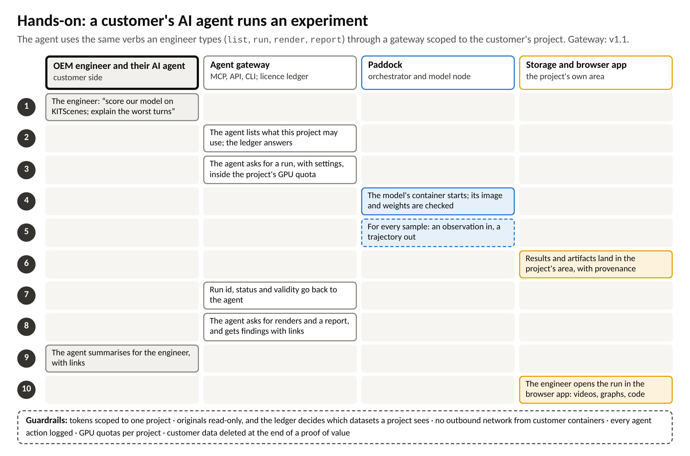
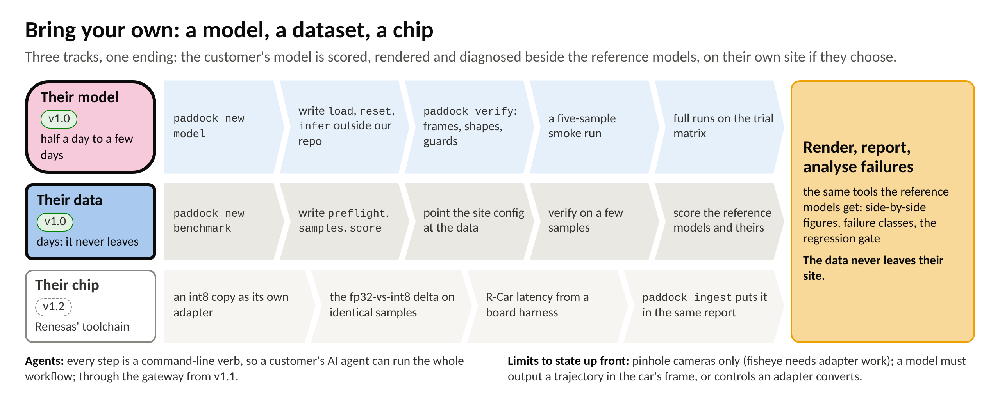

# Design: hands-on access, for customers and their agents

*Level 2, design plan. Decides: how a customer moves from watching a demo to running
experiments themselves, including with their own AI agents, and how they bring their
own model and data.
Up: [3 · What customers ask](../1-strategy/03-customer-questions.md) · [executive plan](../plan-v1.0.0.md)*

**The point**
- **We can always demo Paddock visually, but customers decide by using it.** The trial
  ladder ([3](../1-strategy/03-customer-questions.md)) runs from an evidence pack to
  their own model.
- **Hands-on means a project** where their engineers and their AI agents run
  experiments, through an **agent gateway** that exposes Paddock's existing verbs.
- **When they adopt,** download scripts and containers take the same setup home.
- **Guardrails come first:**
  - isolation;
  - read-only originals;
  - no outbound network from customer containers;
  - an audit log.
- **v1.0.0:** the kit and the bring-your-own-model path. **v1.1:** hosted projects and
  the gateway.

---

## What customers need, and what we provide

| They need | We provide | Exists today? |
|---|---|---|
| To see results with no setup | the evidence pack and a guided demo (v1.0); the browser app (v1.1) | partly: rendered figures, videos, a scene viewer for one benchmark on a branch |
| To run experiments themselves | an isolated hosted project with the browser app and a development container | no (v1.1) |
| To connect their own agents | an agent gateway: an MCP server (the open protocol AI agents use to call tools), an API and the CLI, scoped per project | no, but every verb already exists in the CLI: `list`, `verify`, `run`, `render`, `report` |
| To get models and data at home | download scripts that fetch from the original source under the customer's own licence, check checksums and lay files out as Paddock expects | partly: fetchers for KITScenes and NAVSIM; one model's setup checks a checksum |
| To set the repository up quickly | a development container, plus one image per model | no; AlpaSim already runs on Docker |

## Guardrails

- **Isolation.** Each customer project is isolated; agents act with tokens scoped to it.
- **Read-only originals.** Data and models cannot be changed, and the licence ledger
  decides which datasets a project may use.
- **No outbound network** from customer containers. Every agent action is logged.
- **Quotas.** GPU quotas per project.
- **Deletion.** Customer data is deleted at the end of a proof of value.
- **Reviews.** Legal and security review the hosted trial before any commercial user
  touches it.
  - Showing non-commercial dataset frames to a commercial user is a legal question
    first.

## Bring your own model, data, or chip

**Their model**
- **The steps:** `paddock new model`, write `load`, `reset` and `infer`, then
  `paddock verify`, a five-sample smoke run, and full runs.
- **The time:** about half a day to a few days for a model that already runs, mostly
  spent on coordinate frames.
- **In v1.0.0 the adapter lives outside our repository,** so their code is never
  committed beside ours.

**Their data**
- **The steps:** `paddock new benchmark`, write `preflight`, `samples` and `score`, then
  point the site config at the data, verify, and score the reference models beside
  theirs.
- **The data never leaves their site.**

**Their chip (v1.2)**
- An int8 copy of the model, as its own adapter, gives a paired fp32-vs-int8 delta on
  identical samples.
- On-chip R-Car latency comes from a board harness, imported with `paddock ingest`.
- The board is not driven as a benchmark ([model to car](model-to-car.md)).

**Driven by agents.** Every step above is a command-line verb, so a customer's agent can
run the whole workflow:
- on their own machines with v1.0.0;
- through the gateway from v1.1.

**Limits to disclose up front**
- Camera models assume pinhole projection; fisheye rigs need adapter work.
- A model must output a trajectory in the car's frame, or controls an adapter converts.

## In v1.0.0, and after

| Piece | v1.0.0 | v1.1 | Later |
|---|---|---|---|
| Evidence pack, guided demo | yes | the browser app replaces the hand-made pack | — |
| Their model and data on their site | yes: kit, external adapters, private results | — | — |
| Hosted project for their engineers | — | yes | — |
| Agent gateway (MCP, API) | — | yes | more agent frameworks |
| Chip deltas | — | — | v1.2 |

---

## Sources

**Verified:**
- The verbs: `src/paddock/cli.py`.
- The fetchers: `tools/benchmarks/kitscenes/fetch_scenes.py`,
  `tools/benchmarks/navsim/fetch_test_blobs.py`.
- A model setup that checks a checksum: `src/paddock/adapters/models/meteor/setup.sh`.
- Wrapping time: `docs/adding-a-model.md`.
- Pinhole cameras: `docs/benchmarks/alpasim.md`.
- The int8 adapter and latency ingest: `docs/design/model-card-and-latency.md`.

**Argued:**
- The guardrails.
- The gateway.
- The release split.

These were carried over from the 15 October deployment plan.
