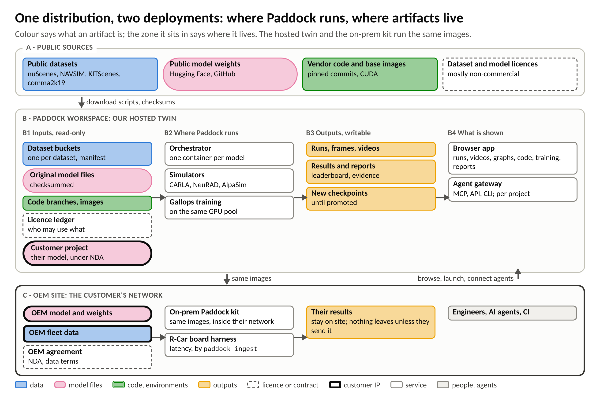

# Design: one distribution, a hosted twin and an on-prem kit

*Level 2, design plan. Decides: where Paddock runs for customers, what each kind of
customer gets, and what infrastructure that needs. It names the services it depends on;
it does not design them.*

*Up: [4 · Using Paddock](../1-strategy/04-using-paddock.md) · [executive plan](../plan-v1.0.0.md)*

**The point**
- **One pinned distribution, deployed in two places:**
  - a **hosted twin**, operated by us, for demos, hands-on trials and proofs of value;
  - an **on-prem kit** for adopters, whose models and data never leave their network.
- **Both run the same images, profiles and certification run,** so a number from a demo
  and a number at a customer's site mean the same thing.
- **v1.0.0 ships the kit** (open loop and NAVSIM) and a guided demo on our machines.
  The hosted twin as a self-serve trial follows in v1.1.

---

## How the pieces relate

The figure shows three zones.

**Zone A, public sources**
- Datasets, model weights, vendor code, and the licences that govern them.
- They enter only through **download scripts that verify checksums**. A customer's own
  licence decides what they may fetch.

**Zone B, our workspace: the hosted twin**
- **Inputs are read-only:** dataset buckets, original model files, code and images, and
  a licence ledger that decides who may use what.
- **Paddock runs in a GPU pool:** the orchestrator, one container per model, the
  simulators, and Gallops training.
- **Outputs are writable:** runs, videos, results, new checkpoints.
- **Two front doors show it all:** the browser app, and the agent gateway for programs.
- A customer's proof-of-value model lives only in its own isolated project, under the
  OEM agreement.

**Zone C, the OEM site**
- The same images run inside the customer's network.
- **Their model, their data and their results stay there.**
- On-chip latency from an R-Car board comes back through `paddock ingest`.
- Their engineers, agents and CI reach the hosted twin only through the browser app
  and the gateway.

## Who gets what: customers and profiles

"Different OEMs" usually means different teams with different goals. Each team maps to
a **profile**, which decides:
- which images to pull;
- which data to fetch;
- which checks must pass;
- what hardware to size.

| Customer team | Wants | Profile | Release |
|---|---|---|---|
| Evaluator, pre-sales | to see it work, then try it | demo, then a hosted project | demo v1.0; project v1.1 |
| Model team | to score its own model against the reference models | `openloop`, plus `navsim` | v1.0 |
| Data owner | a benchmark on its own fleet data | `private-data` | v1.0 (their own benchmark adapter) |
| Validation team | closed-loop simulation | `closedloop` | v1.1 for one simulator |
| Chip and deployment team | the int8 delta and R-Car latency | `soc` | v1.2 |

## What a site needs, by tier

| Tier | Compute | Software | Data and weights |
|---|---|---|---|
| Demo | any Linux x86-64 machine, no GPU | a container runtime | a small public slice |
| Open loop | one GPU with 48 GB or more (the largest model needs 26 GB); 32 or more cores; 1–2 TB of fast disk | a recent NVIDIA driver; Docker, Podman or Apptainer | the datasets the customer licenses; gated weights through their own accounts |
| NAVSIM | plus CPU-heavy scoring | plus the scorer's environment | plus ~95 GB of test data and a metric cache |
| Closed loop | 80–96 GB GPUs (AlpaSim alone needs 17–41 GB) | plus CARLA, the neural renderer and AlpaSim | plus a renderer checkpoint per scene |
| Chip deltas | as open loop | plus the customer's quantised export, and an R-Car board harness on their side | none extra |

**People:**
- an ML engineer, who wraps the model;
- an infrastructure admin;
- a data and licensing owner.

## Infrastructure

### The hosted twin: ours

**Compute**
- To start: one dedicated 4-GPU server (80–96 GB class) plus a CPU-heavy node for
  scoring. Scale with demand.
- **Not on today's shared research machines,** which are already contended.

**Storage**
- S3-compatible object storage for dataset buckets, the model store and artifact
  areas. About 5 TB to start.
- A fast NVMe cache on the GPU nodes.

**Services**
- The browser app and the agent gateway: small CPU services behind single sign-on.
- A private container registry.
- A development container per user and per customer project.
- An audit log.

**CI**
- Today's CPU checks.
- Plus a self-hosted GPU runner, for nightly smoke and certification runs and for
  image builds.

### The on-prem kit: theirs

| Size | Hardware | Runs |
|---|---|---|
| **S** | a workstation with one 48–96 GB GPU | the demo and the open-loop trial matrix |
| **M** | one server with 2–4 GPUs of 80 GB or more | open loop, NAVSIM, one closed-loop benchmark |
| **L** | a GPU cluster (Slurm or Kubernetes) | the full matrix and closed-loop sweeps; needs multi-node orchestration (v2.0) |

- The kit works on plain file systems; object storage is optional on-prem.
- **Air-gapped sites** get an offline bundle: the images, the packages, and the weights
  the customer is licensed for (v1.2).

## Principles

1. **The same artifact in both places.** The hosted twin is the on-prem kit, run by us.
2. **Containers hold environments.** Data and licensed weights are never shipped inside
   them.
3. **Everything pinned, everything recorded:** code commit, image digest, weight hash,
   data hash.
4. **Customer IP stays with the customer:** in their own repositories, or in their
   isolated project.
5. **Check before trust.** `doctor` gates each stage, and a site is certified before
   its numbers count.
6. **Licences first.** They are cleared before any demo shows them.

## In v1.0.0, and after

| Piece | v1.0.0 | Later |
|---|---|---|
| On-prem kit | open loop and NAVSIM; sizes S and M | closed loop (v1.1); offline bundle (v1.2); size L (v2.0) |
| Hosted twin | a guided demo on our machines | self-serve hosted projects with the browser app and gateway (v1.1) |
| Certification | on every install | nightly, on the GPU runner |

**Open questions for leadership** (from [8](../1-strategy/08-release-v1.0.0.md#decisions-for-leadership)):
- Our data centre or the cloud for the hosted twin?
- Which models and datasets are in the commercial offer?
- Who supports customers, and at what level?

---

## Sources

**Verified:**
- GPU memory per model: each `model.yaml`.
- AlpaSim's needs: `docs/benchmarks/alpasim.md`.
- NAVSIM's test data: `docs/benchmarks/navsim.md`.
- The ingest path for on-chip latency: `docs/design/model-card-and-latency.md` §5.

**Argued, carried over from the 15 October deployment plan and updated for v1.0.0:**
- The profiles.
- The tiers.
- The sizes.
- The hosted-twin hardware.
