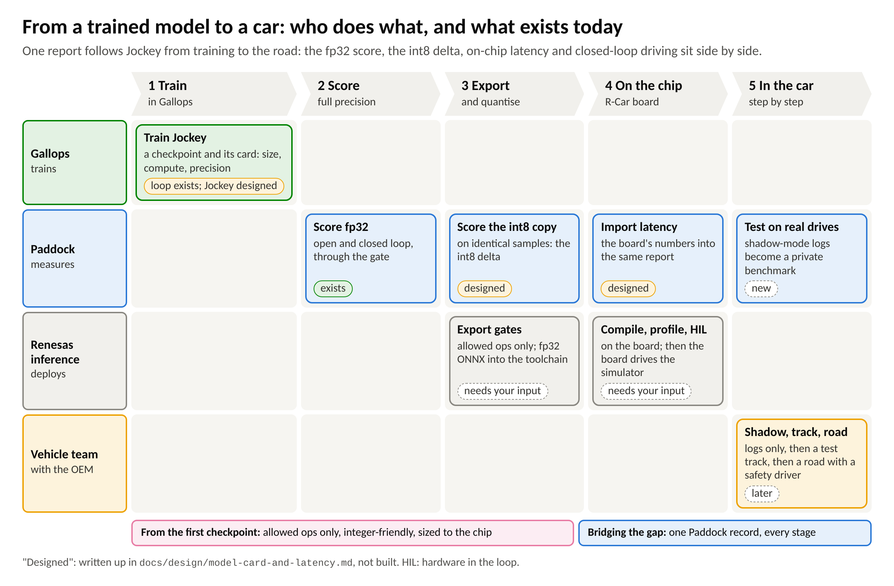

# Design: from a trained model to a car

*Level 2, design plan. Decides: the stages between a Gallops checkpoint and a model
driving on R-Car, who owns each, and how Paddock keeps one record across all of them.*

*Up: [7 · Jockey](../1-strategy/07-jockey.md) · [executive plan](../plan-v1.0.0.md)*

**The point**
- **Five stages:**
  1. train;
  2. score at full precision;
  3. export and quantise;
  4. run on the chip;
  5. drive in a car.
- **Paddock scores stage 2 today.** The int8 delta and the latency import for stages 3
  and 4 are written up in `docs/design/model-card-and-latency.md`, but not built.
- **The gap closes by putting the chip's constraints into the model from its first
  checkpoint,** not by quantising at the end.
- **The inference teams' answers decide the constraints**
  ([7 · Jockey](../1-strategy/07-jockey.md#what-we-need-from-renesas-inference-teams)).

---

## The stages

**1. Train (Gallops)**
- Jockey is trained with the chip's design rules built in:
  - only operations on an agreed allowlist;
  - integer-friendly activations;
  - a size inside the budget.
- The checkpoint's sidecar records its parameter count, its compute and its precision.

**2. Score at full precision (Paddock)**
- Open loop and closed loop, through the regression gate, exactly as every other model.
- **This stage exists.**

**3. Export and quantise (inference team; Paddock scores it)**
- **Gates, cheapest first:**
  1. operations against the allowlist;
  2. a per-channel int8 simulation against a declared accuracy budget;
  3. the real toolchain, which by Gallops' design notes takes an fp32 ONNX and quantises
     internally.
- **Paddock's part:** the quantised model runs as its own adapter, with
  `precision: int8`, on the same samples as the fp32 model. That gives a paired delta:
  what quantisation cost, sample by sample. Designed, not built.

**4. On the chip (inference team; Paddock imports)**
- **Compile and profile on an R-Car board.**
  - "Driving an R-Car board is not a benchmark": a board harness in a deployment
    repository writes a results file shaped like Paddock's.
  - `paddock ingest` reads it into the same report. Designed, not built.
- **Hardware in the loop.** The board's output drives a simulated car, so closed-loop
  behaviour is measured on the real chip. New.

**5. In the car (vehicle team, with the OEM)**
- **The sequence:**
  1. shadow mode: the model runs and is logged, but does not control the car;
  2. a test track;
  3. a public road with a safety driver.
- **Shadow drives become a private Paddock benchmark,** so the next model is measured on
  the roads it will drive. New.

## How one record bridges the gap

- **A model card in every result:** parameters, compute, precision, training data. This
  is the field Paddock leaves empty today for every model.
- **The fp32 score, the int8 delta, on-chip latency and closed-loop driving** sit side
  by side in one report, for Jockey and for any customer model.
- **The `soc` profile (v1.2)** packages stages 3 and 4 for customers: their own int8
  deltas and R-Car latency on their own site.
- **Our own model is held at arm's length "more strictly than the vendors'"**, in the
  design doc's words. Gallops writes checkpoints; Paddock alone scores them.

## What is decided, and what waits on the inference team

| | Decided | Waits on the inference team |
|---|---|---|
| Format | fp32 ONNX into Renesas' toolchain | the toolchain's actual input and calibration needs |
| Operations | ban attention softmax, LayerNorm, SiLU and GELU, squeeze-excitation, dynamic shapes | the real allowlist, from the SDK |
| Precision | int8 by default | int16 or mixed where it matters |
| Latency | measured on the board, imported into Paddock | a board, or a profiler that works without one |
| Rate | 10–20 Hz | the budget at that rate, beside the other workloads on the chip |

## In v1.0.0, and after

Nothing here ships in v1.0.0; its release is about evaluation. The order:
1. **Inference-team answers by 13 November.**
2. **The model card and int8 adapter in Paddock** (v1.1–v1.2).
3. **The latency import and the board harness** (v1.2).
4. **Hardware in the loop and shadow mode,** with the vehicle team (later).

---

## Sources

**Verified:**
- The model card, the int8 adapter, latency measured inside the node, the R-Car ingest,
  and "our own model at arm's length": `docs/design/model-card-and-latency.md` (status:
  proposed).
- The export gates and the fp32 ONNX input: Gallops `docs/architecture.md` §6.
- The banned operations: the same document, §2.
- Paddock records no size or latency today: Gallops `docs/STRATEGY.md` §5; the
  `hardware` field in `src/paddock/runner.py`.

**Argued:**
- Hardware in the loop.
- The vehicle stages.
- The shadow-mode benchmark.
- The order.
