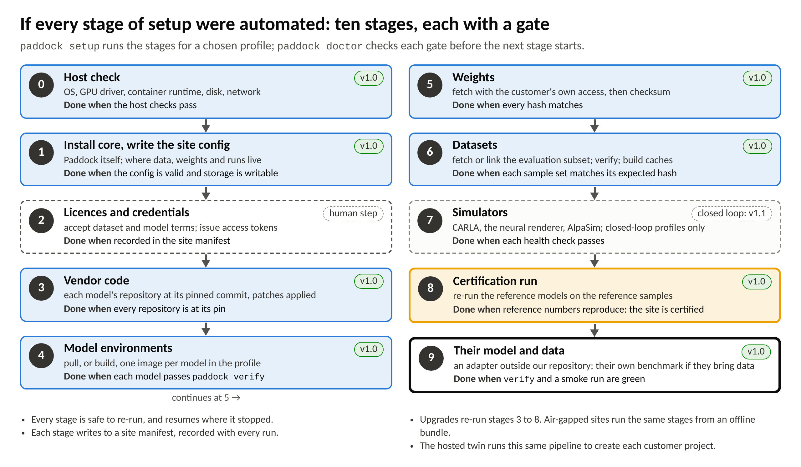

# Design: packaging and setup

*Level 2, design plan. Decides: how a site gets from nothing to a certified install,
whether to use containers, and what `paddock setup` does. Names the framework changes;
does not design them.
Up: [4 · Using Paddock](../1-strategy/04-using-paddock.md) · [executive plan](../plan-v1.0.0.md)*

**The point**
- **Setup time today goes to four things:**
  - model environments: hours to days each;
  - data: days to weeks;
  - simulators;
  - manual steps: cloning at pinned commits, applying patches, writing config.
- **Containers are the right call, within three boundaries:**
  - images carry environments, never data or licensed weights;
  - one image per model;
  - Docker, Podman and Apptainer all supported.
- **`paddock setup` becomes a staged pipeline,** with a gate after every stage and a
  certification run at the end.
- **v1.0.0 builds the open-loop and NAVSIM profiles.**

---

## Where the time goes, and the levers

Biggest saving first:
1. **Prebuilt images:** one per model, plus a core image and a development container.
   They remove the hours to days per environment.
2. **Download scripts that fetch only the evaluation subset, with checksums.**
   - KITScenes is ~4.2 TB in full, but the benchmark reads 223 keyframes.
   - Fetchers already exist for KITScenes and NAVSIM.
3. **Profiles,** so a site installs only what it will run.
4. **A setup command gated by `doctor`,** which already checks a site without changing
   it.
5. **The hosted demo for first contact,** which needs no setup at all.

## The container decision

**Yes to containers, within three boundaries**
1. **Images carry environments.**
   - Data and licensed weights are mounted at run time and never baked in.
   - This keeps images shareable and licences with the customer.
2. **One image per model,** because model environments conflict.
   - Today's nine environments span Python 3.9 to 3.12, three environment managers and
     several CUDA versions.
   - Add a core image, a development container and the simulator images.
   - Pin each image by digest, and record the digest in every run.
3. **Docker, Podman and Apptainer are all supported.**
   - High-performance-computing sites usually allow only Apptainer.
   - The host's GPU driver stays a prerequisite: an image cannot carry it.

**Rejected alternatives**
- **One all-in-one image.**
  - It would be tens of GB, carry conflicting CUDA versions, and need a rebuild on every
    change.
  - Kept only for the laptop demo, whose models run on a CPU.
- **Better scripts alone.** They do not remove driver and CUDA drift between sites.

**Already true today**
- AlpaSim's simulator services run under Docker Compose.
- Everything else runs in per-model environments that Paddock launches itself. Each
  model's `model.yaml` declares its environment, so an image is one more declaration,
  not a new mechanism.

## The automated stages

| # | Stage | Done when | v1.0.0? |
|---|---|---|---|
| 0 | Host check: OS, driver, GPU, container runtime, disk, network | host checks pass | yes |
| 1 | Install core, write the site config | config valid, storage writable | yes |
| 2 | Licences and credentials (a **human step**) | recorded in the site manifest | yes, by hand |
| 3 | Vendor code at pinned commits, patches applied | every repository at its pin | yes |
| 4 | Model environments: pull or build images for the profile | each model passes `verify` | yes, for the trial matrix |
| 5 | Weights: fetch and checksum | hashes match | yes |
| 6 | Datasets: fetch or link, verify, build caches | sample sets match their hashes | yes, for the evaluation subsets |
| 7 | Simulators (closed-loop profiles only) | health checks pass | v1.1 |
| 8 | Certification run | reference numbers reproduce | yes |
| 9 | The customer's own model and data | `verify` and a smoke run are green | yes |

**Rules for the stages**
- **Every stage is safe to re-run,** and resumes where it stopped.
- **Each stage writes to a site manifest,** which is recorded with every run. Upgrades
  re-run stages 3 to 8.
- **Air-gapped sites run the same stages** from an offline bundle.
- **The hosted twin runs the same pipeline** to create each customer project.

## Certification

A site is certified when the reference models reproduce the reference numbers on the
reference samples:
- **exactly,** where the model is deterministic;
- **within a stated tolerance per benchmark,** where it is not.

The same command at another site already gave a different KITScenes error. Tolerances,
and an image digest in every record, are how two sites prove they ran the same thing.

## Framework changes this needs

Named here; each will get its own design in its pull request.
- **`paddock setup`.** Today it prints "not implemented".
- **Container launch** for a model whose `model.yaml` names an image.
- **Adapters outside the repository.** Today the registry finds models and benchmarks
  only inside it.
- **A private results location.** Today results are written into the repository's
  tracked tree.
- **Provenance in every run:** image digest, weight hash, data hash. Open PR #100 adds
  the Paddock commit.

---

## Sources

**Verified:**
- `setup` is a stub: `src/paddock/cli.py`.
- `doctor` checks: `src/paddock/doctor.py`, `docs/site-setup.md`.
- Environments: each `model.yaml`.
- The fetchers: `tools/benchmarks/kitscenes/fetch_scenes.py`,
  `tools/benchmarks/navsim/fetch_test_blobs.py`.
- AlpaSim on Docker: `docs/architecture.md`.
- The cross-site difference: `docs/ROADMAP.md`, M6.
- The commit in run records: PR #100's description.

**Argued:**
- The container boundaries.
- The stages.
- The v1.0.0 subset.

These were carried over from the 15 October deployment plan.
