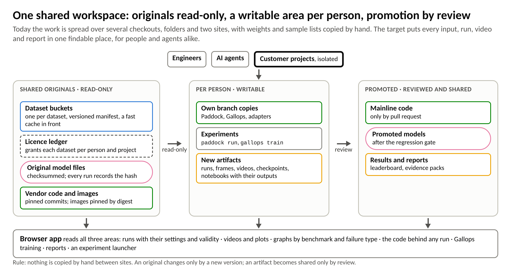

# Design: the shared workspace and the browser app

*Level 2, design plan. Decides: how our own teams, and later customers' projects, share
data, models, code and results, and what one browser app shows of all of it.*

*Up: [1 · Where we are](../1-strategy/01-where-we-are.md) · [executive plan](../plan-v1.0.0.md)*

**The point**
- **Today the work is scattered:**
  - several working copies per person;
  - the training and evaluation repositories on different disks and sites;
  - weights and sample lists copied by hand.
- **The target is one workspace:**
  - read-only originals;
  - a writable area per person;
  - promotion only by review;
  - one browser app over all of it.
- **It is also the base of the hosted twin.** A customer project is this workspace with
  isolation.
- **It is v1.1.** v1.0.0 needs none of it, but the hosted trial needs all of it.

---

## Today: scattered

**Code.** Several working copies of the Paddock repository sit on one workstation, one
per analysis thread. Gallops and an openpilot fine-tuning project sit beside them, with
other copies at another site.

**Data and outputs**
- Vendor code, dataset caches and run outputs live in separate folders on each machine.
- Analysis notebooks are committed without outputs; the outputs live only in local
  backups.
- Evidence videos are kept out of git, spread across sites.

**Hand copies.** Weights and sample lists move between sites by hand. Example: the
openpilot fine-tuning project cannot run its KITScenes baseline, because the
223-keyframe list that *is* the benchmark is missing on its machine.

**Site configs.** Each site keeps its own paths. When two sites hold different subsets
of a dataset, the same command measures different things.

## The target

| Element | What it is | Rule |
|---|---|---|
| **Dataset buckets** | object storage, one bucket per dataset, each with a versioned manifest | read-only; the licence ledger grants access per person and project; a fast cache in front, as Paddock already tiers dataset storage |
| **Original model files** | one store for every checkpoint we evaluate | read-only and checksummed; every run records the hash |
| **Code** | a branch copy per person of Paddock, Gallops and adapters; vendor repositories pinned and shared | reaches mainline only by pull request |
| **New artifacts** | a writable area per person and per experiment: runs, frames, videos, notebooks with outputs, checkpoints | promoted to shared results or models only after review, and for models after the regression gate |
| **Browser app** | one place to see all of the above | reads everything; launches experiments |

## The browser app

**Views**
- **Runs,** with their settings, sample set, validity and provenance.
- **Videos and plots.**
- **Graphs** by benchmark, speed band and failure type.
- **The code and settings behind any run.**
- **Gallops training runs and checkpoints.**
- **Reports and evidence packs.**
- **An experiment launcher.**

**Where it starts.** A small scene viewer for comma2k19 frames, plans and plots exists
on an unmerged branch, and `paddock render` already draws the cross-model figures for 5
of 9 benchmarks.

**Build or buy**
- An off-the-shelf experiment tracker may cover the Gallops training views.
- The evaluation views are Paddock-specific and worth building: validity, paired
  comparisons, failure classes.

**For customers**
- The same app, scoped to their project.
- Their agents reach the same data through the gateway
  ([hands-on access](hands-on-access.md)).

## In v1.0.0, and after

| Piece | v1.0.0 | Later |
|---|---|---|
| Shared workspace | not needed: the kit runs on a customer's plain file system | v1.1, for our own teams first; then customer projects |
| Browser app | not in v1.0.0; the evidence pack and renders stand in | v1.1 MVP: runs, videos, graphs, reports. v2.0: Gallops views, experiment queue |

**Why our own teams go first:**
- every rough edge is found by people who can fix it;
- the hosted trial inherits a workspace that already works.

---

## Sources

**Verified:**
- The scene viewer: branch `comma2k19-scene-viewer`.
- Render coverage: `src/paddock/render.py`.
- Notebooks committed bare: `tools/strip_notebooks.py`.
- Videos untracked: `docs/evidence/driving-videos/`.
- The missing sample list: the openpilot fine-tuning project's README.
- Tiered dataset storage: `docs/data-setup.md`.

**Argued:**
- The target.
- The rules.
- Build or buy.

These were carried over from the 15 October deployment plan.
