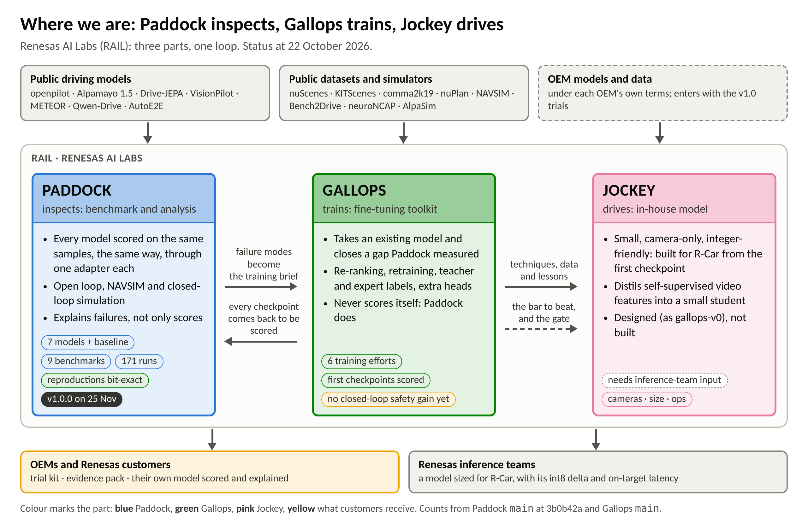
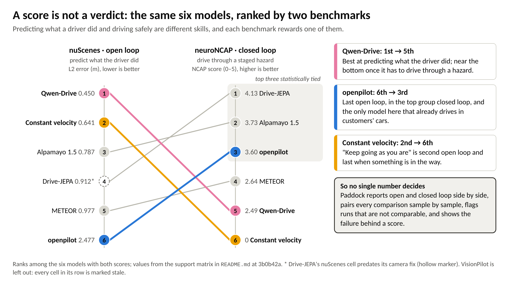
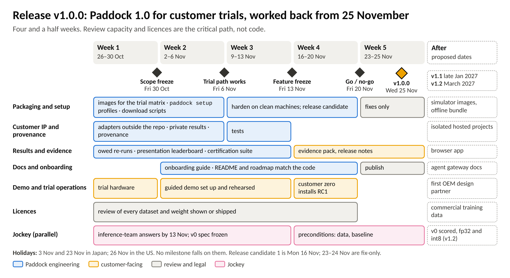

# RAIL release v1.0.0: executive plan

**Status:** draft for leadership alignment, 22 October 2026.

**Scope:** Renesas AI Labs (RAIL): Paddock, Gallops and Jockey, the in-house model.
The release is **Paddock 1.0 for customer trials, on Wednesday 25 November 2026.**

**How to read it:**
- This page is the summary.
- [`briefing.html`](briefing.html) is the same story as a page to present. Open it in a
  browser from a checkout.
- The [index at the end](#dive-deeper) leads to every detail, from strategy down to
  design and evidence.

---

## Decisions we need today

| | Decision | Recommendation |
|---|---|---|
| D1 | v1.0.0's scope and date | **Yes:** a self-install trial kit (open loop and NAVSIM) on a certified matrix, an evidence pack and a guided demo, on 25 November. Hosted hands-on trials follow in v1.1 |
| D2 | The trial matrix | 4 benchmarks × 6 models plus a baseline ([8](1-strategy/08-release-v1.0.0.md#the-proposed-trial-matrix)) |
| D3 | Licence review | **Start this week,** with a named legal owner. It is on the critical path |
| D4 | Customer zero and a design partner | A Renesas team installs the release candidate unaided on 16 November; one OEM partner for v1.1 |
| D5 | Hosting and budget | One dedicated 4-GPU server and ~5 TB of storage for demos and trials; our data centre or the cloud |
| D6 | Jockey's direction | Confirm it, and name an inference-team counterpart to answer six questions by 13 November |
| D7 | The name "Jockey" | Adopt it for the in-house model family; its first design is `gallops-v0` |
| D8 | Ownership | A release owner and a review rotation; freeze non-release changes from 13 November |

## 1 · Where we are

- **Paddock, the benchmark and analysis framework, is ready to release.**
  - Every model runs behind one adapter interface and is scored on the same samples:
    7 driving models and a baseline, 9 benchmarks, 171 recorded runs.
  - Earlier evaluations reproduce bit for bit.
- **Gallops, the fine-tuning toolkit, has proven the loop.** It has run six training
  efforts, but none is yet a closed-loop safety gain on held-out scenes.
- **Jockey, the in-house model, is designed but not built.** It waits on the inference
  teams' constraints.
- **Activity:** 71 Paddock pull requests merged since September; 14 open, none yet
  approved. Review, not code, is the critical path.

## 2 · Risk: a score is not a verdict

- **Every benchmark measures one slice of driving.** A high or low score does not settle
  whether a model is good:
  - openpilot ships in customers' cars and ranks last open loop;
  - Qwen-Drive ranks first open loop and fifth when it has to drive;
  - doing nothing clever, constant velocity, beats most models open loop.
- **Paddock's answer:**
  - several benchmarks side by side;
  - paired comparisons;
  - runs that are not comparable marked as such;
  - the failure behind each score.
- **Other risks:** licences (most public data is non-commercial), review capacity, the
  date, and reproducing numbers across sites.

## 3 · What customers ask

- **Why a framework?** Every model reports itself on its own terms, so nobody can
  compare them. Paddock makes numbers comparable and trustworthy, explains failures,
  and will report what a model costs on R-Car.
- **How easy is it?** Today it takes an expert days. v1.0.0 aims at install to first
  certified run in under a day, through:
  - container images;
  - download scripts;
  - `paddock setup`;
  - a certification run.
- **How do they try it?** A five-rung ladder, from an evidence pack to their own model:
  - **v1.0.0** delivers the evidence pack, the guided demo and the self-install kit;
  - **v1.1** adds hosted projects where their engineers and AI agents run experiments.

## 4 · Using Paddock

| Step | What v1.0.0 provides |
|---|---|
| **Setup** | one image per model; `paddock setup` by profile, gated by `doctor`; checksummed download scripts |
| **Orchestration** | the same runner, launching containers; a certification run; every run records its commit, image, weights and data |
| **Compute** | **S:** one 48–96 GB GPU for open loop. **M:** 2–4 GPUs for NAVSIM and one closed-loop benchmark |
| **Storage** | evaluation subsets with manifests; results written to the customer's own location |
| **Results** | a presentation-grade leaderboard, an evidence pack, an onboarding guide; a browser app in v1.1 |

## 5 · What using Paddock produces

- **Failure modes, not just scores.**
  - openpilot reads its own speed 12% slow on KITScenes.
  - It stalls at standstill: 53% of its lost Bench2Drive points.
  - Drive-JEPA's adapter once left it unable to see its camera.
  - Drive-JEPA picks the 15th-best of its own 32 plans.
- **Areas to improve, cheapest first:**
  1. fix an input, which needs no training. openpilot: −21.8% on KITScenes;
  2. fix the model's choice;
  3. fine-tune a skill;
  4. build a new model.
- **Tools and techniques:**
  - cross-model renders and videos;
  - scene sweeps;
  - failure tags;
  - a candidate-plan viewer;
  - a regression gate that pairs every change with its baseline.

## 6 · Pathway to Gallops

- **Fine-tuned performance** (all from Drive-JEPA):
  - **re-ranker:** KITScenes error 2.52 → 0.97 m, but worse in closed loop;
  - **retrain on NVIDIA data:** AlpaSim 0.543 → 0.770;
  - **Bench2Drive retrain:** 73.6, chosen on its own test routes.
- **Techniques:** selection, head and generator retraining, teacher labels, a geometric
  expert, DAgger, auxiliary heads, and distillation (planned).
- **New or existing model?** Fix inputs, then the choice, then fine-tune. Train a new
  model only when no existing one can meet the constraints. That is Jockey.

## 7 · What comes next: Jockey

- **The candidates, in one line each:**

  | Family | Pros | Cons |
  |---|---|---|
  | Drive-JEPA-inspired | best closed-loop safety; its video encoder works | 307 M parameters and chip-unfriendly ops; picks poorly |
  | AutoE2E and VisionPilot | small, open licence, built to retrain | weak closed loop; a map and route dependence |
  | Alpamayo | best open-loop accuracy; explains itself | 10 B parameters and non-commercial weights |
  | openpilot | ships; small; tied for top safety | no training code; no speed input; front cameras only |

- **Recommendation:** one small, integer-friendly student that takes the strengths of
  each:
  - distilled from a self-supervised video encoder;
  - reads its own speed;
  - three front cameras;
  - chosen on closed loop;
  - built for R-Car from its first checkpoint.
- **This shapes the inference teams' work, and we need their answers by 13 November:**
  - the target chip's envelope;
  - supported operations and precision;
  - **how many cameras;**
  - **the size and latency budget:** we aim for a backbone of 12 M parameters or
    fewer, inside a 100 M ceiling;
  - the toolchain;
  - the output contract.
- **To a car:**
  1. train;
  2. score fp32;
  3. score int8 on identical samples;
  4. import on-chip latency;
  5. hardware in the loop;
  6. shadow mode.

  One Paddock record bridges every stage.

## 8 · Release v1.0.0, worked back from 25 November

- **Milestones:**
  - scope freeze 30 Oct;
  - trial path working 6 Nov;
  - feature freeze 13 Nov;
  - release candidate 16 Nov;
  - go / no-go 20 Nov;
  - **v1.0.0 on 25 Nov.**
- **Exit criteria:**
  - customer zero installs to a certified run in a day, unaided;
  - reference numbers reproduce;
  - no stale numbers;
  - an outside adapter passes `verify`;
  - the licence review is closed.
- **After v1.0.0** (proposed):
  - **v1.1, late January:** hosted hands-on projects, the browser app, the agent
    gateway;
  - **v1.2, March:** an on-prem pilot, the chip profile, Jockey v0 scored;
  - **v2.0:** scale.

---

## Dive deeper

| Level | Document | Answers |
|---|---|---|
| **0 · Executive** | [briefing.html](briefing.html) | this plan, as a page to present: one screen per topic |
| **1 · Strategy** | [1 · Where we are](1-strategy/01-where-we-are.md) | what RAIL has built, and what the open PRs add |
| | [2 · What a score says](1-strategy/02-what-a-score-says.md) | why no single benchmark decides, with our own evidence |
| | [3 · What customers ask](1-strategy/03-customer-questions.md) | why Paddock, how easy it is, how to try it |
| | [4 · Using Paddock](1-strategy/04-using-paddock.md) | setup, orchestration, compute, storage, results |
| | [5 · Outcomes](1-strategy/05-outcomes.md) | the failure modes found, and the tools that found them |
| | [6 · Pathway to Gallops](1-strategy/06-pathway-to-gallops.md) | fine-tuned results, techniques, when to train anew |
| | [7 · Jockey](1-strategy/07-jockey.md) | the candidates' pros and cons, the asks to inference, the road to a car |
| | [8 · Release v1.0.0](1-strategy/08-release-v1.0.0.md) | scope, milestones, exit criteria, risks, decisions |
| **2 · Design** | [Hosted twin and on-prem kit](2-design/hosted-twin-and-on-prem-kit.md) | where Paddock runs for customers, profiles, sizing |
| | [Packaging and setup](2-design/packaging-and-setup.md) | containers, staged setup, certification |
| | [Shared workspace](2-design/shared-workspace.md) | read-only originals, per-person areas, the browser app |
| | [Hands-on access](2-design/hands-on-access.md) | customer projects, the agent gateway, guardrails, bring your own |
| | [Model to car](2-design/model-to-car.md) | the stages from a checkpoint to a road, and who owns each |
| **3 · Reference** | [Evidence](3-reference/evidence.md) | every headline number, its source and its strength |
| | [Open work](3-reference/open-work.md) | open PRs, issues and re-runs, with proposed v1.0.0 dispositions |
| | [Glossary](3-reference/glossary.md) | the terms, in plain words |
| | [Figures](figures/README.md) | how every figure is made and kept readable at 1680×1050 |
